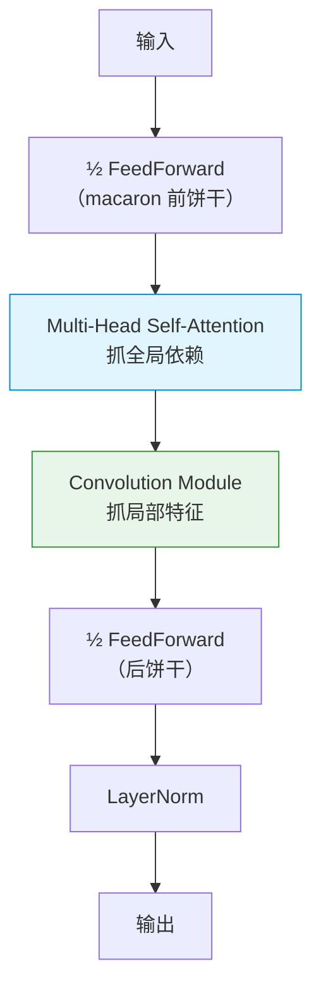
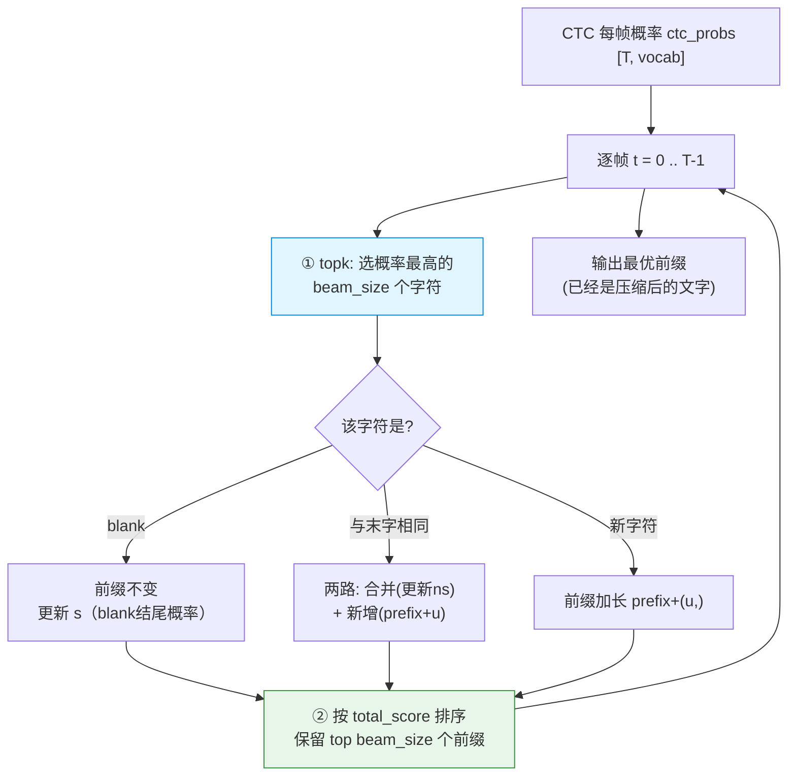

# Conformer vs Paraformer 架构对比 & CTC 详解

> 本文讲两件事：
> 1. 项目里两个 ASR 相关模型——**Conformer**（KWS 用）和 **Paraformer**（主 ASR 用）——在架构上的本质区别；
> 2. **CTC** 是什么、怎么工作、prefix beam search 怎么解码（详细版）。
>
> 阅读基础：了解神经网络、注意力机制的基本概念即可。

---

## 目录

1. [先建立全局认知](#1-先建立全局认知)
2. [Conformer 架构详解](#2-conformer-架构详解)
3. [Paraformer 架构详解](#3-paraformer-架构详解)
4. [两者核心区别对比](#4-两者核心区别对比)
5. [CTC 详解](#5-ctc-详解)
6. [CTC prefix beam search 详解](#6-ctc-prefix-beam-search-详解)
7. [总结](#7-总结)

---

## 1. 先建立全局认知

一个端到端语音识别系统通常分两大块：

```
音频 → [编码器 Encoder] → 高层特征 → [解码器/解码策略 Decoder] → 文字
```

- **编码器**：把声学特征"听懂"，变成高层表示。
- **解码器/解码策略**：把高层表示转成文字。

关键认知：**Conformer 和 Paraformer 不是同一个层面的东西。**

| 名称 | 本质 | 属于哪一层 |
|------|------|-----------|
| **Conformer** | 一种**编码器**结构 | 编码器 |
| **Paraformer** | 一个**完整的 ASR 系统** | 编码器 + 预测器 + 解码器 |

换句话说：

- Conformer 只是"编码器"这一个零件。它后面要接 CTC 或 attention decoder 才能出字。
- Paraformer 是整套方案，**它内部的编码器其实也常用 Conformer/SAN-M 这类结构**。

所以严格说，"Conformer vs Paraformer" 是"一个零件 vs 一整套系统"的对比。但在这个项目里，它们对应两条不同的技术路线：

| | 项目里的角色 | 编码器 | 解码方式 |
|---|------------|--------|---------|
| **Conformer + CTC**（WeNet） | KWS 唤醒词验证 | Conformer | CTC + prefix beam search |
| **Paraformer**（FunASR） | 主 ASR 识别 | SAN-M/Conformer类 | CIF 预测器 + 并行 decoder |

下面分别拆解，再对比。

---

## 2. Conformer 架构详解

### 2.1 设计动机

语音识别要同时抓两种信息：

- **局部细节**：相邻几帧的频谱变化（一个音素的细微特征）→ **卷积（CNN）** 擅长
- **全局依赖**：整句话里远距离的前后文关系 → **自注意力（Transformer）** 擅长

纯 Transformer 抓全局强、抓局部弱；纯 CNN 反之。**Conformer = Convolution + Transformer**，把两者揉进同一层，取长补短。

### 2.2 一层 ConformerEncoderLayer：Macaron 结构

项目代码 `asr/wenet/transformer/encoder_layer.py` 里，每层有 4 个子模块，排成"马卡龙（Macaron）"结构——两个前馈网络像饼干夹在两头，中间夹注意力和卷积：

```python
# forward 顺序（简化）
# ① 第一个前馈（半步，×0.5）
x = x + 0.5 * self.feed_forward_macaron(x)
# ② 多头自注意力（抓全局）
x = x + self.self_attn(x, x, x, mask, pos_emb)
# ③ 卷积模块（抓局部）
x = x + self.conv_module(x)
# ④ 第二个前馈（半步，×0.5）
x = x + 0.5 * self.feed_forward(x)
# ⑤ 最终 LayerNorm
x = self.norm_final(x)
```



四个子模块分工：

| 子模块 | 作用 |
|--------|------|
| FeedForward (macaron) | 前馈特征变换，前半步 |
| Multi-Head Self-Attention | 全局依赖建模（整句前后文） |
| **Convolution Module** | **局部特征建模（Conformer 的特色）** |
| FeedForward | 前馈特征变换，后半步 |

每个子模块都带残差连接 + LayerNorm，保证深层稳定。

### 2.3 卷积模块内部

项目代码 `convolution.py`，结构是：

```
Pointwise Conv1d (升维 channels→2×channels)
  → GLU 门控（一半当门控制另一半）
  → Depthwise Conv1d (kernel=15, groups=channels, 沿时间卷积)
  → BatchNorm
  → 激活函数
  → Pointwise Conv1d (降维回 channels)
```

核心是 **Depthwise Conv（深度卷积）**：`kernel_size=15` 意味着每个时间点会看附近 15 帧，专门抓"相邻帧之间的局部模式"（比如一个音节的起止、声调变化）。

```python
self.depthwise_conv = nn.Conv1d(channels, channels, kernel_size=15,
                                groups=channels, ...)  # groups=channels 即深度卷积
```

`causal` 参数控制是否因果（流式时只看左边、不看右边）。

### 2.4 完整编码器

```
FBank 特征 [T, 80]
  → Subsampling（降采样卷积，降低帧率，比如 4 倍下采样）
  → 位置编码
  → ConformerLayer × N（N 层堆叠）
  → encoder_out [T', d]
```

输出 `encoder_out` 是每帧的高层表示，**后面要接解码器（CTC 或 attention）才能出字**。

> **关键：Conformer 只管"编码"，不管"出字"。** 它是个零件。

---

## 3. Paraformer 架构详解

Paraformer 是一套**完整的非自回归（NAR）ASR 系统**。它的核心创新是用 **CIF 预测器**替代传统的自回归解码，实现"一次并行出所有字"。

### 3.1 整体结构

```
FBank 特征
  → Encoder（编码器，SAN-M / Conformer 类）
  → CIF Predictor（预测器：决定有几个字 + 产出每个字的声学嵌入）
  → Decoder（并行解码所有字位置）
  → 文字
```

注意：**Paraformer 的 Encoder 内部也可以是 Conformer 结构**。所以不是"Conformer 或 Paraformer 二选一"，而是"Paraformer 这套系统里也可能用到 Conformer 当编码器"。Paraformer 真正的特色在 **CIF 预测器** 和 **非自回归并行解码**。

### 3.2 CIF 预测器（Paraformer 的灵魂）

CIF = Continuous Integrate-and-Fire（连续积分发放）。项目代码 `asr/funasr/models/predictor/cif.py`：

```python
def forward(self, hidden, ...):
    # 1. 用卷积+全连接算出每帧的"信息量权重" alpha
    output = self.cif_conv1d(self.pad(hidden.transpose(1,2)))  # 卷积
    output = self.cif_output(torch.relu(output.transpose(1,2)))  # 全连接→1维
    alphas = torch.sigmoid(output)        # 每帧一个 0~1 的权重
    # 2. 累加 alpha，达到阈值1.0就"发放"一个字
    token_num = alphas.sum(-1)            # 所有alpha之和 = 字数
    acoustic_embeds, cif_peak = cif(hidden, alphas, self.threshold)  # 积分发放
    return acoustic_embeds, token_num, alphas, cif_peak
```

工作机制（形象版）：

```
编码器给每帧打一个"信息量权重" alpha（这帧含多少"字的信息"）
CIF 沿时间轴累加 alpha：
  帧1: 0.3  累计0.3
  帧2: 0.4  累计0.7
  帧3: 0.5  累计1.2 → 超过阈值1.0！发放第1个字的声学嵌入，余0.2带入下一轮
  帧4: 0.6  累计0.8
  帧5: 0.5  累计1.3 → 发放第2个字...
累加了几次 = 这句话有几个字（token_num）
```

CIF 一举解决两个问题：

1. **字数确定**：`alpha` 之和 = 字数，不需要自回归靠 EOS 标记逐个判断。
2. **每个字的声学表示**：每次"发放"产出一个字的声学嵌入（`acoustic_embeds`），作为 decoder 的 query。

### 3.3 非自回归并行解码

有了 CIF 给的 N 个字的声学嵌入，decoder 一次性并行算出所有 N 个字的概率分布：

```
传统自回归 decoder:  出"打"→出"开"→出"空"→出"调"  (串行，慢)
Paraformer decoder:  "打""开""空""调" 同时算出       (并行，快)
```

这就是 Paraformer 比传统 attention 模型快得多的根本原因。

详细的 decoder 输入输出、和 beam search 的衔接，见 `模型定制化修改说明.md` 第 5 节。

---

## 4. 两者核心区别对比

| 维度 | Conformer (+CTC) | Paraformer |
|------|------------------|------------|
| 本质 | 编码器结构 | 完整 ASR 系统 |
| 编码器 | Conformer（卷积+注意力） | SAN-M / Conformer 类 |
| 怎么确定字数 | CTC：每帧出字符再去重 | CIF：积分 alpha 之和 |
| 解码方式 | CTC + prefix beam search | CIF 嵌入 + 并行 decoder |
| 自回归? | 非自回归（CTC 逐帧独立） | 非自回归（CIF 并行） |
| 帧-字对齐 | CTC 用 blank 隐式对齐 | CIF 显式积分定位 |
| 擅长 | 找词、流式、关键词检测 | 整句高精度识别 |
| 项目里用途 | KWS 唤醒词验证 | 主 ASR（流式+非流式） |

### 一个关键区分：CTC 和 CIF 都解决"对齐"，但思路不同

两者都要解决"音频很多帧、字没几个，怎么对齐"，但方式相反：

- **CTC**：让**每帧都出一个字符**（含 blank 空白符），最后**去重删 blank**。是"先全输出再压缩"。
- **CIF**：先**积分算出有几个字**，再为每个字精确**定位声学嵌入**。是"先定数量再生成"。

CTC 更简单鲁棒（适合找词、判别）；CIF 更精细（适合整句精识别）。这也解释了为什么 KWS 用 CTC、主 ASR 用 Paraformer(CIF)。

---

## 5. CTC 详解

CTC 全称 **Connectionist Temporal Classification（连接时序分类）**。

### 5.1 它解决什么问题

语音识别有个根本难题——**对齐问题**：

```
"你好萤石"  只有 4 个字
但音频可能有 200 帧
模型每帧都要输出点东西，可哪几帧对应"你"？哪几帧对应"好"？
而且不同人语速不同：有人"你————好萤石"，有人"你好萤——石"
```

传统方法需要预先标注"第几帧到第几帧是哪个字"（强制对齐），非常麻烦。CTC 的伟大之处：**不需要预先对齐，模型自己学会对齐。**

### 5.2 核心思想：引入 blank + 后处理压缩

CTC 在词表里加一个特殊符号 **blank（空白，记作 `-`）**，然后：

1. **让模型每帧都输出一个符号**（可以是真字，也可以是 blank）
2. **用规则把帧序列压缩成最终文字**：
   - 先合并连续重复的字符
   - 再删除所有 blank

例子：

```
模型逐帧输出（11帧）:
帧:   1  2  3  4  5  6  7  8  9  10 11
输出: 你 你 -  好 -  -  萤 萤 -  石 石

压缩步骤:
① 合并连续重复:  你 - 好 - - 萤 - 石   （连续的"你你"→"你"，"萤萤"→"萤"，"石石"→"石"）
   实际规则是：先处理重复，blank 隔开的不算重复
② 删除 blank:    你 好 萤 石
结果: "你好萤石"
```

项目代码里这个压缩函数叫 `remove_duplicates_and_blank`。

### 5.3 blank 的妙用：区分"真重复"和"对齐重复"

blank 不只是占位符，它还能区分两种情况：

```
情况A："萤石"里没有重复字，但"好好"这种词有真的重复字
情况B：语速慢导致一个字占了好几帧（对齐重复）
```

规则是：**只有被 blank 隔开的相同字才算两个字**：

```
"你-你"（中间有blank）→ 删blank后是"你你"  ← 两个字（真重复）
"你你"（无blank）     → 合并成"你"          ← 一个字（对齐重复）
```

所以模型要表达"好好学习"的两个"好"，必须在它们之间输出一个 blank：`好 - 好`。这是 CTC 设计的精髓。

### 5.4 CTC 训练时在学什么

训练时，CTC 损失会考虑**所有能压缩成正确答案的帧序列路径**的总概率。

```
目标："你好"
可能的帧路径（假设4帧）有很多种都能压缩成"你好"：
  你你好好、你-好-、-你好-、你好--、--你好 ...
CTC 把这些路径的概率全加起来，最大化它
```

这样模型不用被告知"具体哪帧对哪字"，它自己在训练中摸索出一种合理的对齐方式。这就是"自动学会对齐"。

### 5.5 CTC 的特点

| 优点 | 缺点 |
|------|------|
| 不需要预先对齐标注 | 假设各帧输出条件独立（不建模字间依赖） |
| 逐帧独立，可流式 | 因此语言建模能力弱，常需配合语言模型/attention |
| 简单、快、鲁棒 | 对"输出像不像一句话"把控不如自回归 |
| 适合找词/关键词检测 | |

> 正因为 CTC"逐帧独立、不强行建模句子结构"，它特别适合 KWS 这种"找词"任务——音频里没有唤醒词时，它不会硬凑出来，判别干脆。

---

## 6. CTC prefix beam search 详解

CTC 每帧输出了概率分布后，怎么得到最终文字？这就是解码。

### 6.1 为什么不能简单贪心

最简单的办法是每帧取概率最大的符号（贪心），但有个大问题：

```
不同的帧序列，压缩后可能是同一个字符串！
"你-好"、"你好"、"-你好"、"你好-" 压缩后都是"你好"
```

如果只看单条帧序列的概率，会**低估**"你好"的真实概率——因为"你好"的概率应该是所有能压缩成"你好"的路径概率之和。贪心忽略了这一点，可能选错。

**prefix beam search（前缀束搜索）的核心改进**：它不按"帧序列"算概率，而是按**"压缩后的字符串前缀"**累加概率。

### 6.2 关键：每个前缀维护两个概率

项目代码 `search.py` 里，每个候选前缀用 `PrefixScore` 记录，核心是两个分开的概率：

```python
class PrefixScore:
    s  = ...   # 该前缀以 blank 结尾 的概率（blank-ending）
    ns = ...   # 该前缀以 非blank 结尾 的概率（none-blank-ending）
```

**为什么要分这两个？** 因为它们决定了下一帧来同一个字时，是"合并"还是"新增"：

```
前缀"你"以"非blank"结尾 → 下一帧又来"你" → 合并（还是"你"，对齐重复）
前缀"你"以"blank"结尾   → 下一帧来"你"   → 新增（变"你你"，真重复）
```

这正是 5.3 节 blank 区分规则在解码时的落地。

### 6.3 搜索流程

```python
for t in range(num_t):                      # 逐帧
    logp = ctc_prob[t]
    top_k = logp.topk(beam_size)            # ① 第一次剪枝：取概率最高的beam_size个字符
    for u in top_k:                         # 对每个候选字符
        for prefix, score in cur_hyps:      # 对每个现有前缀
            if u == blank:                  # 情况1：blank
                # 前缀不变，更新"以blank结尾"概率 s
            elif u == prefix最后一个字:       # 情况2：和末字相同
                # 两条路：合并(更新ns) + 新增(prefix+u)
            else:                           # 情况3：新字符
                # 前缀加长 prefix+(u,)
    cur_hyps = sorted(next_hyps, by=total_score)[:beam_size]  # ② 第二次剪枝
```

三种情况（CTC 解码精髓）：

| 当前帧字符 | 处理 | 例子 |
|-----------|------|------|
| **blank** | 前缀不变，累加到 s（blank结尾） | "你"+`-` → 还是"你" |
| **和前缀末字相同** | 分两路：合并 or 新增 | "你"+"你" → "你"(合并) 或 "你你"(新增) |
| **新字符** | 前缀加长 | "你"+"好" → "你好" |

每帧做**两次剪枝**：

1. **第一次**：只看概率最高的 `beam_size` 个字符（不然词表几千个全考虑会爆炸）
2. **第二次**：所有新前缀按总分排序，只留前 `beam_size` 个

`beam_size` 就是"同时保留多少条候选"。本项目 KWS 用 `beam=1`，相当于每步只留最优一条（但仍按前缀正确累加概率，比纯贪心准）。

### 6.4 完整流程图



### 6.5 和普通 beam search 的区别

之前讲 Paraformer 的 beam search 是在"字序列"上搜。CTC prefix beam search 特殊在：

- 它在**帧序列**上逐帧走，但按**压缩后的前缀**记分
- 要处理 blank 和重复字的合并逻辑（普通 beam search 没有这一层）
- 同一个前缀的概率 = 所有能压缩成它的帧路径概率之和（用 s + ns 累加实现）

---

## 7. 总结

### Conformer vs Paraformer

> - **Conformer 是编码器结构**（卷积+自注意力的 Macaron 层），只负责"听懂声音"，本身不出字，要接 CTC 或 decoder。
> - **Paraformer 是完整 ASR 系统**，核心是 **CIF 预测器**（积分定字数 + 产声学嵌入）+ **非自回归并行解码**。它的编码器内部也可能用 Conformer 类结构。
> - 两者不是平级的"二选一"，而是"一个零件 vs 一整套系统"。项目里它们对应两条路线：**Conformer+CTC 做 KWS**，**Paraformer 做主 ASR**。

### CTC 的本质

> - CTC 通过引入 **blank 空白符**，让模型**每帧都输出一个符号**，再用**去重+删blank**压缩成文字，从而**不需要预先对齐**就能训练。
> - blank 还用来区分"真重复字"（被blank隔开）和"对齐重复"（连续相同）。
> - **prefix beam search** 在 CTC 概率上解码：按"压缩后的前缀"累加概率（用 blank结尾/非blank结尾 两个分数处理合并与新增），逐帧两次剪枝搜出最优文字。

### 为什么这样分工

> CTC 逐帧独立、不硬建模句子结构 → 鲁棒、适合"找词"和判别 → KWS 用它。
> CIF 精细定位、并行解码整句 → 高精度 → 主 ASR 用 Paraformer。
