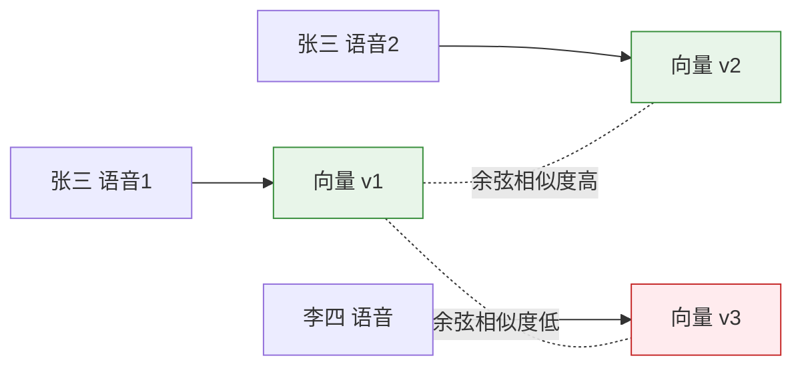
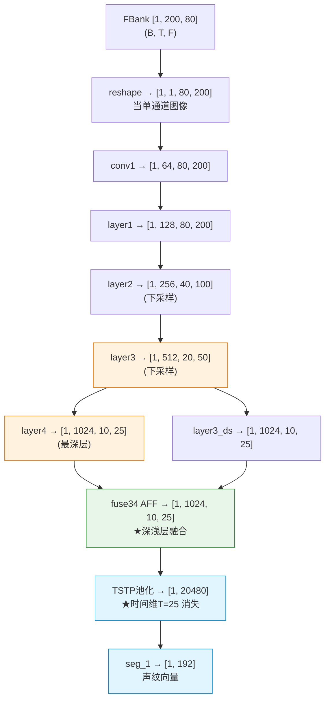
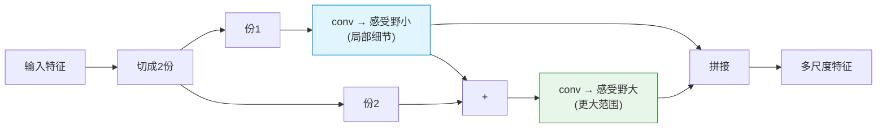
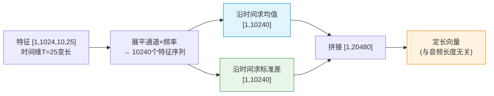
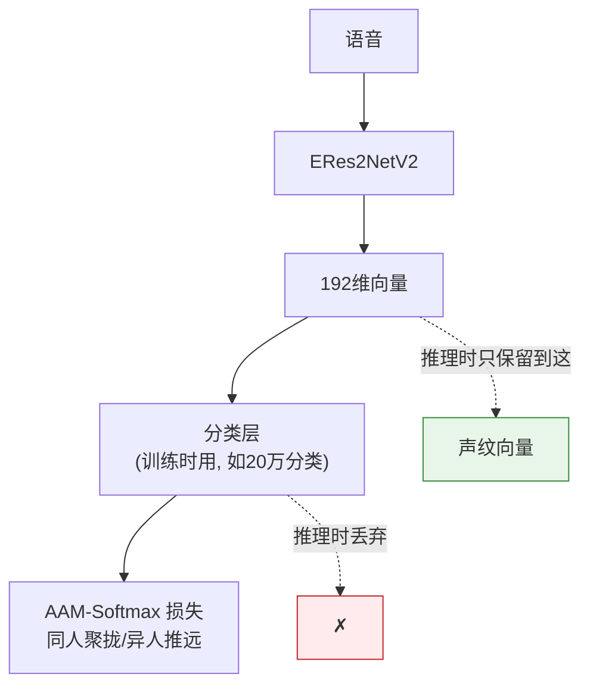
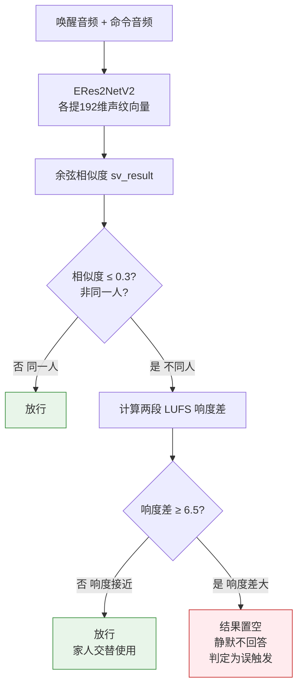

# 声纹模型 ERes2NetV2 详解 & 声纹+响度双判

> 本文详细讲解项目中声纹验证用的 **ERes2NetV2** 模型结构，**用一个具体例子追踪数据从输入到输出的形状与数值变化**，并讲解基于它构建的 **声纹+响度双判防误唤醒** 机制。
>
> - ERes2NetV2 模型本体：🔵 3D-Speaker（达摩院）开源，直接用预训练权重（`pretrained_eres2netv2.ckpt`）
> - 声纹+响度双判逻辑：🟢 项目自研

---

## 目录

1. [它要解决什么问题](#1-它要解决什么问题)
2. [声纹识别的基本原理](#2-声纹识别的基本原理)
3. [ERes2NetV2 名字拆解与配置](#3-eres2netv2-名字拆解与配置)
4. [★ 用一个具体例子追踪数据流](#4--用一个具体例子追踪数据流)
5. [核心模块详解（带数值）](#5-核心模块详解带数值)
6. [TSTP 池化：均值和方差到底有什么用](#6-tstp-池化均值和方差到底有什么用)
7. [声纹模型怎么训练的](#7-声纹模型怎么训练的)
8. [声纹+响度双判机制](#8-声纹响度双判机制)
9. [归属与总结](#9-归属与总结)

---

## 1. 它要解决什么问题

### 防误唤醒的最后一道关

萤石设备的防误唤醒是多级链路：

```
端侧唤醒（轻量模型） → KWS 二次验证（云端复核唤醒词） → 声纹+响度双判（本文）
```

KWS 解决"有没有说唤醒词"，但有一种情况它拦不住：

```
电视里播放了"你好萤石"（比如萤石自己的广告）
→ KWS 验证："确实说了你好萤石" → 通过 ✗（其实是电视误触发）
```

KWS 只认"内容对不对"，认不出"是不是该让它唤醒的真人"。这就需要声纹——**判断唤醒音频和命令音频是不是同一个人说的**。

---

## 2. 声纹识别的基本原理

声纹识别（Speaker Verification）的核心思想：

> **把一段语音转成一个向量（声纹 embedding），这个向量代表"这个人的嗓音特征"。同一个人的不同语音，向量相近；不同人，向量相远。**

声纹向量就像"声音指纹"：



判断"是不是同一人"，就是算两个向量的**余弦相似度**：相似度接近 1 → 同一人；接近 0 → 不同人。

ERes2NetV2 就是负责"把语音变成这个声纹向量"的网络。

---

## 3. ERes2NetV2 名字拆解与配置

```
E         Enhanced（增强）：加了多尺度特征融合（AFF）
Res2Net   在 ResNet 基础上，让单个残差块能做"多尺度"特征提取
V2        第二版：剪枝优化，减少参数量和计算成本
```

本质：**一个为声纹任务优化的卷积神经网络（CNN）**，骨架是 ResNet，核心创新是 Res2Net 多尺度 + AFF 特征融合。

项目实际配置（`ERes2NetV2_COMMON`）：

```python
feat_dim=80           # 输入 80 维 FBank 特征
embedding_size=192    # 输出 192 维声纹向量
m_channels=64         # 基础通道数
num_blocks=[3,4,6,3]  # 四个阶段的残差块数量
baseWidth=26, scale=2, expansion=2
```

---

## 4. ★ 用一个具体例子追踪数据流

假设输入一段 **2 秒的语音**。下面追踪它在网络里每一步的**张量形状变化**（batch=1）。

### 4.0 起点：音频 → FBank 特征

```
2 秒音频，每 10ms 一帧 → 约 200 帧
每帧提取 80 维 FBank 特征
→ 特征张量 shape = [1, 200, 80]   即 [batch, 时间T, 频率F]
```

### 4.1 完整 shape 变化追踪

| 步骤 | 操作 | 输出 shape | 说明 |
|------|------|-----------|------|
| 输入 | FBank | `[1, 200, 80]` | [B, T, F] |
| reshape | permute+unsqueeze | `[1, 1, 80, 200]` | [B, 通道C=1, 频率F=80, 时间T=200]，当单通道图像 |
| conv1 | 初始卷积(1→64) | `[1, 64, 80, 200]` | 通道升到 64 |
| **layer1** | 3个块, stride=1 | `[1, 128, 80, 200]` | 通道→128(64×expansion2), 分辨率不变 |
| **layer2** | 4个块, stride=2 | `[1, 256, 40, 100]` | 通道→256, 频率/时间各减半 |
| **layer3** | 6个AFF块, stride=2 | `[1, 512, 20, 50]` | 通道→512, 再减半 |
| **layer4** | 3个AFF块, stride=2 | `[1, 1024, 10, 25]` | 通道→1024, 再减半（最深） |
| layer3_ds | layer3下采样 | `[1, 1024, 10, 25]` | 把 layer3 输出对齐到 layer4 尺寸 |
| **fuse34** | AFF融合 | `[1, 1024, 10, 25]` | 深层(layer4)+浅层(layer3)融合 |
| **TSTP池化** | 时间维统计 | `[1, 20480]` | ★ 变长T消失！压成定长 |
| seg_1 | 全连接 | `[1, 192]` | 最终声纹向量 |

### 4.2 图示



### 4.3 两个关键观察

**观察1：时间维 T 一直存在，直到 TSTP 才消失**

```
输入 T=200 → layer2 后 100 → layer3 后 50 → layer4 后 25 → TSTP 后 没有了
```

注意：如果输入是 4 秒音频（T=400），到 layer4 后 T=50，但 **TSTP 之后同样输出 `[1, 20480]`**——这就是 TSTP 解决"变长"的地方。**TSTP 之前所有 shape 都和音频长度有关，TSTP 之后完全无关。** 这是整个网络最关键的一步。

**观察2：通道数翻倍、分辨率减半（CNN 金字塔）**

```
通道:   64 → 128 → 256 → 512 → 1024   （越来越多，表示越来越抽象的特征）
频率F:  80 → 80  → 40  → 20  → 10      （越来越小）
时间T:  200→ 200 → 100 → 50  → 25      （越来越小）
```

浅层分辨率高、通道少（管细节）；深层分辨率低、通道多（管抽象的身份特征）。这就是为什么后面要做"深浅层融合"——两种信息都要。

### 4.4 TSTP 这一步的 shape 细节

```
输入 fuse34 输出: [1, 1024, 10, 25]   = [B, 通道, 频率, 时间]
① 把 通道×频率 看成特征维: 1024 × 10 = 10240 个特征
② 沿时间维(T=25)求均值: [1, 10240]
③ 沿时间维(T=25)求标准差: [1, 10240]
④ 拼接均值和标准差: [1, 20480]      ← 10240 + 10240
```

所以 `seg_1` 的输入维度是 20480，输出 192。下一节专门讲这个均值和标准差的意义。

---

## 5. 核心模块详解（带数值）

### 5.1 Res2Net 多尺度块

普通 ResNet 块就是几个卷积串起来；Res2Net 块在内部做"**分组 + 层级连接**"，实现多尺度。

代码 `BasicBlockERes2NetV2.forward`：

```python
out = self.relu(self.bn1(self.conv1(x)))   # 1x1卷积
spx = torch.split(out, self.width, 1)       # ★ 把通道切成 scale=2 份
for i in range(self.nums):
    if i==0:
        sp = spx[i]
    else:
        sp = sp + spx[i]                    # ★ 当前份 + 前一份的结果
    sp = self.convs[i](sp)                  # 3x3卷积
    out = sp if i==0 else torch.cat((out,sp),1)
```

**多尺度怎么来的**（举例，假设切成 2 份）：

```
份1：只过 1 次 3x3 卷积 → 感受野 = 3 帧（看局部细节，如音色纹理）
份2：先加上份1的结果，再过卷积 → 感受野 = 5 帧（看更大范围，如语调）
拼接：同时拥有"3帧视野"和"5帧视野"的特征 = 多尺度
```



**为什么声纹需要多尺度**：嗓音特征是多层次的——精细频谱细节（音色）+ 较大范围模式（语调、共振峰）。多尺度能同时抓到。

> 类比：普通块像单一焦距镜头；Res2Net 块像同时用广角+长焦看。

### 5.2 AFF 注意力特征融合

`fusion.py` 的 AFF——**智能融合两路特征，而不是简单相加**：

```python
def forward(self, x, ds_y):
    xa = torch.cat((x, ds_y), dim=1)          # 两路拼接
    x_att = self.local_att(xa)                 # 算注意力权重
    x_att = 1.0 + torch.tanh(x_att)            # 权重范围 (0, 2)
    xo = torch.mul(x, x_att) + torch.mul(ds_y, 2.0-x_att)  # ★ 加权融合
    return xo
```

数值例子（某个位置）：

```
x = 0.8（深层特征值）, ds_y = 0.3（浅层特征值）
网络算出注意力权重 x_att = 1.5
融合结果 = 0.8×1.5 + 0.3×(2-1.5) = 1.2 + 0.15 = 1.35
（如果是简单相加只会是 0.8+0.3=1.1，AFF 让模型自己决定谁更重要）
```

权重和恒为 2（此消彼长），由网络学习"这个位置该更信深层还是浅层"。

### 5.3 fuse34 深浅层融合（"Enhanced"核心）

```python
out3_ds = self.layer3_ds(out3)            # layer3 [1,512,20,50] 下采样→[1,1024,10,25]
fuse_out34 = self.fuse34(out4, out3_ds)   # 用 AFF 融合两个 [1,1024,10,25]
```

| 来源 | shape（本例） | 特点 | 提供 |
|------|--------------|------|------|
| 浅层 layer3 | `[1,512,20,50]`→下采样 | 分辨率高 | **细节**（精细频谱纹理） |
| 深层 layer4 | `[1,1024,10,25]` | 抽象程度高 | **身份语义**（高层嗓音特征） |

声纹既需要细节（区分相似嗓音）也需要高层身份特征，融合两者比只用最深层更全面。

---

## 6. TSTP 池化：均值和方差到底有什么用

这是整个网络最关键、也最值得深究的一步。

### 6.1 它面对的数据

池化前是 `[1, 1024, 10, 25]`。把 `通道×频率 = 1024×10 = 10240` 看成 **10240 个特征通道，每个通道是一条沿时间(T=25)的序列**。

```
某个特征通道沿时间的25个值，比如：
通道A: [0.2, 0.3, 0.2, 0.25, 0.3, ...]  ← 平稳
通道B: [0.1, 0.9, 0.2, 0.8, 0.1, ...]   ← 剧烈波动
```

T=25 是变长的（音频越长越大），但声纹向量要定长。所以要把"每条沿时间的序列"压成固定几个数。**怎么压最不丢信息？** 答案：均值 + 标准差。

### 6.2 均值的作用——捕捉"平均水平"

```python
pooling_mean = x.mean(dim=-1)   # 沿时间维求平均
```

均值 = 这个特征通道在整段语音里的**平均激活强度**，回答"这个声学特征平均来说有多强"。

```
通道A 均值 ≈ 0.25
通道B 均值 ≈ 0.42
```

**声纹意义**：反映说话人嗓音的"**平均音色**"。比如对应"低频共振"的通道，男声平均激活高、女声低 → 均值能区分。均值是身份最基础、最稳定的信息。

### 6.3 标准差的作用——捕捉"波动程度"

```python
pooling_std = torch.sqrt(torch.var(x, dim=-1) + 1e-8)   # 沿时间维求标准差
```

标准差 = 这个特征沿时间的**波动幅度**，回答"这个特征在说话过程中变化大不大"。

```
通道A 标准差小  → 全程平稳
通道B 标准差大  → 忽高忽低
```

**声纹意义**：反映说话人的"**动态特征**"——语调起伏（平淡 vs 抑扬顿挫）、发音稳定性、韵律变化。这些也是身份的一部分，且难伪装。

### 6.4 ★ 为什么两个都要——关键数值例子

核心原因：**只用均值会丢失"波动信息"，而波动本身携带身份特征。**

看一个极端例子，两个特征通道：

```
通道X: [0.5, 0.5, 0.5, 0.5, 0.5]   均值=0.5, 标准差=0      （完全平稳）
通道Y: [0.0, 1.0, 0.0, 1.0, 0.0]   均值=0.5, 标准差=0.5    （剧烈震荡）
```

**它们均值完全一样（都是 0.5）！**

```
只用均值池化:
  通道X → 0.5
  通道Y → 0.5      ← 两个完全不同的声学行为，被压成同一个数！模型分不清
均值+标准差池化:
  通道X → (0.5, 0.0)
  通道Y → (0.5, 0.5)   ← 区分开了！
```

所以标准差补上了均值丢失的信息。

### 6.5 一个生活类比

描述一个班的成绩：

| 统计量 | 对应 | 例子 |
|--------|------|------|
| **均值** | 班级平均分（整体水平） | "这班平均 80 分" |
| **标准差** | 分数离散程度（差异大小） | "有的班齐刷刷80，有的班两极分化(100和60)" |

两个班平均分可能一样，但一个整齐、一个分化，是完全不同的班。只报平均分就漏掉了这个区别。**声纹同理：均值抓"平均音色"，标准差抓"音色变化模式"，合起来才完整。**

### 6.6 拼接成定长向量

```python
stats = torch.cat((pooling_mean, pooling_std), 1)   # [1,10240] + [1,10240] = [1,20480]
```



**关键**：无论输入音频 2 秒（T=25）还是 4 秒（T=50），TSTP 输出永远是 `[1, 20480]`——因为均值和标准差是"对整条时间序列的统计"，和序列长度无关。这就是变长转定长的本质。

> 命名：均值叫**一阶统计量**，标准差叫**二阶统计量**。这套池化源自经典的 **x-vector** 声纹框架（Statistics Pooling），是声纹领域被验证有效的标准做法。配置里 `n_stats=2` 就指均值+标准差两个统计量。

### 6.7 最后投影

```python
embed_a = self.seg_1(stats)   # Linear(20480 → 192)
```

把 20480 维统计向量投影到 192 维——这就是最终的**声纹向量**。

---

## 7. 声纹模型怎么训练的

> 项目只做推理（直接用预训练权重），这里说明它一般怎么训出来，帮助理解它为什么能区分人。

声纹模型通常用**分类任务 + 特殊损失**训练：

```
训练数据：成千上万个说话人，每人多条语音（如 CN-Celeb、VoxCeleb）
任务：给定一段语音，分类"这是哪个说话人"（如 20 万人=20 万分类）
损失：AAM-Softmax（加角度间隔的 softmax）
     → 不只要分对，还要让"同人向量挤一起、异人向量推远"
```



训练完后**丢掉分类层，只保留到 192 维 embedding**。模型学到的就是通用的"同人映射到相近向量、异人映射到远向量"的能力。

> 这解释了为什么**声纹可直接用预训练**：它在 20 万人上学会了"如何区分人"，这个通用能力对萤石用户同样有效，不需要重训。（对比 KWS 必须为"你好萤石"专门训练。）

---

## 8. 声纹+响度双判机制

> 🟢 这部分是项目自研逻辑。

### 8.1 声纹比对流程

```python
def inference(self, wakeup_byte_data, asr_byte_data):
    wav_wakeup, embedding_wakeup = self.compute_embedding(wakeup_byte_data)  # 唤醒音→[192]
    wav_cmd,    embedding_cmd    = self.compute_embedding(asr_byte_data)     # 命令音→[192]
    scores = self.similarity(embedding_wakeup, embedding_cmd).item()         # 余弦相似度
    return wav_wakeup, wav_cmd, scores   # ★ 还返回原始波形(为算响度)
```

🟢 **定制点**：通用声纹库通常只返回相似度，这里特意把**原始波形也返回**，为 backend 算响度用。

### 8.2 为什么光有声纹不够

只用声纹判定"不同人就静默"，会误伤：

```
爸爸唤醒"你好萤石"，妈妈接着说"打开空调"
→ 声纹不同 → 若只看声纹就静默 ✗（误伤！正常家庭使用）
```

**"声纹不同"≠"误触发"**，所以加第二个判据——**响度**。真正的误触发（电视/背景声）特征：唤醒音和命令音**响度差异大**。

### 8.3 双判逻辑

```python
if self.business_type in self.sv_eable_type and is_final and len(self.wakeup_audio_data) > 16000:
    if len(self.data_online) > 16000:
        wav_wakeup, wav_cmd, sv_result = self.sv_model.inference(self.wakeup_audio_data, self.data_online)
        if sv_result <= self.sv_sim_thres:          # ① 声纹相似度 ≤ 0.3
            loudness_wakeup = self.loudness_meter.integrated_loudness(wav_wakeup)
            loudness_cmd    = self.loudness_meter.integrated_loudness(wav_cmd)
            if loudness_wakeup - loudness_cmd >= self.sv_loud_thres:   # ② 响度差 ≥ 6.5 LUFS
                asr_results_text[0]['value'] = ""    # ★ 两条件都满足→静默
```

**两个判据必须同时满足才静默（AND）**：

| 判据 | 阈值 | 含义 |
|------|------|------|
| ① 声纹相似度 ≤ 0.3 | 低 | 唤醒音和命令音不是同一人 |
| ② 响度差 ≥ 6.5 LUFS | 高 | 两段音频响度差异大 |

> 响度用 **LUFS**（感知响度单位，比简单分贝更贴近人耳），由 `pyloudnorm` 计算。

### 8.4 判定流程图



判定矩阵：

| 声纹相似度 | 响度差 | 判定 | 典型场景 |
|-----------|-------|------|---------|
| 高（同人） | 任意 | 放行 | 同一人唤醒+命令 ✓ |
| 低（不同人） | 小 | 放行 | 家人交替使用 ✓ |
| 低（不同人） | **大** | **静默** | 电视/背景声误触发 ✗ |

### 8.5 设计精髓：两个弱判据取交集

```
只用声纹  → 误伤"家人交替使用"
只用响度  → 误伤"同一人但远近不同"
声纹 AND 响度 → 精准命中"电视误触发"，放过两种合法场景
```

宁可漏掉个别误触发（保守），也不误伤真实用户——"该响应却不响应"对体验的伤害更大。

---

## 9. 归属与总结

| 部分 | 归属 |
|------|------|
| ERes2NetV2 网络结构 + 预训练权重 | 🔵 3D-Speaker 原生，直接用 |
| 提声纹向量、算余弦相似度 | 🔵 标准声纹流程 |
| `inference` 额外返回原始波形 | 🟢 项目定制（为算响度） |
| 声纹 + 响度 AND 双判逻辑 | 🟢 项目创新 |
| 阈值 0.3 / 6.5、Apollo 白名单 | 🟢🟡 项目配置 |

### 一句话总结

> **ERes2NetV2** 把语音 FBank 特征当"图像"用 CNN 处理，数据流是：`[1,200,80] → [1,1,80,200] → 逐层卷积(通道翻倍/分辨率减半) → [1,1024,10,25] → TSTP池化 → [1,20480] → [1,192]`。
>
> 三个核心设计：
> - **Res2Net 多尺度块**：块内切份、层级连接，同时捕获细节和大范围特征；
> - **AFF 注意力融合 + 深浅层融合**：智能加权融合不同深度特征；
> - **TSTP 时间统计池化**：沿时间维算**均值（平均音色）+ 标准差（音色波动）**，把变长语音压成定长向量。两者缺一不可——因为"平稳0.5"和"震荡0.5"均值相同，只有加上标准差才能区分。
>
> 项目在它之上构建 🟢 **声纹+响度双判**防误唤醒：**只有"非同人 AND 响度差大"才静默**，用两个弱判据的交集精准拦截"电视误触发"，同时放过"家人交替使用"等合法场景。
