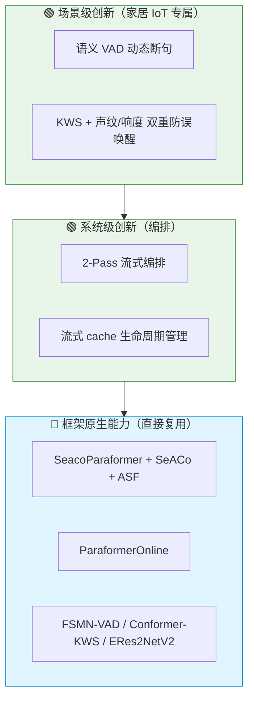
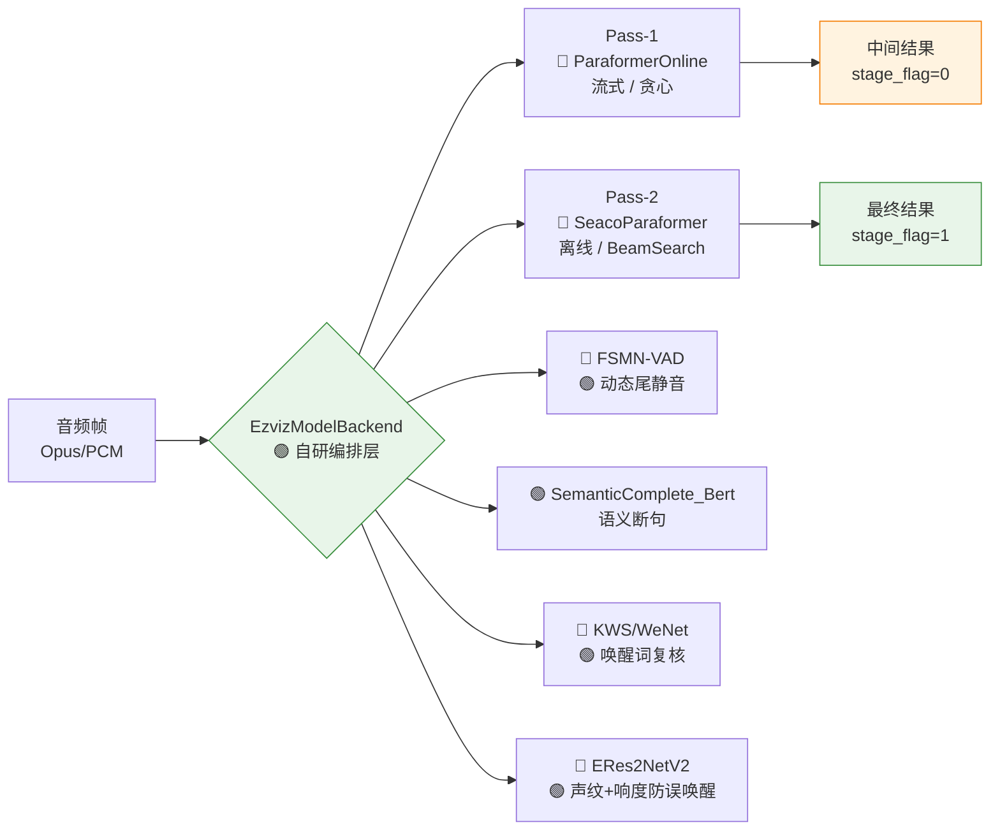
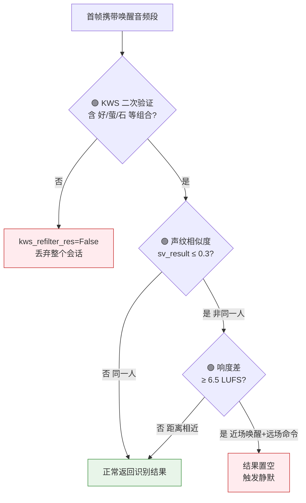

# 萤石 ASR 项目：框架与模型创新设计点说明

> 本文梳理本项目相对开源基线（FunASR / WeNet / 3D-Speaker）所做的工作，**重点区分「框架原生能力」与「本项目真正的创新设计点」**，逐项说明各部分的归属、实现与设计动机。
>
> 核心结论：开源框架提供了**单模型识别**的基础能力（包括 Paraformer、SeACo 热词、FSMN-VAD、Conformer-KWS、ERes2NetV2 声纹等算法本身）。本项目的创新**不在重新发明这些算法**，而在于：
> 1. **系统级编排**——把多个独立模型缝合成一套服务化的 2-Pass 流水线；
> 2. **场景级增强**——为家居 IoT 语音交互补上框架不具备的能力（语义断句、防误唤醒、动态运维）；
> 3. **工程级适配**——流式 cache、Opus 解码、配置热更新等落地细节。

---

## 归属标注约定

全文用三个标记区分每一项的归属，避免把「框架自带」误认为「项目发明」：

| 标记 | 含义 | 说明 |
|------|------|------|
| 🔵 **框架原生** | 开源框架自带的算法/模型 | 本项目直接加载使用，未改内部实现 |
| 🟡 **配置调优** | 调用框架接口时按场景设定参数 | 用的是框架能力，调了适合萤石的值 |
| 🟢 **项目创新** | 本项目自研或自行设计的部分 | 框架里没有，是本项目真正的设计贡献 |

---

## 目录

1. [整体架构与创新分层](#1-整体架构与创新分层)
2. [创新点一：2-Pass 流式编排（系统级）](#2-创新点一2-pass-流式编排系统级)
3. [创新点二：语义 VAD 动态断句（场景级）](#3-创新点二语义-vad-动态断句场景级)
4. [创新点三：双重防误唤醒（场景级）](#4-创新点三双重防误唤醒场景级)
5. [框架原生能力：SeacoParaformer 热词与 ASF](#5-框架原生能力seacoparaformer-热词与-asf)
6. [工程级适配：流式 cache / Opus / 配置热更新](#6-工程级适配流式-cache--opus--配置热更新)
7. [归属总表](#7-归属总表)

---

## 1. 整体架构与创新分层

本项目把多个开源框架的模型缝合成一套萤石业务流水线，主入口是 `asr/ezviz_backend.py` 的 `EzvizModelBackend` 类。

### 1.1 各模型的归属

| 模块 | 算法/模型 | 归属 | 对应目录 |
|------|----------|------|---------|
| ASR 非流式 | SeacoParaformer（含 SeACo 热词 + ASF） | 🔵 FunASR 原生 | `asr/funasr` |
| ASR 流式 | ParaformerOnline | 🔵 FunASR 原生 | `asr/funasr` |
| 端点检测 | FSMN-VAD | 🔵 FunASR 原生（动态尾静音为 🟢 改造） | `asr/funasr` |
| 唤醒词复核 | Conformer + CTC KWS | 🔵 WeNet 原生（唤醒词判定为 🟢 定制） | `asr/wenet` |
| 声纹验证 | ERes2NetV2 | 🔵 3D-Speaker 原生（响度联判为 🟢 定制） | `asr/speakerlab` |
| **语义完整性判断** | 极小 BERT / BiLSTM | 🟢 **项目自研** | `asr/semantic_vad` |
| **2-Pass 编排** | 双引擎协同调度 | 🟢 **项目自研** | `asr/ezviz_backend.py` |
| 中文 ITN/TN | 文本逆标准化 | 🟢 项目自研（替换 FST） | `asr/textProcessing` |

### 1.2 创新分层

本项目的创新可归为三层，**越往上越是项目独有的贡献**：



### 1.3 运行时数据流



两种对外推理模式：

- **非流式** `forward()`（行 223）：整段音频一次性走 SeacoParaformer 离线推理。
- **流式** `stream_init()`（行 286）+ `stream_forward()`（行 346）× N：2-Pass 策略。
- 配置热更新 `apollo_callback()`（行 552）。

---

## 2. 创新点一：2-Pass 流式编排（系统级）

> 🟢 **项目创新**。FunASR 提供了流式和非流式两种推理脚本，但「让两个引擎协同、流式撑体验 + 非流式保结果」这套调度逻辑是本项目自研的，框架里没有。

**位置**：`asr/ezviz_backend.py` → `stream_forward()`（行 346）

### 设计

同时实例化并协同运行两个 ASR 引擎：

| 引擎 | 模型 | 归属 | 配置 | 触发时机 | 输出标志 |
|------|------|------|------|---------|---------|
| `inference_online` | ParaformerOnline | 🔵 框架 | 流式，`chunk_size=[8,8,4]`，贪心解码 | 每累积 480ms（`stride_size=15360` 字节） | `stage_flag=0`（中间结果） |
| `inference_offline` | SeacoParaformer | 🔵 框架 | 非流式，`beam_size=10`，`ctc_weight=0.5`，SeACo 热词 | 流结束（`is_final=True`）时对整段重解码 | `stage_flag=1`（最终结果，客户端以此为准） |

> **创新落点**：模型是框架的，但「什么时候调哪个、流式中间结果如何与最终结果衔接、VAD 何时强制结束流」这套编排是项目设计的。

关键代码逻辑（简化）：

```python
if (self.decode_end - self.decode_beg) >= self.stride_size:
    if is_final:
        # Pass-2: 整段离线纠正（高精度）
        asr_results_text = self.inference_offline(data, param_dict=self.param_dict)
        self.inference_online(data, param_dict=param_online)  # 清空流式 cache
        stage_flag = 1
    else:
        # Pass-1: 流式中间结果（低延迟）
        asr_results_text = self.inference_online(chunk, param_dict=param_online)
        self.decode_beg += self.stride_size
```

- `stride_size = int(60 * chunk_size[1] / 1000 * 16000 * 2) = 15360` 字节 ≈ 480ms。
- 流结束有两种触发：客户端主动 `sequence_end=True`，或服务端 VAD 检测到语音终止点后强制 `is_final=True`（见第 3 节）。

### 时序图

```mermaid
sequenceDiagram
    participant C as 客户端
    participant B as 🟢 Backend (stream_forward)
    participant ON as 🔵 ParaformerOnline (Pass-1)
    participant OFF as 🔵 SeacoParaformer (Pass-2)

    Note over C,B: stream_init() 初始化会话/热词
    loop 每帧音频 (累积到 480ms)
        C->>B: 音频帧 (base64)
        B->>ON: chunk 流式推理
        ON-->>B: 中间结果
        B-->>C: stage_flag=0 (实时滚字)
    end
    Note over B: is_final=True<br/>(客户端结束 或 VAD 检测到终止点)
    B->>OFF: 整段音频离线重解码 (beam=10 + 热词)
    OFF-->>B: 高精度最终文本
    B->>ON: is_final=True 清空 cache
    B-->>C: stage_flag=1 (最终结果，客户端以此为准)
```

### 为什么这么设计

IoT 语音助手有两个互相冲突的需求：

1. **低延迟**：用户说话时屏幕要实时滚字，否则体验卡顿。
2. **高精度**：最终送去执行设备指令的文本不能错。

单一模型无法两全：

- 流式模型快，但只能看到有限的未来信息（chunk 右看 4 帧），且用贪心解码，准确率较低；
- 非流式模型准（full-attention + BeamSearch + CTC/Attention 联合解码 + 热词），但必须等整句说完。

2-Pass 用流式模型撑住**交互体验**、用非流式模型保证**最终结果质量**，客户端最终以 `stage_flag=1` 为准。这是兼顾延迟与精度的工程折中，也是本项目最核心的系统级创新。

---

## 3. 创新点二：语义 VAD 动态断句（场景级）

> 这是本项目**最具原创性**的设计：用一个自研的语义完整性模型去**动态控制** FSMN-VAD 的断句时机。其中语义模型 🟢 完全自研，对 VAD 的动态化改造 🟢 也是项目所加。

### 3.1 自研语义完整性模型 🟢

**位置**：`asr/semantic_vad/infer.py` → `SemanticComplete_Bert`（类定义 50 行，`map_value` 在 73 行）

用一个极小的 BERT 判断当前已识别文本的语义完整度：

- 模型极小：`hidden_size=192`、`num_hidden_layers=4`、`num_attention_heads=4`、`intermediate_size=384`、`pad_size=64`（为低延迟、低开销而设计）。
- 核心是 `map_value`：把"语义完整概率"映射成"尾静音时长 `max_end_sil`（毫秒）"：

```python
def map_value(self, input_value):
    if 0 <= input_value <= 0.4:
        return 1300 - 1000 * input_value   # 语义不完整 → 尾静音长（最长 1300ms）
    elif 0.4 < input_value <= 0.8:
        return 1250 - 1000 * input_value
    elif 0.8 < input_value <= 1.0:
        return 1150 - 1000 * input_value   # 语义完整 → 尾静音短（最短 ~150ms）
    else:
        return 500
```

> 注：项目同时提供 `SemanticComplete_BiLSTM` 版本（8 行，`map_value` 在 26 行），映射区间略不同（1300/1200/1100 三段），是 BERT 版的备选实现。

### 3.2 FSMN-VAD 动态尾静音改造 🟢

**位置**：`asr/funasr/models/e2e_vad.py` → `forward_online`（511 行，新增 `max_end_sil` 形参在 513 行；阈值动态重设在 516 行）

🔵 FSMN-VAD 本身是 FunASR 原生模型，但开源版的尾静音阈值是**初始化时固定死**的（`AllResetDetection` 中 247 / 277 行用 `vad_opts.max_end_silence_time` 固定计算）。本项目 🟢 改造为 `forward_online` 新增 `max_end_sil` 形参、**每帧调用时动态重设**：

```python
def forward_online(self, feats, waveform, in_cache=dict(),
                   is_final=False, max_end_sil=800):
    ...
    # 🟢 改造点：原版固定，这里改为每帧可动态设定
    self.max_end_sil_frame_cnt_thresh = max_end_sil - self.vad_opts.speech_to_sil_time_thres
```

终止点判定（654 行）：

```python
if self.continous_silence_frame_count * frm_shift_in_ms >= self.max_end_sil_frame_cnt_thresh:
    self.OnVoiceEnd(...)
    self.vad_state_machine = VadStateMachine.kVadInStateEndPointDetected
```

### 3.3 两者联动 🟢

**位置**：`asr/ezviz_backend.py` → `stream_forward()`

```python
if self.business_type in self.vad_eable_tpye:
    if self.semantic_complete_flag:
        # 🟢 用上一轮识别文本算出新的尾静音阈值，喂给 VAD
        self.vad_param_dict['max_end_sil'] = self.semantic_complete_prob.forward(self.last_asr_text)
        self.semantic_complete_flag = False
    _, vadsegments, vad_out_cache = self.vad_online([binary_Data, "speech", "bytes"],
                                                    param_dict=self.vad_param_dict)
    if vadsegments and vadsegments[0]:
        if vadsegments[0][0][1] != -1:        # 检测到终止点
            self.data_online = self.data_online[self.vad_beg_point:vadsegments[0][0][1]*32]
            is_final = True                   # 强制触发 Pass-2 纠正
```

### 为什么这么设计

固定的 VAD 断句阈值在真实对话里很难受：

- **设短了**：用户说"帮我把……"中间停顿一下就被切断，话没说完。
- **设长了**：用户说完"打开客厅灯"还要干等一两秒才响应，体验迟钝。

让断句**跟着语义走**：

| 用户说的内容 | 语义完整度 | 尾静音阈值 | 效果 |
|-------------|-----------|-----------|------|
| "打开空调" | 高 | 短（~150ms） | 快速响应 |
| "帮我把" | 低 | 长（~1300ms） | 耐心等用户说完 |

```mermaid
flowchart TD
    A[流式识别出文本片段] --> B[🟢 SemanticComplete_Bert<br/>判断语义完整度]
    B --> C{完整概率}
    C -->|高 接近 1.0| D[map_value → 尾静音 ~150ms]
    C -->|低 接近 0| E[map_value → 尾静音 ~1300ms]
    D --> F[🔵🟢 FSMN-VAD 用新阈值判断终止点]
    E --> F
    F --> G{静音累计 ≥ 阈值?}
    G -->|是| H[触发终止点<br/>is_final=True → Pass-2]
    G -->|否| A
```



「语义 VAD」概念框架里没有，是本项目结合家居指令场景的原创设计。

---

## 4. 创新点三：双重防误唤醒（场景级）

> KWS（Conformer）🔵 和声纹（ERes2NetV2）🔵 模型都是框架原生，但「云端二次复核 + 声纹与响度联合判别」这套防误唤醒策略 🟢 是本项目针对 IoT 误唤醒痛点自行设计的。

IoT 设备最头疼的是误唤醒（电视里有人说了唤醒词、家人闲聊触发）。本项目做了两道云端防线。

### 4.1 KWS 唤醒词二次验证 🟢（基于 🔵 WeNet）

**位置**：`asr/wenet/bin/kws_inference_conformer.py` → `inference` 类（25 行），唤醒词判定在 `__call__`（77 行）的 100 行

WeNet Conformer + CTC prefix beam search 是 🔵 框架能力，本项目 🟢 在其输出上**硬编码萤石唤醒词判定**：

```python
results = self.post_processing(tokens)
if all(sub in results for sub in ["好","萤","石"]) \
   or all(sub in results for sub in ["你","好","萤"]) \
   or all(sub in results for sub in ["你","萤","石"]):
    return True   # 唤醒词验证通过
else:
    return False  # kws_refilter_res=False，丢弃整个会话
```

### 4.2 声纹 + 响度双判 🟢（基于 🔵 ERes2NetV2）

**位置**：`asr/speakerlab/bin/inference.py` → `speaker_verification` 类（33 行，`inference` 在 59 行）+ `asr/ezviz_backend.py`

- 🔵 声纹模型用 `ERes2NetV2_COMMON`（`baseWidth=26, scale=2, expansion=2, embedding_size=192`）。
- 🟢 `inference` 比对唤醒/命令音频余弦相似度时，**特意返回原始 wav**（供 backend 额外算响度，这是相对开源声纹库的定制点）。
- 🟢 backend 中的"声纹 + 响度"双重判别逻辑：

```python
if self.business_type in self.sv_eable_type and is_final and len(self.wakeup_audio_data) > 16000:
    if len(self.data_online) > 16000:
        wav_wakeup, wav_cmd, sv_result = self.sv_model.inference(self.wakeup_audio_data, self.data_online)
        if sv_result <= self.sv_sim_thres:          # 0.3，声纹判定非同一人
            loudness_wakeup = self.loudness_meter.integrated_loudness(wav_wakeup)
            loudness_cmd    = self.loudness_meter.integrated_loudness(wav_cmd)
            if loudness_wakeup - loudness_cmd >= self.sv_loud_thres:   # 6.5 LUFS
                asr_results_text[0]['value'] = ""    # 触发静默，不回答
```

### 为什么这么设计

单靠端侧唤醒模型误报率高，云端再做一次"复核"。声纹 + 响度联合用来区分两种容易混淆的情况：

| 场景 | 声纹相似度 | 响度差 | 判定 |
|------|-----------|-------|------|
| 家人在不同距离正常使用 | 低（非同一人） | 小 | 放行 |
| 电视 / 远处背景声误触发 | 低（非同一人） | 大（唤醒音近场大声、命令音远场小声） | 静默 |

只用声纹会误伤"家人正常使用"，加上响度差才能精准识别"背景声误触发"。



---

## 5. 框架原生能力：SeacoParaformer 热词与 ASF

> ⚠️ **重要澄清**：SeACo 热词机制和 ASF（Attention-based Selection Filter）**都是 🔵 FunASR 框架原生能力，不是本项目的创新**。它们出自论文 [SeACo-Paraformer (arXiv:2308.03266)](https://arxiv.org/abs/2308.03266)，代码与预训练权重均来自 FunASR 上游。本项目直接加载使用，**未改其内部实现**。
>
> 本节说明这些原生能力的原理，并明确指出本项目在它们**外围**做了哪些 🟡 配置 / 🟢 定制。

**位置**：`asr/funasr/models/e2e_asr_paraformer.py` → `SeacoParaformer`（类定义 1768 行）、`_seaco_decode_with_ASF`（1982 行）、`_hotword_representation`（2050 行）；ASF 打分 `forward_asf6` 在 `asr/funasr/models/decoder/sanm_decoder.py`（1040 行）

### 5.1 🔵 框架原生：SeACo + ASF 原理

1. **热词表示**：`_hotword_representation` 用 `bias_encoder`（LSTM）把每个热词编码成向量。
2. **ASF 候选过滤**：当热词数 > `nfilter`(默认 50) 时，用 `forward_asf6` 取出"句子每个字 × 每个热词"的**注意力矩阵**，按热度求和打分，`topk` 选出最相关的 50 个（再补一个"无热词"占位符），过滤掉无关热词。
3. **SeACo 双路 attention**：对筛选后的热词分别用「声学嵌入」和「解码器隐状态」当 query 算两路 attention，`_merge` 相加——既要声学像、又要语境像。
4. **结果融合**：`_merge_res` 用 `seaco_weight` 把热词预测和普通解码按掩码（`dha_ids == 8377`）加权融合。

```python
# ASF Core（🔵 框架）：大热词表时先用注意力矩阵粗筛
if nfilter > 0 and nfilter < num_hot_word:
    hotword_scores = self.seaco_decoder.forward_asf6(contextual_info, _len, decoder_hidden, ys_pad_lens)
    hotword_scores = hotword_scores[0].sum(0).sum(0)
    dec_filter = torch.topk(hotword_scores, min(nfilter, num_hot_word - 1))[1].tolist()
    selected = selected[dec_filter + [占位符]]

# SeACo Core（🔵 框架）：双路 attention 精修
cif_attended, _ = self.seaco_decoder(contextual_info, _len, sematic_embeds,  ys_pad_lens)  # 声学路
dec_attended, _ = self.seaco_decoder(contextual_info, _len, decoder_hidden, ys_pad_lens)   # 语境路
merged = self._merge(cif_attended, dec_attended)
```

> ASF 是"粗筛 → 精修"的两阶段设计：用 attention 的**权重**做廉价排序筛掉无关热词，再让精英热词进入昂贵的双路增强。这套机制在大热词表场景下省算力、降误触发——**但这是 SeACo 论文提出、FunASR 实现的，不是本项目所加。**

### 5.2 🟡🟢 本项目在外围做的事

虽然 ASF/SeACo 算法本身没改，本项目围绕它做了这些**真正属于项目**的工作：

| 项 | 归属 | 内容 | 位置 |
|----|------|------|------|
| 热词预处理 | 🟢 定制 | `generate_hotwords_list` 正则过滤长数字/型号串、限长 ≤10 token、表上限 500 | `asr_inference_paraformer_vad_tp.py` |
| 热词权重调参 | 🟡 配置 | `clas_scale_score=0.54`（即 `seaco_weight`），控制热词"侵略性" | `ezviz_backend.py` |
| 默认品牌词注入 | 🟢 定制 | 默认热词固定注入 `["萤石"]` | `ezviz_backend.py` |
| 按业务动态热词 | 🟢 定制 | Apollo 下发分业务热词表 + 分业务权重 `hw_score_split`（见第 6 节） | `ezviz_backend.py` |
| 用作 Pass-2 | 🟢 编排 | 把 SeacoParaformer 作为 2-Pass 的离线纠正引擎（见第 2 节） | `ezviz_backend.py` |

**一句话**：算法（SeACo/ASF）是框架的，**热词怎么来、怎么洗、怎么按业务动态调、放在流水线哪一环**是项目的。

---

## 6. 工程级适配：流式 cache / Opus / 配置热更新

### 6.1 流式推理 cache 生命周期管理 🟢

**位置**：`asr/funasr/bin/asr_inference_paraformer_streaming.py` → `inference_online`（类定义 497 行）；`asr_inference_paraformer_vad_tp.py` → `vadOnlineInfer`（872 行）

🔵 流式 chunk 推理是框架能力，但 🟢 本项目把它包装成**常驻服务可复用**的 cache 管理：

- **Encoder cache**：`start_idx`、`cif_hidden`、`cif_alphas`、`feats`、`tail_chunk` 等，维护 CIF/encoder 跨块状态。
- **Decoder cache**：`decode_fsmn`，维护 SANM decoder 的 FSMN 记忆。
- **is_final 清理**：流结束时 `_cache_reset` + `frontend.cache_reset()` 清空所有状态并返回 `['']`，避免污染下一次会话（`stream_reset()` 会复用同一引擎实例）。

```python
if is_final:
    self.cache = _cache_reset(...)
    self.speech2text.frontend.cache_reset()
    return ['']
```

### 6.2 Opus 裸流解码 🟢

**位置**：`asr/ezviz_backend.py`（`opus_dec` 实例化在 153 行）

```python
self.opus_dec = Decoder(fs=self.model_fs, channels=1)   # 16kHz, 单声道
# 每 80 字节 Opus → 320 samples × 2 bytes = 640 字节 PCM
for dec_step in range(0, len(b64Decode_Data), 80):
    binary_Data += self.opus_dec.decode(b64Decode_Data[dec_step:dec_step+80], frame_size=320)
```

**为什么**：IoT 设备带宽和算力有限，Opus 压缩比约 8x，省流量省电。

### 6.3 Apollo 配置热更新 🟢

**位置**：`asr/ezviz_backend.py` → `apollo_callback`（552 行）

在线下发并热更新，无需重启服务：

- 热词（`hw_add`，按业务类型分组）
- VAD 参数（`vad_end` 尾静音、`vad_len` 单段最大长度、`vad_eable` 启用业务类型）
- 热词权重（`hw_score` 全局、`hw_score_split` 按业务类型）

**为什么**：热词/断句策略需要按设备型号、业务线频繁调整，运营不可能每次都发版。

### 6.4 自研中文 ITN/TN 🟢

**位置**：`asr/textProcessing`（`itn/` 和 `tn/` 两套）

用自研 `InverseNormalizer`（`enable_standalone_number=True, enable_0_to_9=True`）替换 FunASR 原 FST 实现，把"打开二十三度"规整成"23 度"，适配设备指令的数字归一化。

---

## 7. 归属总表

| # | 设计点 | 位置（文件 : 行） | 归属 | 基于的框架能力 | 解决的问题 |
|---|--------|------------------|------|--------------|-----------|
| 1 | **2-Pass 流式编排** | `ezviz_backend.py` : 346 | 🟢 **项目创新（系统级）** | FunASR 双推理脚本 | 低延迟与高精度兼得 |
| 2 | **语义完整性模型** | `semantic_vad/infer.py` : 50 | 🟢 **项目自研** | 无（自研） | 按语义判断是否说完 |
| 3 | **VAD 动态尾静音改造** | `e2e_vad.py` : 511 | 🟢 **项目改造** | FSMN-VAD（原固定阈值） | 对话断句生硬 |
| 4 | **KWS 唤醒词复核判定** | `kws_inference_conformer.py` : 100 | 🟢 **项目定制** | 🔵 WeNet Conformer | 唤醒词误报 |
| 5 | **声纹 + 响度双判** | `speakerlab/inference.py` : 33 + `ezviz_backend.py` | 🟢 **项目定制** | 🔵 3D-Speaker ERes2NetV2 | 区分正常使用与背景误触发 |
| 6 | 流式 cache 生命周期管理 | `asr_inference_*_streaming.py` : 497 | 🟢 项目工程 | 🔵 FunASR streaming | 常驻服务跨会话复用 |
| 7 | Opus 裸流解码 | `ezviz_backend.py` : 153 | 🟢 项目工程 | opuslib | IoT 带宽与功耗 |
| 8 | Apollo 配置热更新 | `ezviz_backend.py` : 552 | 🟢 项目工程 | 无（自研） | 热词/策略免发版调整 |
| 9 | 中文 ITN/TN 后处理 | `asr/textProcessing` | 🟢 项目自研 | 替换 FST | 设备指令数字归一化 |
| 10 | SeacoParaformer + SeACo + ASF | `e2e_asr_paraformer.py` : 1768 | 🔵 **框架原生** | FunASR / SeACo 论文 | 热词定制识别（非本项目发明） |
| 11 | ParaformerOnline 流式识别 | `asr_inference_*_streaming.py` | 🔵 框架原生 | FunASR | 流式 ASR（非本项目发明） |
| 12 | 热词预处理 + 动态权重 | `asr_inference_paraformer_vad_tp.py` / `ezviz_backend.py` | 🟢 项目定制 + 🟡 配置 | 🔵 SeACo 接口 | 热词洗词、按业务调权 |

---

## 一句话总结

> **框架（FunASR / WeNet / 3D-Speaker）提供了一个个独立的识别算法（SeACo 热词、ASF、Paraformer、FSMN-VAD、Conformer-KWS、ERes2NetV2），这些是 🔵 原生能力，不是本项目发明。**
>
> **本项目真正的创新在三层**：
> - 🟢 **系统级**：2-Pass 流式编排——让流式与非流式两个引擎协同，兼顾延迟与精度；
> - 🟢 **场景级**：语义 VAD 动态断句、KWS + 声纹/响度双重防误唤醒——为家居 IoT 补上框架没有的能力；
> - 🟢 **工程级**：流式 cache 管理、Opus 解码、Apollo 热更新、ITN/TN——让模型在真实服务里稳定落地。
