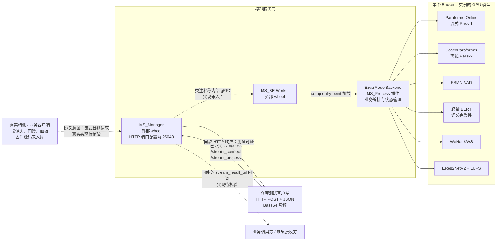
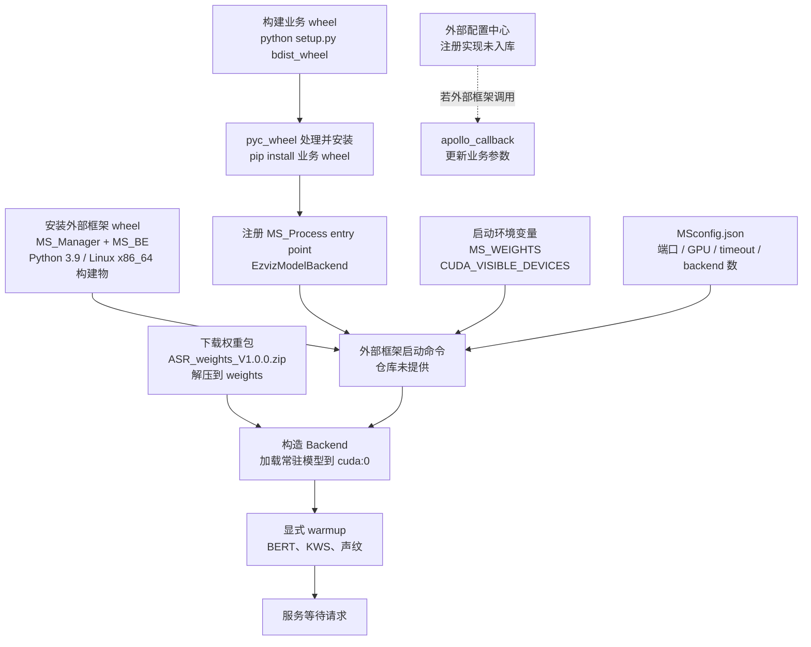
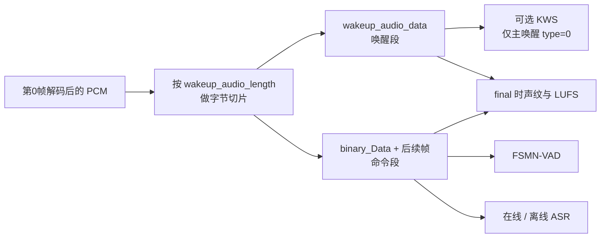
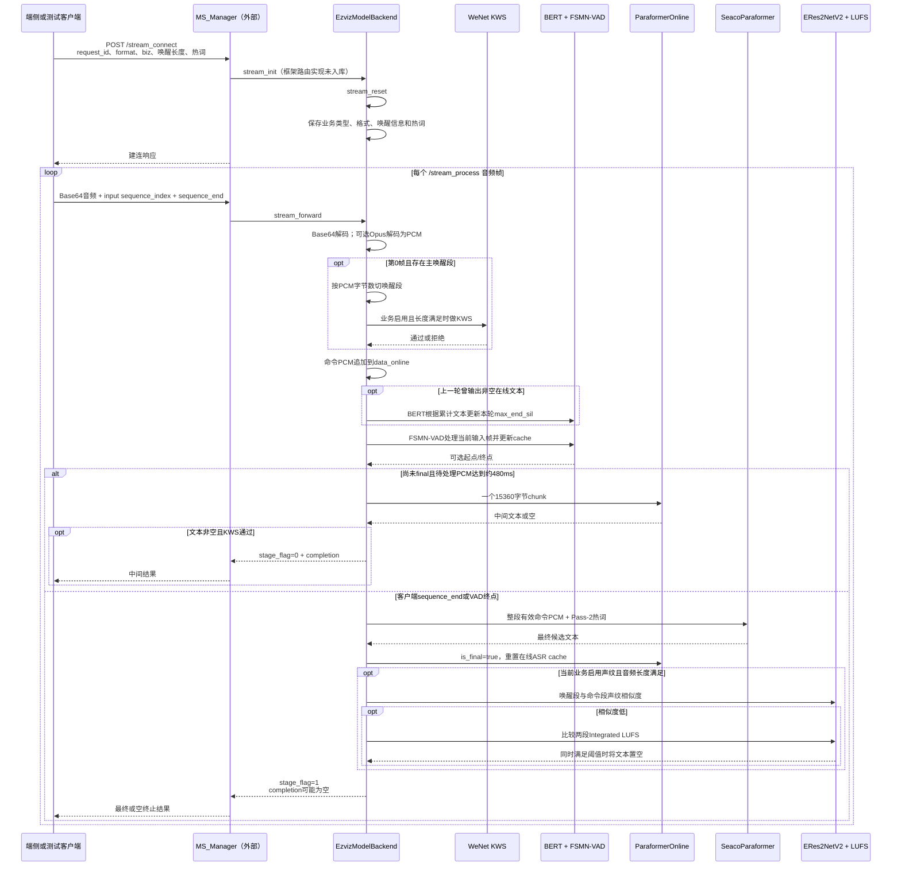
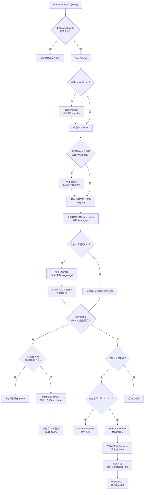
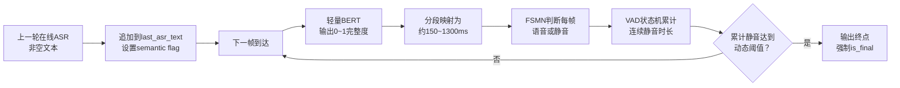
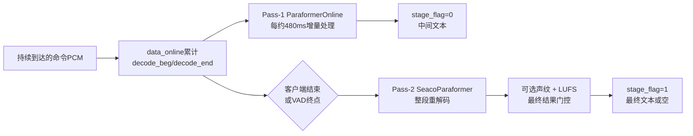
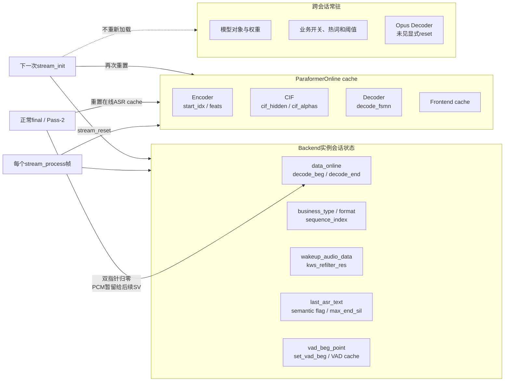

# 端侧到云端 ASR 服务流转与部署详解

> 本文基于当前仓库的代码、测试脚本和部署配置整理，目标是说明一条语音从端侧/客户端进入服务，到流式中间结果、最终识别结果返回的完整过程，并作为项目面试复盘材料。
>
> **证据边界：**仓库包含服务端业务代码和 Python 测试客户端，但不包含真实摄像头/门铃固件，也不包含 `MS_Manager`、`MS_BE`、`ms_common` 和 protobuf/gRPC 实现。因此，本文会区分“仓库已证实”和“外部框架约定”，避免将推测写成线上事实。

---

## 1. 阅读标记与核心结论

本文使用三类标记：

- **已证实**：能由当前仓库源码、测试代码或配置直接确认。
- **接口约定**：测试客户端或业务代码要求的输入输出约定，但真实端侧实现不在仓库。
- **待核验**：类注释或外部配置提及，但实现位于未提交的内部框架中。

一句话概括整个流式链路：

> 端侧或业务客户端将 PCM/Opus 音频用 Base64 放入流式请求；服务入口完成会话初始化，Backend 将音频统一为 PCM，按客户端给出的字节长度切出唤醒段，对命令段执行 FSMN-VAD 和 ParaformerOnline；每累计约 480ms 可产生中间结果，客户端结束或 VAD 检测到端点后，SeacoParaformer 对整段命令音频重新解码，再经过可选的声纹与 LUFS 联判，返回最终结果。

需要提前明确：

1. **端侧**是摄像头、门铃、面板或其业务客户端，真实固件不在仓库。
2. **Base64 是传输编码，不是音频编码。**其中承载的是 PCM 或 Opus 字节。
3. **唤醒/命令边界不是云端模型推断的。**客户端传入 `wakeup_audio_length`，Backend 按解码后 PCM 字节数切分。
4. **流式和离线是两套模型权重。**Pass-1 使用 ParaformerOnline，final 时 Pass-2 使用 SeacoParaformer。
5. **`stage_flag=1` 不保证一定有最终文本。**KWS 拒绝、VAD 未检测到语音或离线结果为空时，也可能返回结束标志但没有 `completion`。

---

## 2. 总体部署与调用架构

### 2.1 端到端架构图

图中：

- 实线表示当前仓库能够直接证明的调用或加载关系。
- 虚线表示真实端侧行为、内部 gRPC、回调等外部框架约定，当前仓库无法继续核验。



### 2.2 各层职责

| 层级 | 主要职责 | 当前仓库能否确认 |
|---|---|---|
| 真实端侧 | 麦克风采集、端侧唤醒、可能的降噪/AEC、PCM/Opus 编码、发送流式请求 | 不能，端侧源码不在仓库 |
| 测试客户端 | 构造 HTTP JSON、复用 `request_id`、Base64 编码、递增输入帧号 | 能，见 `test/server_test_MIMO.py` 等 |
| MS_Manager | HTTP 接入、路由、会话/进程调度 | 只能确认外部 wheel、端口和测试接口，内部实现不可见 |
| MS_BE | 承载模型 Backend worker | 外部 wheel，内部实现不可见 |
| EzvizModelBackend | 音频解码、会话状态、模型调度、VAD、2-Pass、防误唤醒、响应封装 | 能，主入口为 `asr/ezviz_backend.py` |
| 模型层 | ASR、VAD、语义完整性、KWS、声纹与响度 | 能确认推理调用和权重路径，不能确认实际线上权重内容 |

---

## 3. 服务如何打包和启动

### 3.1 不是独立脚本，而是模型服务插件

`setup.py` 将项目注册到 `MS_Process` entry point：

```python
entry_points={
    "MS_Process": [
        "<unit_name>=asr.ezviz_backend:EzvizModelBackend"
    ]
}
```

因此当前项目的部署形态是：

```text
业务代码打成 wheel
→ 安装到模型服务环境
→ 外部 MS 框架发现 MS_Process entry point
→ 构造 EzvizModelBackend
→ Backend 在构造函数中加载模型
→ 框架把请求转发给 forward / stream_init / stream_forward
```

Backend 软件版本在 `setup.py` 中为 `2.6.0`。

### 3.2 构建与启动关系图



### 3.3 构建产物与代码保护

`Makefile` 的业务模块构建步骤为：

```text
python setup.py bdist_wheel
→ python -m pyc_wheel dist/*.whl
→ pip install dist/*.whl
```

`setup.py` 虽然引用了 Cython，但当前：

```python
so_filelist = []
```

且将源码放入 `.so` 的分支被注释。因此，**当前代码不能证明业务 Python 文件会被 Cython 编译为 `.so`**；能确认的是 wheel 构建以及后续 `pyc_wheel` 处理。

### 3.4 权重和业务代码分离

`weights_download.sh` 会下载固定权重包并解压到 `weights`，Backend 通过 `MS_WEIGHTS` 定位模型：

```text
业务 wheel：代码和推理逻辑
weights 目录：模型权重、YAML、MVN、词表
```

这种方式允许权重与业务代码分别发布，但当前脚本在下载前会删除旧 `weights`，生产发布时需要保证回滚包、校验和与版本管理由外部流程负责。

### 3.5 模型文件与加载方式

| 模块 | 代码期待的主要文件 | 当前能确认的格式事实 |
|---|---|---|
| SeacoParaformer | `seaco_paraformer_model/model.pt`、`config.yaml`、`am.mvn` | loader 按 PyTorch checkpoint/state dict 读取 |
| ParaformerOnline | `paraformer_streaming_model/model.pb`、`config.yaml`、`am.mvn` | 虽然后缀是 `.pb`，当前 loader 仍按 PyTorch checkpoint 读取，不能称为 TensorFlow protobuf |
| FSMN-VAD | `model_vad_fsmn/vad.pb`、`vad.yaml`、`vad.mvn` | 同样由 PyTorch loader 装载到 VAD 模型 |
| 语义 BERT | `semantic_vad/model.pt`、`vocab.txt` | `torch.load` + `load_state_dict` |
| WeNet KWS | `kws_model/` 下的配置、词表与 checkpoint | 以模型目录构建，具体线上目录内容不在仓库 |
| ERes2NetV2 | `sv_model/pretrained_eres2netv2.ckpt` | `torch.load` + `load_state_dict` |
| 标点模型 | 只传入配置路径，`punc_model_file=None` | 当前服务未启用标点模型 |

仓库没有实际 `weights` 内容，因此只能确认代码期待的路径和加载方式，不能确认线上文件哈希、量化方式或实际权重版本。

### 3.6 GPU 与服务配置

`MSconfig.json` 中可以确认的配置值：

| 配置 | 当前值 | 准确解释 |
|---|---:|---|
| `FLASK_port` | 25040 | Manager HTTP 端口配置键，实际监听由外部框架实现 |
| `port_start` | 25041 | 后端端口起始配置，调度语义在外部框架 |
| `GPU_start_idx` | 7 | GPU 调度起始索引配置 |
| `backend_GPUmem` | 4.0 | 框架配置值，不能直接说成实测显存占用 |
| `stream_task_timeout` | 45.0 | 流式任务超时配置值 |
| `MAX_GPU` | 1 | 当前配置允许的 GPU 数 |
| `max_backend` | 1 | 当前配置允许的 Backend 数 |

Backend 内部统一传入 `device="cuda:0"`。如果进程环境设置：

```text
CUDA_VISIBLE_DEVICES=7
```

那么物理 GPU 7 通常会映射成进程内的逻辑 `cuda:0`。但实际环境变量由外部启动器如何设置，仍需线上部署脚本确认。

### 3.7 模型常驻与 warmup

`EzvizModelBackend.__init__` 会构造并常驻以下组件：

```text
SeacoParaformer
ParaformerOnline
FSMN-VAD
语义 BERT
WeNet KWS
ERes2NetV2
Opus Decoder
LUFS Meter
```

显式 warmup 可以确认：

- 语义 BERT 在构造函数中执行一次 dummy forward。
- KWS 使用全零字节执行一次推理。
- 声纹模型使用两段全零字节执行一次推理。

没有看到离线 ASR、在线 ASR 和 VAD 的显式 dummy forward，因此不能说“所有模型都完成 warmup”。

---

## 4. 从端侧到服务侧：接口和音频形态

### 4.1 “端侧”在本文中的含义

端侧是运行在摄像头、门铃、面板或业务客户端上的软硬件。通常可能负责麦克风采集、唤醒和编码，但当前仓库没有端侧源码，所以本文只能确认服务端要求它提供什么：

- 同一个会话复用 `request_id`。
- 建立流会话时提供音频格式、业务类型、可选热词、唤醒类型和唤醒音频字节长度。
- 每次流式请求提供递增的输入 `sequence_index`、`sequence_end` 和 Base64 音频。

### 4.2 三层“格式”不要混淆


更准确地说：

- **Base64**：把二进制放进 JSON 的文本编码，不压缩音频。
- **PCM**：裸采样数据。流式代码假设为 16kHz、单声道、有符号 int16；代码只做偶数字节检查，没有自动检测采样率或声道数。
- **Opus**：压缩编码。当前 Backend 假设每 80 字节是一个 20ms 包，解码为 320 个采样点，即 640 字节 PCM。
- **WAV**：带文件头的容器。流式 `format=pcm` 期待裸 PCM，不应把 WAV 头直接传进去。

### 4.3 字节数和时间换算

在 16kHz、mono、int16 PCM 下：

```text
1秒 = 16000 samples × 2 bytes = 32000 bytes
1毫秒 = 32 bytes
480毫秒 = 15360 bytes
16000 bytes = 0.5秒
48000 bytes = 1.5秒
```

这些换算解释了代码中的：

- `stride_size=15360`：在线 ASR 每约 480ms 处理一次。
- `start_ms * 32`、`end_ms * 32`：VAD 毫秒时间转成 PCM 字节偏移。
- `>16000`：声纹/LUFS 至少约 0.5 秒。
- `>=48000`：KWS 主唤醒音频至少约 1.5 秒。

### 4.4 流初始化请求

测试和 Backend 代码所对应的代表性结构：

```json
{
  "request_id": "<uuid>",
  "task_type": "asr",
  "statistic": {
    "biz_key": "<business_type>"
  },
  "data_params": [
    {
      "modal": "audio",
      "format": "pcm_or_opus",
      "wakeup_audio_length": 48000,
      "audio_wakeup_type": 0,
      "hotwords": ["示例热词"]
    }
  ]
}
```

`stream_init()` 的行为：

1. 先调用 `stream_reset()` 清理上一会话。
2. 读取 `biz_key`，确定业务热词以及 VAD/KWS/SV 是否启用。
3. 检查 `format`，非空时只接受 `pcm` 或 `opus`。
4. 保存 `wakeup_audio_length` 和 `audio_wakeup_type`。
5. 合并默认、分业务和请求热词。

### 4.5 每帧流式请求

```json
{
  "request_id": "<same_uuid>",
  "task_type": "asr",
  "sequence_index": 0,
  "sequence_end": false,
  "data_info": [
    {
      "modal": "audio",
      "type": "base64",
      "data": "<base64_audio>"
    }
  ]
}
```

Backend 要求：

- `data_info` 恰好一项。
- `modal` 必须为 `audio`。
- 流式 `type` 必须为 `base64`。
- `sequence_end=true` 表示客户端主动结束。

输入帧号与输出帧号不能混淆：

- 请求中的 `sequence_index` 是客户端输入帧序号。
- 响应中的 `sequence_index` 是 Backend 已经产生的非空结果计数，不一定回显输入序号。

---

## 5. 唤醒段和命令段是如何切开的

### 5.1 切分边界来自客户端元数据

首帧解码后可以抽象为：

```text
[唤醒段 PCM][第一段命令 PCM]
```

只有同时满足以下条件才切分：

```text
audio_wakeup_type in [0, 2]
wakeup_audio_length > 0
输入 sequence_index == 0
```

切分代码等价于：

```python
wakeup_audio = pcm[:wakeup_audio_length]
command_audio = pcm[wakeup_audio_length:]
```

所以：

- `wakeup_audio_length` 是**解码后 PCM 字节数**。
- 它不是毫秒数、sample 数、Base64 长度或 Opus 压缩字节数。
- 云端没有通过 ASR、VAD 或 KWS 自动推断这个边界。

### 5.2 切分后的用途



`audio_wakeup_type=2` 也会切出唤醒段，但不会进入主唤醒 KWS 分支；该段仍可能在 final 阶段用于声纹比较。

---

## 6. 一次流式会话的完整时序



关键时序点：

1. KWS 最早执行，只使用首帧切出的主唤醒音频。
2. BERT 不是每帧执行；上一轮有非空 ASR 文本时，下一帧才更新尾静音阈值。
3. FSMN-VAD 每个输入 HTTP 帧执行一次，而在线 ASR 以约 480ms 为内部处理步长。
4. 声纹和 LUFS 在 final 阶段执行，只决定最终文本是否放行。

---

## 7. Backend 每帧处理流程



一个容易忽略的实现细节：在线分支使用 `if` 而不是 `while`。因此，如果单次 HTTP 请求携带远大于 480ms 的音频，Backend 在这一轮最多只消费一个在线 chunk，剩余待处理数据要等待后续调用。

---

## 8. 六个模型/模块的调度关系

| 组件 | 触发时机 | 主要输入 | 跨帧状态 | 结果作用 |
|---|---|---|---|---|
| WeNet KWS | 第0帧切出主唤醒段后，业务启用且长度至少约1.5秒 | 唤醒 PCM | 无会话模型cache，Backend保存布尔结果 | 失败时最终阻止文本返回并结束会话 |
| 语义 BERT | 上一轮返回过非空ASR文本后的下一帧 | 累计 `last_asr_text` | `semantic_complete_flag`、累计文本 | 输出动态 `max_end_sil`，不直接判断音频结束 |
| FSMN-VAD | 当前业务启用时，每个流式输入帧 | 当前命令 PCM | `vad_param_dict['in_cache']` | 检测语音起止点，终点可强制final |
| ParaformerOnline | 非final且待处理PCM达到15360字节 | 一个约480ms命令chunk | Encoder/CIF/Decoder/frontend cache | 产生中间文本，通常返回 `stage_flag=0` |
| SeacoParaformer | 客户端final或VAD终点，且确认存在有效语音 | 整段有效命令PCM、Pass-2热词 | 无跨HTTP会话cache | 产生最终候选文本，返回阶段标志1 |
| ERes2NetV2 + LUFS | final后、结果封装前，业务启用且两段音频足够长 | 唤醒PCM、整段命令PCM | 无跨会话模型cache | 声纹低且响度差大时将最终文本置空 |

### 8.1 在线解码并非代码上无条件贪心

在线 `Speech2Text` 的实现为：

```text
如果存在CTC scorer / beam_search → BeamSearchPara
否则 → decoder输出argmax
```

Backend 虽传入 `beam_size=10` 和 `ctc_weight=0.5`，但最终是否有 CTC scorer 仍取决于实际流式权重配置。因此准确表述应为：

> 在线模型采用条件式 BeamSearchPara/argmax，不能仅根据注释断言线上必然是纯贪心。

同时，Backend 虽把 `hotwords` 放进在线参数，但当前在线 wrapper 没有消费该字段；请求热词的可确认生效位置是 final 的 SeacoParaformer Pass-2。

### 8.2 当前最终模型配置

当前 Backend 中可以确认：

- SeacoParaformer：`beam_size=10`、`ctc_weight=0.5`、`nbest=1`。
- `lm_weight=0`：未使用外部语言模型。
- `punc_model_file=None`：未启用标点模型。
- `is_use_itn=False`：未启用ITN。
- `eable_fst_search=False`：未启用FST搜索。
- SeACo/ASF热词增强在Pass-2模型内部使用。

---

## 9. 语义完整度和FSMN-VAD如何形成闭环

### 9.1 不是BERT直接检测静音



职责划分：

- BERT 决定“需要等待多长的连续静音”。
- FSMN-VAD 决定“当前每一帧是不是语音/静音，并累计了多久”。

### 9.2 轻量BERT配置

当前模型：

```text
hidden_size = 192
num_hidden_layers = 4
num_attention_heads = 4
intermediate_size = 384
pad_size = 64
```

它对累计文本添加 `[CLS]`，经过全连接层和 Sigmoid 输出 0~1 分数。

当前分段映射对合法分数的实际范围约为：

```text
低完整度 → 约1300ms
高完整度 → 最短约150ms
```

源码注释中“500~1300ms”并不完全准确：500ms只用于越界回退，而合法 `[0,1]` 输入可以映射到约150ms；并且0.4、0.8附近存在分段跳变。

### 9.3 VAD如何触发结束

FSMN输出帧级分数，后处理结合能量、SNR和窗口平滑得到语音/静音状态。确认进入静音后：

```text
连续静音帧数 × frame_in_ms
>= max_end_sil - speech_to_sil_time_thres
→ OnVoiceEnd
```

之所以减去 `speech_to_sil_time_thres`，是因为从语音状态确认切换到静音状态的窗口已经消耗了一段时间，避免重复计算。

---

## 10. 2-Pass如何兼顾实时结果与最终结果



### Pass-1

- 处理增量PCM，复用跨chunk缓存。
- 主要目标是尽早提供中间文本。
- 结果可能为空，不一定每个HTTP帧都有输出。

### Pass-2

- 使用VAD截取后的完整命令音频。
- 使用整句信息、SeACo/ASF热词增强和配置的联合搜索。
- 结果随后仍可能被KWS或声纹/LUFS置空。

因此，`stage_flag=1`更准确地说是“会话进入最终/终止阶段”，而不是“离线纠正必然成功”。

---

## 11. 声纹与LUFS防误唤醒流程

最终阶段且业务启用声纹验证时：

```text
唤醒段、命令段都 > 16000 bytes（约0.5秒）
→ 80维FBank
→ ERes2NetV2
→ 两个192维speaker embedding
→ 余弦相似度
```

判断规则：

```text
声纹相似度 <= 0.3
并且
唤醒段Integrated LUFS - 命令段Integrated LUFS >= 6.5
→ 最终文本置空
```

这是 AND 规则，不是只要声纹低就拦截。其业务意图是：

- 声纹低只能说明两段声音不像同一个人，家庭成员接力仍可能是正常请求。
- LUFS差大提供额外的声场/响度不一致信号。
- 两个条件同时满足才静默，以减少正常请求误杀。

LUFS只能作为辅助信号，不能证明声源距离或说话人身份，并且会受到AGC、设备增益、噪声和音频长度影响。

---

## 12. 会话状态和cache生命周期

### 12.1 状态结构图



### 12.2 `stream_reset()`清理什么

下一次 `stream_init()` 开始时会清理：

- 在线ASR encoder/CIF/decoder/frontend cache。
- `data_online`、`decode_beg`、`decode_end`。
- 输出 `sequence_index`。
- VAD起点、VAD cache和VAD frontend状态。
- 请求格式、唤醒类型、唤醒长度、唤醒PCM。
- 累计文本、语义更新标记和动态尾静音阈值。
- KWS结果。

不会重新加载：

- 模型权重和模型对象。
- 通过热更新维护的业务列表与阈值。
- 已构造的 Opus Decoder；代码未看到显式 decoder reset。

### 12.3 final不等于立刻全量reset

正常final时，代码会：

- 用 `is_final=true` 重置在线ASR cache。
- 将 `decode_beg/decode_end` 归零。
- 暂时保留 `data_online`，因为后面声纹验证还要使用完整命令音频。

完整的Backend会话状态清理发生在下一次 `stream_init()` 开头。因此不能简单表述成“收到final后所有状态立即清空”。

### 12.4 并发隔离是必须核验的部署问题

Backend的会话字段是实例属性，没有按 `request_id` 存在字典中。由此可以得出：

> 同一个Backend实例是否可以同时处理多个会话，完全依赖外部MS框架如何为request/channel分配Backend实例以及是否保证串行调用。

由于Manager/BE源码不在仓库，不能确认线上并发隔离策略。生产部署必须核验：

- 一个Backend实例是否独占一个流式会话。
- 同一 `request_id` 是否保证顺序执行。
- 超时、取消或异常后是否一定执行清理。
- KWS/VAD/在线ASR状态是否会跨会话污染。

---

## 13. 响应、结束条件与异常路径

### 13.1 两种正常结束来源

```text
客户端主动结束：sequence_end = true
服务端主动结束：FSMN-VAD检测到终点 → is_final = true
```

服务端VAD结束只是在Backend内部将当前请求标为final。类注释提到Manager可能通过early-stop释放channel并丢弃后续帧，但实现不在仓库，需要外部框架确认。

### 13.2 结果类型

| 场景 | `stage_flag` | `sequence_end` | `completion` |
|---|---:|---:|---|
| 在线ASR有非空文本且KWS通过 | 0 | 通常false | 中间文本 |
| final离线结果通过所有门控 | 1 | true | 最终文本 |
| KWS失败 | 1 | true | 通常为空 |
| final但VAD未检测到有效语音 | 1 | true | 为空 |
| final离线模型输出为空 | 1 | true | 为空 |
| 声纹低且LUFS差大 | 1 | true | 文本被置空 |
| 有效音频不超过3200字节 | 1/错误响应 | true | 为空 |

### 13.3 主要异常路径

- Base64解码失败：返回参数错误并结束。
- Opus解码失败：返回参数错误并结束。
- PCM字节为奇数：末尾补一个零字节，以满足int16对齐。
- 音频太短：返回 `AudioDecodeFail`。
- 启用VAD但始终没有检测到起点：不执行Pass-2，最终为空。
- KWS失败：当前代码可能已经执行后续VAD/ASR计算，但最终响应阶段会拦截结果。
- 声纹/LUFS失败条件命中：离线文本生成后再被清空，不会节省前面的ASR计算。

---

## 14. 非流式 `/process` 路径

非流式与流式不是同一条链路：


可以确认的行为：

- `type` 只允许 `base64` 或 `url`。
- Base64分支只解码为bytes，不解析WAV/AAC/Opus容器，所以调用方应提供模型能够直接解释的原始字节。
- `url`分支实际根据字符串后缀处理本地或可加载路径；仓库没有显式HTTP下载代码，不能保证任意远程URL可用。
- `.pcm`直接读取bytes；`.wav/.opus`等交给`torchaudio.load`；`.aac`交给`pydub`。
- 只调用SeacoParaformer，不调用在线VAD、语义BERT、KWS、声纹或2-Pass。
- 当前标点、ITN和FST开关关闭。

---

## 15. Apollo热更新如何进入运行时

Backend提供：

```python
def apollo_callback(self, value: str):
    ...
```

可更新：

- 默认和分业务热词。
- 热词数量、长度和热词权重。
- VAD默认尾静音、最大语音长度、启用业务列表。
- KWS和声纹启用业务列表。
- 声纹相似度与LUFS差阈值。

但仓库没有Apollo客户端或回调注册实现，所以准确说法是：

> Backend暴露了热更新回调入口；是否由Apollo、何时调用、失败重试和配置一致性由外部框架负责。

不同参数的生效时机并不完全一致：

- 分业务热词通常在下一次 `stream_init()` 重新组合。
- `vad_end_sil_init` 在下一次 `stream_reset()` 时复制到当前动态阈值。
- VAD最大长度、业务开关及声纹/KWS阈值会被后续请求直接读取。

---

## 16. 生产部署需要额外确认的内容

当前仓库无法确认以下生产信息，面试或文档中不要直接断言：

1. 真实端侧是否使用Opus、AEC、降噪、AGC，以及实际分帧大小。
2. Manager到BE是否一定使用gRPC，以及proto和重试策略。
3. 同一会话串行化、Backend实例池和多请求并发隔离。
4. `/stream_cancel`、45秒超时和early-stop的真正清理行为。
5. `stream_result_url`异步回调是否启用、失败如何重试。
6. 容器化、Kubernetes、负载均衡、多机多卡扩容和灰度发布方式。
7. 线上真实显存占用、QPS、并发数和P95/P99延迟。
8. 模型权重的实际哈希、精度、量化方式和版本兼容矩阵。
9. Opus Decoder跨会话是否需要显式reset。

### 建议生产侧补充的验证

- 用同一请求完整记录输入PCM哈希、模型版本、配置版本和各阶段耗时。
- 对 `request_id` 做会话级日志串联。
- 验证同一Backend实例多会话并发时是否发生状态污染。
- 为KWS、VAD、ASR、BERT、声纹分别记录触发率和耗时分位数。
- 对Base64、Opus、过短音频、全静音、取消和超时做故障注入。
- 记录 `stage_flag=1` 的细分原因，不能把所有空结果混成同一个指标。

---

## 17. 面试口述版

> 这个项目以Python wheel插件的形式注册到内部MS模型服务框架。外部客户端通过HTTP JSON建立流式会话，并不断发送Base64音频；Base64里是PCM或Opus，Backend会统一解码成16k单声道int16 PCM。第0帧如果携带唤醒音频，服务端按照客户端提供的PCM字节长度切出唤醒段，命令段和后续音频进入流式处理。
>
> 每个输入帧先走FSMN-VAD；上一轮产生过中间文本时，轻量BERT会在下一帧根据累计文本调整尾静音阈值。命令PCM每累计15360字节，也就是约480毫秒，调用ParaformerOnline产生中间结果。客户端主动结束或VAD检测到端点后，再用SeacoParaformer对整段有效语音做第二遍识别。最后，如果业务启用了防误唤醒，会比较唤醒段和命令段的声纹相似度，只有相似度低且唤醒段相对命令段LUFS差较大时才把结果静默。
>
> 部署上，模型在Backend构造时一次性加载到逻辑`cuda:0`并常驻，BERT、KWS和声纹有显式warmup；模型权重与业务wheel分离，运行参数可以通过Backend暴露的配置回调动态更新。仓库没有真实端侧和MS框架源码，所以内部gRPC、并发隔离、集群扩容和回调机制只能作为外部框架边界说明，不能包装成我能够从代码直接证明的实现。

---

## 18. 代码依据索引

| 主题 | 主要文件 |
|---|---|
| 模型加载、流式/非流式业务编排、热更新 | `asr/ezviz_backend.py` |
| 流式HTTP测试协议 | `test/server_test_MIMO.py`、`test_stream_forward.py` |
| 在线Paraformer解码与cache | `asr/funasr/bin/asr_inference_paraformer_streaming.py` |
| 在线VAD与离线SeacoParaformer入口 | `asr/funasr/bin/asr_inference_paraformer_vad_tp.py` |
| FSMN-VAD端点状态机 | `asr/funasr/models/e2e_vad.py` |
| 语义BERT与尾静音映射 | `asr/semantic_vad/infer.py`、`asr/semantic_vad/models/model_bert.py` |
| KWS | `asr/wenet/bin/kws_inference_conformer.py` |
| 声纹模型 | `asr/speakerlab/bin/inference.py` |
| PCM bytes转float | `asr/funasr/datasets/iterable_dataset.py` |
| wheel插件入口 | `setup.py` |
| 构建与框架依赖 | `Makefile` |
| 端口/GPU/timeout配置 | `MSconfig.json` |
| 权重下载 | `weights_download.sh` |
