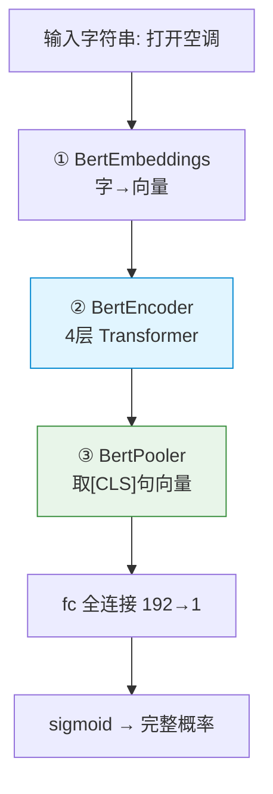
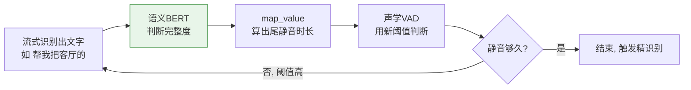

# 语义完整性 BERT 模型详解

> 本文从零讲解项目中**唯一自研训练**的模型——语义完整性判断 BERT（`asr/semantic_vad`）。
> 假设读者不熟悉 BERT，因此从"它要解决什么问题"讲起，逐层拆解结构，并用具体数字和例子说明它怎么训练、怎么工作。

---

## 目录

1. [它要解决什么问题](#1-它要解决什么问题)
2. [一句话看懂它的本质](#2-一句话看懂它的本质)
3. [BERT 是什么（零基础铺垫）](#3-bert-是什么零基础铺垫)
4. [本项目 BERT 的完整结构](#4-本项目-bert-的完整结构)
5. [一条数据从输入到输出走一遍](#5-一条数据从输入到输出走一遍)
6. [怎么训练这个模型](#6-怎么训练这个模型)
7. [训练数据怎么造（关键技巧）](#7-训练数据怎么造关键技巧)
8. [为什么用这么小的 BERT](#8-为什么用这么小的-bert)
9. [它怎么接回语音识别主流程](#9-它怎么接回语音识别主流程)
10. [常见疑问](#10-常见疑问)

---

## 1. 它要解决什么问题

语音助手有一个很实际的难题：**怎么知道用户说完了没有？**

传统的做法是检测静音——用户停顿超过一段时间（比如 800ms）就认为说完了。但这个"纯靠等"的方式有两个毛病：

**毛病一：说一半被打断**

```
用户说："帮我把客厅的……（停顿想词）……灯打开"
                          ↑ 这里停顿超过 800ms
传统做法：判定"说完了" → 只识别到"帮我把客厅的" → 指令残缺，执行失败
```

**毛病二：说完了还干等**

```
用户说："打开空调"（已经说完了）
传统做法：还要傻等 800ms 静音才敢确认 → 用户觉得反应慢
```

根本原因：**"说没说完"本质是个语义问题，但传统方法只看声音、不看内容。**

这个自研 BERT 就是来补上"看内容"这一环：**读懂用户已经说出来的文字，判断这句话语义上完整了没有。**

```
"打开空调"   → 语义完整 ✓  → 可以快点结束
"帮我把"     → 语义不完整 ✗ → 应该多等等
```

---

## 2. 一句话看懂它的本质

> **它是一个"句子完整度打分器"：输入一段文字，输出一个 0~1 的数，表示"这句话说完整了"的概率。**

```
输入："打开空调"   → 输出：0.95  （95% 完整 → 几乎肯定说完了）
输入："帮我把"     → 输出：0.08  （8% 完整 → 基本没说完）
输入："我想看客厅" → 输出：0.55  （半完整 → 拿不准）
```

就这么简单。剩下的所有结构、训练，都是为了让它能准确地输出这个概率。

---

## 3. BERT 是什么（零基础铺垫）

如果你已经懂 BERT，可以跳过这节。

BERT 是一种**理解文字的神经网络**。你可以把它想象成一个"阅读理解专家"：你给它一句话，它能输出每个字（以及整句）的"理解结果"——一串能代表语义的数字向量。

它的核心能力来自**自注意力（self-attention）机制**：句子里的每个字，都会"看一遍"句子里所有其他字，再决定自己的含义。

举例，理解"打开空调"的"调"字：

```
"调" 这个字会去注意：
  - "打" "开"  → 哦，前面是个动作
  - "空"       → 和我组成"空调"这个词
综合起来："调"在这里是"空调"的一部分，整句是"打开+空调"的完整动宾结构
```

正因为每个字都纵观全局，BERT 特别擅长判断"这句话整体是什么意思、结构完不完整"——这正是我们需要的能力。

一个完整的 BERT 分三段：

```
1. Embedding 层：把每个字变成数字向量（机器只认数字）
2. Encoder 层 ：多层自注意力，让每个字理解上下文（核心）
3. 输出层    ：根据任务，把理解结果转成想要的答案
```

---

## 4. 本项目 BERT 的完整结构

### 4.1 配置参数

代码 `asr/semantic_vad/infer.py` 里定义（极小配置）：

```python
self.bert_config = BertConfig(
    vocab_size_or_config_json_file=21128,  # 词表大小：21128 个中文字/符号
    hidden_size=192,        # 每个字用 192 维向量表示
    num_hidden_layers=4,    # 4 层 Transformer（标准 BERT 是 12 层）
    num_attention_heads=4,  # 4 个注意力头
    intermediate_size=384,  # 前馈网络中间层维度
    max_position_embeddings=128)  # 最多处理 128 个字
self.pad_size = 64          # 实际输入补齐到 64 个字
```

### 4.2 最外层：BERT + 一个分类头

代码 `asr/semantic_vad/models/model_bert.py`：

```python
class Bert(nn.Module):
    def __init__(self, bert_config):
        self.bert = BertModel(bert_config)               # BERT 主体（理解文字）
        self.fc = nn.Linear(bert_config.hidden_size, 1)  # 分类头：192维 → 1个数

    def forward(self, context, mask):
        _, pooled = self.bert(context, attention_mask=mask, output_all_encoded_layers=False)
        out = self.fc(pooled)        # 句向量(192维) → 1 个分数
        logit = torch.sigmoid(out)   # 用 sigmoid 把分数压到 0~1，当概率
        return logit
```

结构就两部分：

1. **BertModel**：读懂句子，输出一个代表整句的 192 维向量（`pooled`）
2. **fc + sigmoid**：把这个 192 维向量压成 1 个 0~1 的概率

### 4.3 BERT 主体内部（自底向上三段）



#### ① BertEmbeddings：把字变成向量

代码（`modeling.py`）：

```python
def forward(self, input_ids, token_type_ids=None):
    words_embeddings      = self.word_embeddings(input_ids)        # 字本身的含义
    position_embeddings   = self.position_embeddings(position_ids) # 字的位置（第几个）
    token_type_embeddings = self.token_type_embeddings(...)        # 字属于哪个句子
    embeddings = words_embeddings + position_embeddings + token_type_embeddings  # 三者相加
    return self.dropout(self.LayerNorm(embeddings))
```

每个字的向量 = **字向量 + 位置向量 + 类型向量**，三个相加。

为什么要加"位置向量"？因为字的顺序很重要：

```
"打开空调" 和 "调空开打" 用的字完全一样
但顺序不同 → 一个完整、一个是乱码
位置向量让模型能区分字的先后
```

#### ② BertEncoder：4 层 Transformer（核心）

```python
class BertEncoder(nn.Module):
    def __init__(self, config):
        # 复制 4 层一模一样的 BertLayer 堆叠
        self.layer = nn.ModuleList([copy.deepcopy(layer) for _ in range(4)])
```

每一层 `BertLayer` 内部有两个子模块：

**子模块 A：自注意力（让每个字看到所有字）**

```python
class BertSelfAttention(nn.Module):
    def forward(self, hidden_states, attention_mask):
        query = self.query(hidden_states)   # 每个字的"提问"
        key   = self.key(hidden_states)     # 每个字的"标签"
        value = self.value(hidden_states)   # 每个字的"内容"
        # 算注意力：每个字的query 和 所有字的key 比对
        attention_scores = query · keyᵀ / √d
        attention_scores = attention_scores + attention_mask  # 屏蔽 padding（补的空位）
        attention_probs = softmax(attention_scores)            # 变成"关注度"权重
        context = attention_probs · value                     # 按关注度聚合所有字的内容
```

通俗理解：每个字拿着自己的"问题"(query)，去和所有字的"标签"(key) 对比，算出"我该关注谁、关注多少"，然后把大家的"内容"(value) 按这个权重加权求和——于是每个字的新表示就融合了全句信息。

**子模块 B：前馈网络（加工提炼）**

```python
class BertIntermediate:  # 192 → 384，升维 + GELU 激活
class BertOutput:        # 384 → 192，降维 + 残差连接 + LayerNorm
```

先把维度撑大（192→384）做非线性变换，再压回来（384→192），相当于对每个字的表示做进一步加工。

**残差连接**（`hidden_states + input_tensor`）和 **LayerNorm** 是为了让深层网络训练稳定，可以理解为"加工的同时保留原始信息，防止信息丢失"。

4 层这样的结构层层叠加，每过一层，每个字对上下文的理解就更深一层。

#### ③ BertPooler：提取整句的代表向量

```python
class BertPooler(nn.Module):
    def forward(self, hidden_states):
        first_token_tensor = hidden_states[:, 0]   # ★ 只取第 0 个 token
        pooled_output = self.dense(first_token_tensor)
        pooled_output = self.activation(pooled_output)  # Tanh
        return pooled_output
```

**关键**：取**第 0 个 token**（也就是 `[CLS]` 这个特殊符号）的输出，作为整句的代表。

为什么第 0 个 token 能代表整句？因为经过 4 层自注意力，`[CLS]` 已经"看遍"了句子里所有字、把全句信息都聚合到自己身上了。所以它就是整句语义的浓缩。

这个 `pooled` 向量（192 维）就送给最外层的 `fc` 去打分。

---

## 5. 一条数据从输入到输出走一遍

用 "打开空调" 这个完整句，完整跟一遍（带维度变化）。

### Step 1：分词 + 加特殊符号

```python
# infer.py forward()
token = self.tokenizer.tokenize(feature)   # "打开空调" → ['打','开','空','调']
token = ['[CLS]'] + token                  # → ['[CLS]','打','开','空','调']
```

`[CLS]` 是 BERT 约定的"句子开头"标记，它的最终输出会代表整句。

### Step 2：转成数字 id + 补齐到 64 长度

```python
token_ids = self.tokenizer.convert_tokens_to_ids(token)
# ['[CLS]','打','开','空','调'] → [101, 2802, 2458, 4958, 6444]  (示意id)

# 补齐到 pad_size=64，不足的用 0 填，并记录哪些是真实字
if seq_len < self.pad_size:
    mask = [1]*seq_len + [0]*(64-seq_len)        # mask: 真实字=1, 补的=0
    token_ids += [0]*(64-seq_len)
# token_ids = [101,2802,2458,4958,6444, 0,0,...,0]  (长度64)
# mask      = [1,   1,   1,   1,   1,   0,0,...,0]  (长度64)
```

`mask` 的作用：告诉模型哪些是真实的字（要看）、哪些是补出来的空位（忽略）。

### Step 3：进 BERT

```
token_ids [1, 64]
  ↓ BertEmbeddings：每个 id 变成 192 维向量
[1, 64, 192]
  ↓ BertEncoder：4 层 Transformer（形状不变，但每个字的向量越来越"懂上下文"）
[1, 64, 192]
  ↓ BertPooler：取第0个token([CLS]) → [1, 192]
[1, 192]   ← 这就是 pooled，整句的代表向量
```

### Step 4：分类头打分

```python
out = self.fc(pooled)        # [1,192] → [1,1]，比如算出 2.9
logit = torch.sigmoid(out)   # sigmoid(2.9) ≈ 0.948
# 输出 0.948 → 这句话 94.8% 完整
```

### Step 5：概率映射成"该等多久"（后处理，非模型部分）

```python
return int(self.map_value(logit.item()))   # 0.948 → 尾静音毫秒数
```

```python
def map_value(self, input_value):
    if 0 <= input_value <= 0.4:
        return 1300 - 1000 * input_value   # 不完整 → 等久（最长1300ms）
    elif 0.4 < input_value <= 0.8:
        return 1250 - 1000 * input_value
    elif 0.8 < input_value <= 1.0:
        return 1150 - 1000 * input_value   # 完整 → 等短
    else:
        return 500
```

`0.948` 落在第三段：`1150 - 1000*0.948 = 202ms`。

> 所以 "打开空调" → 完整概率 0.948 → 只需等 202ms 静音就确认结束 → 快速响应。
> 反之 "帮我把" → 完整概率 0.08 → `1300 - 80 = 1220ms` → 多等 1.2 秒，给用户时间说完。

注意 `map_value` 是 `infer.py` 里的普通函数，不是神经网络的一部分。模型只负责输出 0~1 概率，映射成毫秒是人工设定的规则。

---

## 6. 怎么训练这个模型

训练目标：**让模型学会对"完整句"输出接近 1、对"不完整句"输出接近 0。**

这是一个标准的**二分类任务**（完整=1 / 不完整=0）。

### 训练循环（伪代码）

```python
model = Bert(bert_config)               # 第4节那个模型
criterion = nn.BCELoss()                # 二分类交叉熵损失（因为输出是0~1概率）
optimizer = torch.optim.Adam(model.parameters(), lr=2e-5)

for epoch in range(N):                  # 反复看数据 N 遍
    for text, label in dataloader:      # text="打开空调", label=1
        token_ids, mask = tokenize(text)
        prob = model(token_ids, mask)   # 前向：算出完整概率
        loss = criterion(prob, label)   # 和真实标签比，算误差
        optimizer.zero_grad()
        loss.backward()                 # 反向传播：算每个权重该怎么调
        optimizer.step()                # 更新权重
```

### 一个 batch 的具体例子

假设这一批有 3 条样本，模型当前还没训好：

| 样本 | 真实标签 | 模型输出 | 损失计算 | 说明 |
|------|---------|---------|---------|------|
| "打开空调" | 1（完整） | 0.6 | -log(0.6)=0.51 | 偏低，要往上调 |
| "帮我把" | 0（不完整） | 0.3 | -log(1-0.3)=0.36 | 还行 |
| "打开" | 0（不完整） | 0.8 | -log(1-0.8)=**1.61** | 错得离谱，重罚 |

第三条"打开"被误判成完整(0.8)，损失最大（1.61）。反向传播会重点调整权重，让模型下次见到"打开"这种半截话时输出更低的概率。

### 训练逐渐收敛

```
Epoch 1:  平均loss=0.55, 准确率 72%   （刚开始，基本靠猜）
Epoch 5:  平均loss=0.28, 准确率 88%
Epoch 15: 平均loss=0.12, 准确率 94%   （学会了）
Epoch 20: 平均loss=0.10, 准确率 94%   （不再提升，停）
```

验证集准确率不再上升就停止训练，把权重保存成 `semantic_vad/model.pt`——这就是项目加载的那个文件。

---

## 7. 训练数据怎么造（关键技巧）

二分类训练需要大量"句子 + 标签"样本。怎么得到？

### 7.1 正样本（完整句，标签=1）

来自真实的完整语音指令语料：

```
"打开空调"            → 1
"我想看客厅的监控"     → 1
"把卧室的灯关掉"       → 1
"现在几点了"          → 1
"播放音乐"            → 1
```

### 7.2 负样本（不完整句，标签=0）—— 截断法

这是最巧妙的技巧：**把完整句从中间截断，截出来的就是不完整句。**

拿 "打开客厅的灯" 举例，逐字截断：

| 截断后 | 标签 | 说明 |
|--------|------|------|
| "打" | 0 | 明显没说完 |
| "打开" | 0 | 还差宾语 |
| "打开客厅" | 0 | 还没说完（要打开客厅的什么？） |
| "打开客厅的" | 0 | 明显没说完 |
| "打开客厅的灯" | 1 | 完整 |

这样，**一个完整句能自动生成好几个不完整的负样本**，数据量瞬间扩大，且不用人工标注。

### 7.3 实际中还会做的事

- **人工校正**：有些截断也算半完整（如"打开客厅"在某些语境下可接受），需要人工或规则修正标签。
- **真实 ASR 中间结果**：直接收集流式识别过程中产生的中间文本（它们天然就是"说到一半"的样子）当负样本，更贴近真实分布。
- **数据平衡**：保证正负样本数量大致均衡，否则模型会偏向数量多的那一类。

### 7.4 训练数据示意

```
文本                  标签
打开空调               1
帮我把客厅的灯打开       1
帮我                  0
帮我把                0
帮我把客厅的            0
我想看监控             1
我想看                0
现在几点了             1
现在几                0
...
```

---

## 8. 为什么用这么小的 BERT

对比标准 BERT：

| 参数 | 标准 BERT-base | 本项目 | 比例 |
|------|---------------|--------|------|
| 层数 | 12 | 4 | 1/3 |
| hidden_size | 768 | 192 | 1/4 |
| 注意力头 | 12 | 4 | 1/3 |
| 前馈中间层 | 3072 | 384 | 1/8 |
| 参数量 | ~110M | ~3M（估计） | ~1/35 |

原因有两个：

**1. 速度要求极高**

它处在 2-Pass 流式的**关键路径**上——每识别出一段文字就要调它一次，它的耗时会直接累加到用户感受到的延迟里。所以必须快到几乎无感。

**2. 任务足够简单**

它只做"完整/不完整"二分类，不需要大模型那种复杂的语言理解能力。一个 4 层小 BERT 的能力对这个任务绰绰有余。

这是典型的**工程权衡**：用刚好够用的最小模型，换取最低的延迟。盲目上大模型反而拖慢整个语音交互。

---

## 9. 它怎么接回语音识别主流程

在 `asr/ezviz_backend.py` 的流式处理 `stream_forward()` 里形成闭环：

```python
if self.business_type in self.vad_eable_tpye:   # 该业务启用了语义VAD
    if self.semantic_complete_flag:
        # ① 拿上一轮累积的识别文本，喂给语义BERT，算出新的尾静音时长
        self.vad_param_dict['max_end_sil'] = self.semantic_complete_prob.forward(self.last_asr_text)
        self.semantic_complete_flag = False
    # ② 把这个动态时长传给声学VAD
    _, vadsegments, _ = self.vad_online([binary_Data, ...], param_dict=self.vad_param_dict)
    # ③ VAD用新阈值判断：静音够久了吗？
    if vadsegments and vadsegments[0] and vadsegments[0][0][1] != -1:
        is_final = True   # 判定结束，触发 Pass-2 精识别
```

完整闭环：



**两个模型分工**：
- **声学 VAD（FSMN，框架原生）**：负责"数静音数够没有"——纯听声音。
- **语义 BERT（自研）**：负责"动态决定要数到多少"——靠读懂文字。

声学 VAD 是"计时器"，语义 BERT 是给计时器装的"大脑"。

---

## 10. 常见疑问

**Q1：它和前面讲的 FSMN-VAD 是一个东西吗？**

不是，是两个完全独立的模型，互相配合：

| | FSMN-VAD | 语义完整性 BERT |
|---|---------|----------------|
| 看什么 | 声音信号 | 识别出的文字 |
| 回答 | "有没有人在说话" | "这句话说完了吗" |
| 来源 | 🔵 FunASR 框架原生 | 🟢 项目自研训练 |
| 输出 | 语音起止点 | 完整概率 → 尾静音时长 |

**Q2：为什么不直接让 BERT 决定"结束/不结束"，还要绕个尾静音时长？**

因为"结束判定"最终还得结合声学（用户可能只是说话慢，不是说完了）。让 BERT 调整声学 VAD 的等待时长，是"语义"和"声学"两方面综合决策，比单靠任何一方都稳。

**Q3：`map_value` 那条三段折线是怎么来的？**

是根据真实交互体验调出来的经验曲线，不是模型学的。它把"完整概率"翻译成"舒适的等待时长"——完整就少等、不完整就多等，三段截距（1300/1250/1150）是为了在不同置信区间用不同的敏感度。

**Q4：项目里还有个 BiLSTM 版，是干嘛的？**

`SemanticComplete_BiLSTM` 是同任务的备选实现（用双向 LSTM 而非 BERT），接口一样（也有 `forward` 和 `map_value`），可无缝替换。大概率是早期基线，后来用 BERT 提精度，BiLSTM 版作为轻量备选保留。

---

## 总结

> **语义完整性 BERT = 一个"句子完整度打分器"**：
> - **结构**：标准 BERT（Embedding → 4层Transformer → 取[CLS]句向量）+ 全连接 + sigmoid，输出 0~1 的完整概率。用极小配置（4层/192维）保证实时速度。
> - **训练**：当作二分类任务训练；正样本是完整句，负样本用"截断完整句"自动生成；用 BCE 损失反向传播，收敛后存 `model.pt`。
> - **作用**：读懂已识别的文字，判断说没说完，动态控制声学 VAD 的等待时长——说完了快响应、没说完耐心等。
> - **地位**：项目中**唯一自研训练**的模型，是"语义 VAD"理念的核心载体。
