# 萤石 ASR 项目完整数据流程

> 本文用流程图的形式，详细描述整个项目从音频输入到最终识别结果的完整数据流动过程。
>
> 涵盖：两种推理模式（流式/非流式）、2-Pass 策略、VAD 端点检测、语义断句、防误唤醒、热词增强等全部环节。

---

## 目录

1. [系统总览](#1-系统总览)
2. [三层调用架构](#2-三层调用架构)
3. [非流式完整流程](#3-非流式完整流程)
4. [流式完整流程（核心）](#4-流式完整流程核心)
5. [2-Pass 策略详解](#5-2-pass-策略详解)
6. [流式单帧处理的内部数据流](#6-流式单帧处理的内部数据流)
7. [各模型内部数据流](#7-各模型内部数据流)
8. [关键数据结构流转](#8-关键数据结构流转)

---

## 1. 系统总览

整个系统是一个部署在云端的 ASR（语音识别）服务，输入音频、输出文字。它把多个开源框架的模型缝合成一套针对萤石 IoT 设备的语音交互流水线。

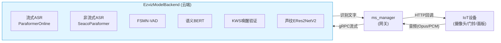

两种对外推理模式：

| 模式 | 入口 | 适用场景 |
|------|------|---------|
| **非流式** | `forward()` | 整段音频一次性识别（文件转写、留言） |
| **流式** | `stream_init()` + `stream_forward()` × N | 实时语音交互（设备语音助手） |

---

## 2. 三层调用架构

数据在三层之间流动，从外到内：

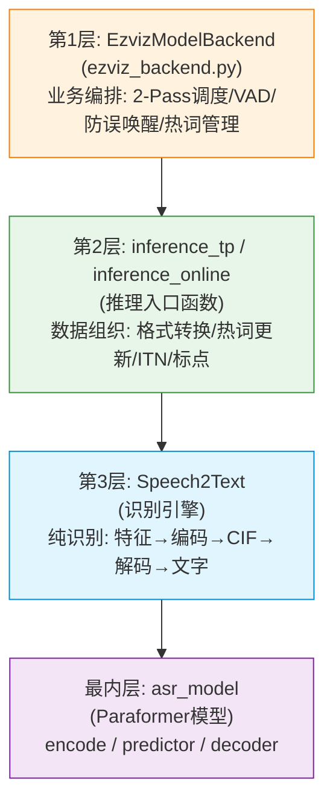

| 层 | 职责 | 关键文件 |
|----|------|---------|
| EzvizModelBackend | 业务编排：2-Pass、VAD、声纹、KWS、Apollo配置 | `ezviz_backend.py` |
| inference 函数 | 数据组织：音频格式、热词更新、ITN/标点后处理 | `asr_inference_*.py` |
| Speech2Text | 识别引擎：把音频转成文字 | `asr_inference_*.py` |
| asr_model | 模型本体：编码器/预测器/解码器 | `e2e_asr_paraformer.py` |

---

## 3. 非流式完整流程

`forward()` —— 一次性传入完整音频，直接走 SeacoParaformer 离线识别。

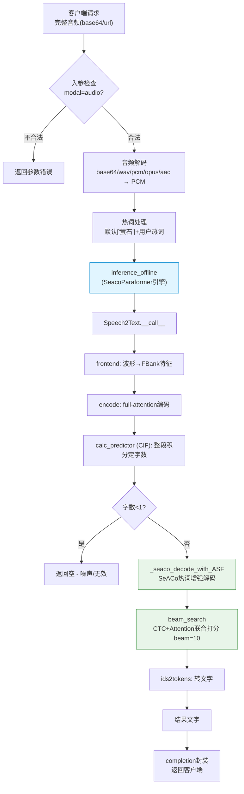

特点：**无 VAD、无 2-Pass、无防误唤醒**——因为输入是完整音频，边界已定，直接整段高精度识别。

---

## 4. 流式完整流程（核心）

流式是项目的核心，采用 2-Pass 策略。一次会话分三阶段：`stream_init` → 多次 `stream_forward` → 结束。

### 4.1 会话级流程

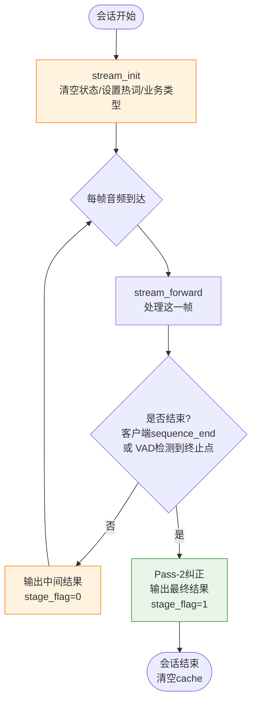

### 4.2 单次 stream_forward 的完整流程

这是最核心的流程图，展示一帧音频进来后的完整处理：

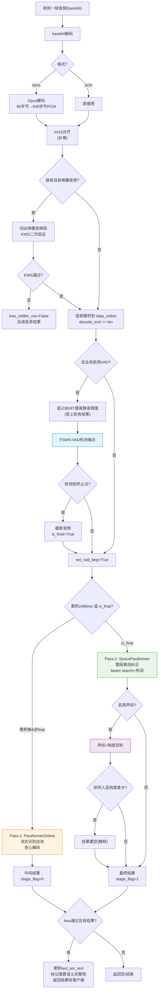

---

## 5. 2-Pass 策略详解

2-Pass 是流式的灵魂：流式引擎撑体验，非流式引擎保结果。

```mermaid
sequenceDiagram
    participant C as 客户端
    participant B as Backend
    participant VAD as FSMN-VAD
    participant SEM as 语义BERT
    participant ON as ParaformerOnline(Pass-1)
    participant OFF as SeacoParaformer(Pass-2)

    Note over C,B: stream_init 初始化
    loop 用户说话中(每480ms)
        C->>B: 音频帧
        B->>VAD: 检测端点(用动态尾静音阈值)
        B->>ON: 流式识别(贪心)
        ON-->>B: 中间结果
        B->>SEM: 用累积文本算下轮尾静音阈值
        B-->>C: stage_flag=0 (实时滚字)
    end
    Note over VAD: 检测到语音终止点 → is_final=True
    B->>OFF: 整段音频精识别(beam+热词)
    OFF-->>B: 高精度文本
    B->>ON: is_final清空cache
    B-->>C: stage_flag=1 (最终结果,客户端采纳)
```

**两个引擎对比**：

| | Pass-1 (ParaformerOnline) | Pass-2 (SeacoParaformer) |
|---|--------------------------|--------------------------|
| 触发 | 每累积480ms | 流结束(is_final) |
| 编码 | encode_chunk(分块+cache) | encode(full-attention) |
| CIF | 跨块积分 | 整段积分 |
| 解码 | 贪心argmax | beam search(CTC+Attention) |
| 热词 | 基础 | SeACo增强 |
| 输出 | stage_flag=0(中间) | stage_flag=1(最终) |
| 目标 | 低延迟 | 高精度 |

---

## 6. 流式单帧处理的内部数据流

聚焦 Pass-1 流式识别（ParaformerOnline）内部，一个 chunk 的数据流：

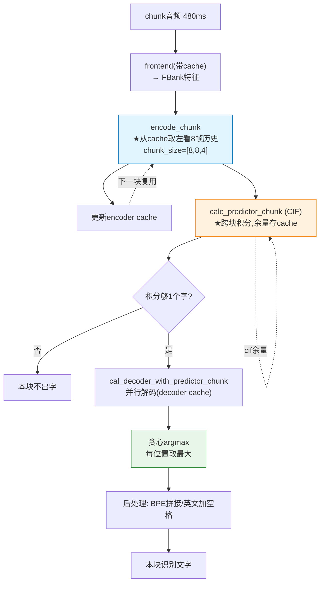

**cache 跨帧流转**（流式的关键）：

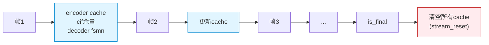

---

## 7. 各模型内部数据流

### 7.1 Paraformer（流式/非流式共享的识别主干）


### 7.2 FSMN-VAD（端点检测）

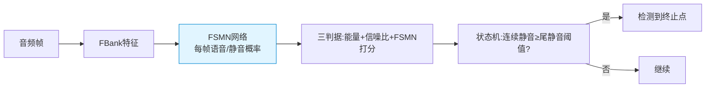

### 7.3 语义完整性 BERT（动态断句）

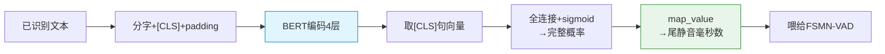

### 7.4 KWS 唤醒验证

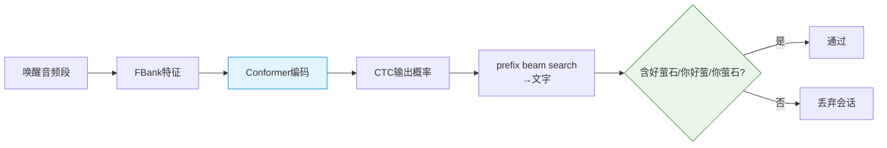

### 7.5 声纹 ERes2NetV2（防误唤醒）

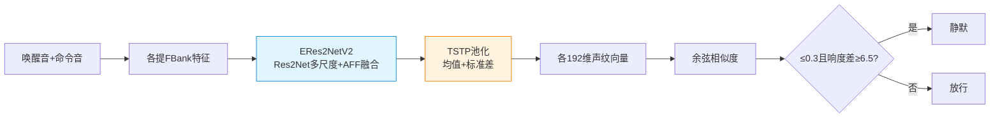

---

## 8. 关键数据结构流转

### 8.1 音频数据的形态变化

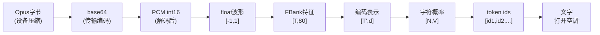

### 8.2 流式会话的状态变量流转

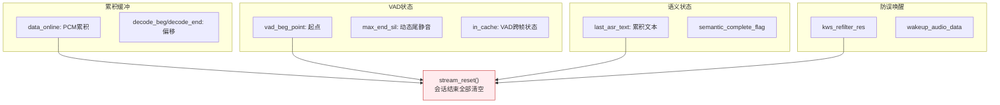

### 8.3 输出结果的标志位

| 字段 | 含义 |
|------|------|
| `stage_flag=0` | 中间结果（Pass-1流式，仅即时反馈） |
| `stage_flag=1` | 最终结果（Pass-2纠正，客户端采纳） |
| `sequence_index` | 输出序号 |
| `sequence_end` | 会话是否结束 |
| `completion` | 识别文字内容 |

---

## 总结：完整数据流一句话串联

> **设备采集音频 → Opus压缩 → base64 → 云端Backend**
> **→ 解码成PCM → (首帧)切唤醒音频做KWS验证 → 音频累积**
> **→ FSMN-VAD检测端点(尾静音阈值由语义BERT动态调整)**
> **→ [未结束] ParaformerOnline流式识别(贪心) → 中间结果stage_flag=0**
> **→ [结束] SeacoParaformer整段精识别(beam+SeACo热词) → 声纹+响度防误唤醒 → 最终结果stage_flag=1**
> **→ 返回客户端**
>
> 核心设计：**2-Pass（流式撑体验+非流式保精度）+ 语义VAD(智能断句) + 双重防误唤醒(KWS+声纹) + 热词增强(SeACo) + Apollo热更新**。
