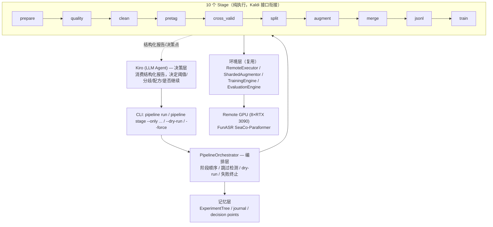
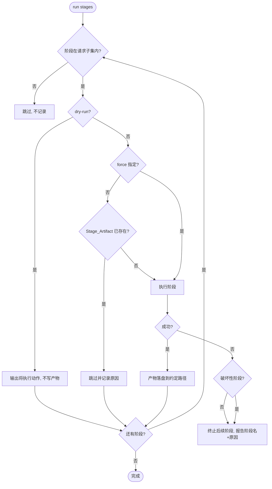

# Design Document

## Overview

本设计将业务侧已成熟的 10 阶段 ASR 训练全流程封装为一个 **阶段化、幂等、可断点** 的自动化训练流水线 `BusinessPipeline`，并集成进现有 `asr-evolve/` 系统（"Kiro 决策，代码执行"）。流水线作为一个新的环境层组件加入 `asr_evolve/`，复用既有的 `RemoteExecutor`（远程 SSH）、`ShardedAugmentor`（分片增量增强）、`TrainingEngine`（FunASR 训练）、`EvaluationEngine`（CER/WER）与 `ExperimentTree`（版本追踪），并新增领域 KPI 评估、按设备隔离切分、多源合并去重、训练健康检查等纯执行组件。

设计的核心约束来自三条工程哲学：

1. **阶段化 + 幂等 + 可断点**：每个阶段执行前检测 Stage_Artifact 是否已存在，存在则跳过，`--force` 可强制重跑；相同输入与配置必须产出内容等价的产物。
2. **Kaldi 接口解耦**：阶段之间只通过 `wav.scp` / `text` / `manifest.jsonl` 衔接，任何阶段可独立检视、替换或重跑。
3. **Kiro 决策，代码执行**：所有"判断类"决策点（质量阈值、交叉验证分歧、配方自适应、是否继续迭代）由 Agent 做出，代码层只产出结构化报告并做确定性执行，绝不内置自动阈值策略。

落地分两步：先用远程已有 AISHELL 小数据集（`AISHELL_Mode`）贯通骨架，再切到真实业务数据 s10/sp4（`Business_Mode`）；两种模式仅通过数据集与配置切换实现，阶段编排逻辑不变。本设计同时修正现有 `asr-evolve` 中与业务实战配方相悖的训练配置缺陷（LR 空转、不收敛），并加固训练健康检查以捕获 FunASR/hydra 静默崩溃（返回码 0 但无检查点）。

### 与现有代码的关系

| 现有组件 | 复用方式 |
|----------|----------|
| `environment/remote.py::RemoteExecutor` | 训练/推理/评估远程执行（R21） |
| `environment/sharded_augmentor.py::ShardedAugmentor` | augment 阶段分片增量增强（R10.4） |
| `environment/trainer.py::TrainingEngine` | train 阶段；已含 `.pt` 健康检查雏形，按 R13/R14 加固 |
| `environment/evaluator.py` | Stripped_CER 复用 `edit_distance_ops` / `normalize_for_eval`（R16.5） |
| `experiment_tree.py::ExperimentTree` | 每次远程训练/评估登记节点（R21.3、R19.5） |
| `core/config.py` | 扩展 `pipeline` / `recipe` 配置段 |
| `pipeline.py::Pipeline` | 复用其原子操作；新增 `BusinessPipeline` 编排层在其之上 |

## Architecture

### 分层结构



### 阶段编排与数据流

每个阶段是一个实现统一 `Stage` 协议的对象。编排器持有固定的 **规范阶段序列**（canonical order），无论用户请求的是全集还是子集，都按该序列的相对顺序执行。阶段之间通过磁盘上约定路径的 Kaldi 文件衔接，因此每个阶段可独立运行。


### 编排控制流（跳过 / 强制 / dry-run / 失败）



### 运行模式切换

`AISHELL_Mode` 与 `Business_Mode` 通过配置中的 `pipeline.mode` 与对应 `datasets` 列表切换，编排逻辑与阶段实现完全不变（R20.3）。模式只影响 Stage 读取的输入数据集路径集合。

## Components and Interfaces

### PipelineOrchestrator

编排层顶层组件，负责阶段顺序、跳过检测、dry-run、失败终止与决策点持久化。

```python
CANONICAL_STAGES = ["prepare", "quality", "clean", "pretag",
                    "cross_valid", "split", "augment", "merge", "jsonl", "train"]

class PipelineOrchestrator:
    def __init__(self, config: dict, base_dir: str = ".",
                 tree: ExperimentTree | None = None): ...

    def run(self, only: list[str] | None = None, *,
            dry_run: bool = False, force: set[str] | None = None,
            mode: str = "aishell") -> PipelineRunReport:
        """按规范顺序执行 only 指定的阶段子集（None=全部）。

        - only 子集始终按 CANONICAL_STAGES 的相对顺序执行 (R1.2, R1.3)
        - dry_run: 输出每阶段动作, 不产生/修改任何 artifact (R1.4)
        - force: 指定需强制重跑的阶段名集合 (R2.2)
        - 非破坏性阶段失败 -> 终止后续并报告 (R1.5)
        """

    def _plan(self, only) -> list[str]:
        """过滤并按 CANONICAL_STAGES 排序, 返回执行计划。"""

    def _should_skip(self, stage: Stage, force: set[str]) -> tuple[bool, str]:
        """artifact 存在且未 force -> (True, reason)。"""

    def record_decision_point(self, kind: str, payload: dict) -> str:
        """将决策点输入以结构化形式持久化, 供 Agent 经 experiment_tree 追溯 (R19.5)。"""
```

### Stage 协议

所有阶段实现统一接口，使编排器可一致地检测产物、执行、dry-run。

```python
class Stage(Protocol):
    name: str
    destructive: bool          # clean 为 True, 其余 False (影响失败处理与默认开关)

    def artifact_exists(self, ctx: StageContext) -> ArtifactStatus:
        """检测本阶段 Stage_Artifact 是否已存在 (R2.1)。返回是否存在+条目计数。"""

    def plan(self, ctx: StageContext) -> list[str]:
        """dry-run: 返回将执行动作的描述, 不触碰磁盘 (R1.4)。"""

    def execute(self, ctx: StageContext) -> StageResult:
        """执行阶段, 产物落盘到 ctx 约定路径 (R2.4)。"""
```

各阶段组件与对应需求：

| Stage | 组件类 | 关键职责 | 需求 |
|-------|--------|----------|------|
| prepare | `PrepareStage` | 原始数据 → labeled/(wav.scp+text) + unlabeled/ | R4 |
| quality | `QualityScanner` + `QualityJudge` | 慢扫描原始指标 / 阈值快判 good-bad | R5 |
| clean | `Cleaner` | 按 bad 清单删除（破坏性, 默认关闭） | R6 |
| pretag | `Pretagger` | FireRedASR + Qwen3-ASR 两份预标注（断点续标） | R7 |
| cross_valid | `CrossValidator` | 三方标签比对, 输出分歧明细 | R8 |
| split | `DataSplitter` | 按 Device_ID 隔离的 90/5/5 切分（seed=42） | R9 |
| augment | `Augmentor`（包装 ShardedAugmentor） | 仅 train 距离关联增强 | R10 |
| merge | `Merger` | 多源按 split 合并去重 → all_label | R11 |
| jsonl | `ManifestGenerator` | scp+text → train.jsonl/dev.jsonl | R12 |
| train | `RecipeTrainer`（包装 TrainingEngine） | 业务实战配方 + 健康检查 | R13/R14/R15 |

### QualityScanner / QualityJudge（解耦）

```python
class QualityScanner:
    def scan(self, labeled_dir: str) -> str:
        """为每条音频采集 duration/sample_rate/channels/rms/clip_rate,
        写入 metrics.jsonl（慢扫描, 只跑一次）。返回 metrics 路径 (R5.1)。"""

class QualityJudge:
    def judge(self, metrics_path: str, thresholds: QualityThresholds
              ) -> tuple[GoodBadLists, dict]:
        """基于既有 metrics 与可配置阈值判定 good/bad,
        bad 条目记录违反的具体问题类型。不重跑扫描 (R5.2, R5.3, R5.4)。"""
```

阈值由 Agent 决定：编排器把 metrics 分布作为决策点交给 Kiro，代码不内置阈值策略（R19.1）。

### DataSplitter（按设备隔离）

```python
class DataSplitter:
    RATIOS = (0.90, 0.05, 0.05)   # train/dev/test (R9.1)
    SEED = 42                      # (R9.2)

    def split(self, labeled_dir: str, out_dir: str) -> dict:
        """按 Device_ID 分组, 整组分配到同一 split,
        固定 seed=42, 每个 split 输出 wav.scp + text。
        多数据集独立切分 (R9.3, R9.4, R9.5)。"""

    def remap_paths(self, wav_scp: str, audio_root: str) -> str:
        """wav.scp 绝对路径失效时按实际目录重映射,
        重映射后仍不存在的条目丢弃 (R3.3)。"""

    @staticmethod
    def device_id_of(utt_id: str) -> str:
        """从 utt_id 提取 Device_ID 作为分组键。"""
```

### Merger（多源合并去重）

```python
class Merger:
    def merge(self, sources: list[SourceSpec], out_dir: str) -> dict:
        """按 split 合并 reflow/augmented/public → all_label。
        - 增强数据仅并入 train (R11.2)
        - 重复键去重, 保留首次出现 (R11.3)
        - 仅纳入 wav.scp ∩ text 的条目 (R11.4)
        - 保持 split 间隔离 (R11.5)
        """
```

### ManifestGenerator

```python
class ManifestGenerator:
    def to_jsonl(self, split_dir: str, split: str) -> str | None:
        """all_label/<split> 的 wav.scp+text → <split>.jsonl,
        仅纳入键交集, 保留 audio 路径与对应 text。
        缺 wav.scp -> 跳过并提示先 merge。单 split 可独立转换 (R12)。"""
```

### RecipeTrainer（业务实战配方 + 健康检查）

包装现有 `TrainingEngine`，强制业务实战配方覆盖旧配置，并在启动前校验 `seaco_id`，结束后做健康检查。

```python
class RecipeTrainer:
    BUSINESS_RECIPE = dict(
        freeze_param="hotword_output_layer,seaco_decoder",  # R13.1
        learning_rate=2e-5,            # R13.2
        warmup_steps=30000,            # R13.3
        batch_size=60000,              # R13.4 (token)
        batch_type="token",
        max_epoch=50,                  # R13.5
        avg_keep_nbest_models_type="loss",  # R13.6
        keep_nbest_models=5, avg_nbest_model=5,
        find_unused_parameters=True,   # R13.7
        seaco_id=8377,                 # R13.8 NO_BIAS
    )

    def build_recipe(self, base_train_cfg: dict) -> dict:
        """以 BUSINESS_RECIPE 覆盖现有相悖配置 (R13, R15.1)。"""

    def preflight_check(self, params: dict) -> None:
        """检测 dataset_conf.seaco_id 是否被显式传入（检查标志本身,
        不论其值是否有效）; 未传 -> 启动前报错提示 seaco_label_pad 将为空 (R13.9)。
        报错输出自身失败时, 仍允许训练启动 (R13.10)。"""

    def train(self, train_jsonl: str, dev_jsonl: str, tag: str) -> dict:
        """经 RemoteExecutor 远程 torchrun 训练 (R21.1)。"""

class TrainingHealthChecker:
    def check(self, output_dir: str, return_code: int) -> HealthResult:
        """校验 output_dir 至少一个有效 .pt 检查点。
        return_code==0 但无 .pt -> 判失败并报告静默崩溃 (R14.1, R14.2)。"""
```

健康检查失败时编排器阻止进入评估并上报（R14.3）。

### DomainEvaluator（领域 KPI）

```python
WAKEWORDS = ["你好萤石", ...]  # 唤醒词变体列表

class DomainEvaluator:
    def strip_wakeword(self, text: str) -> str:
        """按变体列表从首尾剥离 Wakeword (R16.1)。"""

    def instruction_recall(self, samples: list[Sample]) -> RecallReport:
        """命中 = strip(ref) ⊆ strip(hyp)（子串）。
        strip(ref) 为空的样本同时排除出分子与分母 (R16.2, R16.3)。"""

    def evaluate(self, samples, test_set_name: str) -> DomainReport:
        """同时报告剥离前 CER 与剥离后 Stripped_CER（字符级编辑距离,
        复用 evaluator.edit_distance_ops）(R16.4, R16.5)。
        每个测试集独立报告, 不做跨测试集聚合 (R17.1)。"""

    def evaluate_with_baselines(self, version: str, checkpoints: list[str]
                                ) -> ComparisonReport:
        """强制纳入 seaco 与 online 基线; 对每版本评估 best/epN/avgN;
        以 v0.X.0 标识; 输出含各模型 Instruction_Recall 与 Stripped_CER 的对比汇总
        (R18)。"""
```

### CLI 扩展

在 `cli.py` 新增子命令，复用现有参数解析风格：

```
pipeline run [--mode aishell|business] [--dry-run]
pipeline stage --only prepare,quality,split [--force clean,split]
pipeline quality-judge --thresholds ...   # 调阈值快速重判, 不重扫
pipeline eval --version v0.3.0 --checkpoints best,ep50,avg5
```

## Data Models

### 配置扩展（configs/asr_evolve.yaml）

```yaml
pipeline:
  mode: aishell                 # aishell | business (R20)
  datasets:
    aishell: [aishell_small]
    business: [s10_reflow, sp4_reflow]
  stages_root: data/pipeline    # 各阶段 artifact 根目录
  quality_thresholds:           # 仅作为 Judge 默认值; 最终由 Agent 决定 (R19.1)
    min_duration_s: 0.5
    max_duration_s: 20.0
    expected_sample_rate: 16000
    expected_channels: 1
    min_rms: 0.001
    max_clip_rate: 0.01
  split:
    ratios: [0.90, 0.05, 0.05]
    seed: 42
recipe:                         # 业务实战配方 (R13), 覆盖 training 段相悖项 (R15)
  freeze_param: hotword_output_layer,seaco_decoder
  learning_rate: 2.0e-5
  warmup_steps: 30000
  batch_size: 60000
  batch_type: token
  max_epoch: 50
  avg_keep_nbest_models_type: loss
  keep_nbest_models: 5
  avg_nbest_model: 5
  find_unused_parameters: true
  seaco_id: 8377
evaluation:
  wakewords: ["你好萤石"]
  test_sets: [s10_test, sp4_test, business_full]
  baselines: [seaco, online]
```

### 运行时数据结构

```python
@dataclass
class StageContext:
    """传给每个 Stage 的执行上下文。"""
    base_dir: str
    stages_root: str
    mode: str
    datasets: list[str]
    config: dict
    force: bool = False
    dry_run: bool = False

@dataclass
class ArtifactStatus:
    exists: bool
    entry_count: int = 0
    detail: str = ""

@dataclass
class StageResult:
    stage: str
    status: str            # "completed" | "skipped" | "failed"
    reason: str = ""       # 跳过/失败原因
    entry_count: int = 0
    artifacts: list[str] = field(default_factory=list)

@dataclass
class PipelineRunReport:
    mode: str
    planned: list[str]
    results: list[StageResult]
    halted_at: str | None = None
    decision_points: list[str] = field(default_factory=list)

@dataclass
class QualityThresholds:
    min_duration_s: float; max_duration_s: float
    expected_sample_rate: int; expected_channels: int
    min_rms: float; max_clip_rate: float

@dataclass
class GoodBadLists:
    good: list[str]                       # utt_id 列表
    bad: dict[str, list[str]]             # utt_id -> 违反的问题类型列表 (R5.3)

@dataclass
class KaldiEntry:
    utt_id: str
    audio_path: str
    text: str

@dataclass
class Sample:
    audio_path: str
    reference_text: str
    hypothesis_text: str
    scene_type: str = ""

@dataclass
class RecallReport:
    test_set: str
    recall: float
    numerator: int                        # 命中数（仅 strip(ref) 非空）
    denominator: int                      # strip(ref) 非空样本数 (R16.3)

@dataclass
class DomainReport:
    test_set: str                         # 独立, 不聚合 (R17.1)
    cer: float                            # 剥离前
    stripped_cer: float                   # 剥离后 (R16.4)
    recall: RecallReport
    missing: bool = False                 # 明细缺失标记 (R17.3)

@dataclass
class ComparisonReport:
    version: str                          # v0.X.0 (R18.3)
    rows: list[dict]                      # 每模型(含 seaco/online 基线): recall + stripped_cer
```

### Kaldi 接口文件布局

```
data/pipeline/<dataset>/
  labeled/        wav.scp  text          # prepare 产物 (R4.3)
  unlabeled/      wav.scp                # prepare 产物
  quality/        metrics.jsonl  good.lst  bad.lst
  pretag/         firered.text  qwen3.text
  cross_valid/    disagreements.jsonl
  split/          train/{wav.scp,text}  dev/{...}  test/{...}
  augmented/      train/{wav.scp,text}  # 复用 ShardedAugmentor 分片
all_label/        train/{wav.scp,text}  dev/{...}  test/{...}
  train.jsonl  dev.jsonl                 # jsonl 产物
```

## Correctness Properties

*A property is a characteristic or behavior that should hold true across all valid executions of a system — essentially, a formal statement about what the system should do. Properties serve as the bridge between human-readable specifications and machine-verifiable correctness guarantees.*

本流水线的大量核心逻辑是纯函数式的（阶段规划、集合交集、按设备分组切分、合并去重、召回率计算、剥离唤醒词、健康检查判定），非常适合属性测试。下列属性均经 prework 分析并做冗余合并而来。涉及远程 SSH/GPU、外部 ASR 模型、配方常量断言、决策点治理等不随输入变化或属于外部服务的条目，归入单元/集成/示例测试（见 Testing Strategy），不在此列。

### Property 1: 阶段规划不变式（顺序 + 子集 + 模式无关）

*For any* 请求的阶段子集 S（含 None 表示全集）与任意运行模式 m，编排器产出的执行计划恒等于 `[s for s in CANONICAL_STAGES if s in S]` —— 即始终是规范顺序的子序列，只包含被请求的阶段，且与模式 m 无关。

**Validates: Requirements 1.2, 1.3, 20.3**

### Property 2: 跳过/强制决策

*For any* 阶段与其 `(artifact_exists, force)` 状态，编排器跳过该阶段当且仅当产物已存在且未被 force；当被 force 或产物不存在时调用 `execute`。跳过时 `status == "skipped"` 且记录原因。

**Validates: Requirements 2.1, 2.2**

### Property 3: 非破坏性阶段失败即终止

*For any* 执行计划与任意失败阶段位置，当某非破坏性阶段失败时，其后的任何阶段都不被执行，且报告中 `halted_at` 等于该失败阶段名并附带失败原因。

**Validates: Requirements 1.5**

### Property 4: dry-run 不写盘

*For any* 阶段子集，在 dry-run 模式下运行前后磁盘上的 Stage_Artifact 集合逐字节不变（无任何创建或修改），且每个阶段输出其将执行的动作描述。

**Validates: Requirements 1.4**

### Property 5: 幂等性（相同输入+相同配置）

*For any* 输入数据集与配置，对确定性阶段（split、merge、jsonl、quality-judge）连续执行两次产出内容等价的 Stage_Artifact（scp/text/jsonl 的键值集合完全一致）。

**Validates: Requirements 2.3, 2.4**

### Property 6: 质量扫描完整性

*For any* 音频条目列表，Quality_Scanner 为每条音频输出恰好一条 metrics 记录，且每条记录都包含 duration、sample_rate、channels、rms、clip_rate 五个字段。

**Validates: Requirements 5.1**

### Property 7: 质量判定的划分与违规明细

*For any* metrics 与阈值集合，Quality_Judge 将全部条目划分为不相交且完全覆盖的 good 与 bad 两类；每个 bad 条目记录的问题类型集合恰好等于其违反的阈值规则集合。

**Validates: Requirements 5.2, 5.3**

### Property 8: 判定纯依赖既有指标（调阈值不重扫）

*For any* 同一 metrics 与任意两组阈值，重新判定的结果仅由 metrics 与阈值决定，Quality_Scanner 不被再次调用；判定输出与阈值谓词一致。

**Validates: Requirements 5.4**

### Property 9: 清理开关安全不变式

*For any* 数据集与 bad 清单，当清理选项未启用时，labeled 音频集合与索引（text、wav.scp）逐字节不变；当启用时，清理后剩余条目集合等于 `labeled \ bad`，且被删音频文件不再存在。

**Validates: Requirements 6.1, 6.2**

### Property 10: 失效路径重映射与丢弃

*For any* 含合法/失效/可重映射路径的 wav.scp 与音频根目录，重映射后的输出恰好保留重映射后实际存在的条目，丢弃重映射后仍不存在的全部条目。

**Validates: Requirements 3.3**

### Property 11: manifest 仅纳入键交集

*For any* wav.scp 键集合与 text 键集合，生成的 manifest.jsonl 的键集合恰好等于二者的交集。

**Validates: Requirements 3.4, 11.4, 12.1**

### Property 12: jsonl 保真

*For any* wav.scp 与 text，生成的每条 jsonl 记录的音频路径与文本，等于该键在源文件中的对应取值（无丢失、无错配）。

**Validates: Requirements 12.3**

### Property 13: 切分划分与比例

*For any* labeled 数据集，切分结果将全部条目划分为不相交且完全覆盖 train/dev/test 三个 split，且各 split 比例在设备粒度容差内逼近 90% / 5% / 5%。

**Validates: Requirements 9.1**

### Property 14: 切分确定性（固定种子）

*For any* labeled 数据集，使用固定种子 42 的两次独立切分产出完全相同的 split 分配。

**Validates: Requirements 9.2**

### Property 15: 按设备隔离（多数据集独立）

*For any* labeled 数据集集合，对每个数据集独立切分时，任一 Device_ID 的全部音频被分配到唯一一个 split（其占据的 split 集合大小恒为 1），不跨 split。

**Validates: Requirements 9.3, 9.4**

### Property 16: 增强仅作用于 train

*For any* 切分后的 split 集合，增强执行后 dev 与 test 的 wav.scp/text 逐字节不变，仅 train 被修改（新增增强条目）。

**Validates: Requirements 10.1**

### Property 17: 距离因子联动参数

*For any* 采样得到的距离因子 t，由其派生的 (SNR, RT60, 低通截止) 三参数遵循文档约定的单调耦合关系（t 越大 → SNR 越低、RT60 越高、低通截止越低）。

**Validates: Requirements 10.2**

### Property 18: 背景人声能量低于主说话人

*For any* 主说话人语音与背景人声及选定距离因子，混合后背景人声分量的能量严格低于主说话人能量。

**Validates: Requirements 10.3**

### Property 19: 分片增量仅重生成变化分片

*For any* 仅在部分策略参数上不同的两份增强配置，被重新生成的分片集合恰好等于版本 id 发生变化的分片集合。

**Validates: Requirements 10.4**

### Property 20: 合并的 split 归属与隔离

*For any* 多来源数据，合并后每条目所属 split 等于其来源 split（不跨 split 泄漏），且增强数据只出现在 train split，不出现在 dev/test。

**Validates: Requirements 11.2, 11.5**

### Property 21: 合并去重保留首现

*For any* 含重复键的有序来源序列，合并结果的键唯一，且每个键的取值等于其首次出现的取值。

**Validates: Requirements 11.3**

### Property 22: 指令召回率定义

*For any* 样本集合，剥离唤醒词后参考文本为空的样本同时被排除出分子与分母；其余样本中，命中当且仅当 `strip(ref)` 为 `strip(hyp)` 的子串；召回率等于命中数除以剥离后参考文本非空的样本数。

**Validates: Requirements 16.2, 16.3**

### Property 23: 唤醒词首尾剥离

*For any* 基础文本与唤醒词变体，将该变体置于文本首部或尾部后再剥离，应还原为基础文本（仅剥离首尾，保留内部出现）。

**Validates: Requirements 16.1**

### Property 24: Stripped_CER 为字符级编辑距离

*For any* 剥离后的参考与识别文本，Stripped_CER 等于字符级编辑距离与剥离后参考文本长度之比；两者相同则为 0，完全不相交则为 1。

**Validates: Requirements 16.5**

### Property 25: 每个测试集独立报告不聚合

*For any* 测试集集合，评估输出的报告数恰好等于测试集数，每份报告以其测试集标识且互不聚合，不存在任何跨测试集的合并/汇总报告。

**Validates: Requirements 17.1**

### Property 26: 业务配方覆盖相悖配置

*For any* 基础训练配置，`build_recipe` 产出的合并配置中所有由配方治理的键（freeze_param、learning_rate、warmup_steps、batch_size、batch_type、max_epoch、avg_keep_nbest_models_type、keep/avg_nbest_models、find_unused_parameters、seaco_id）的取值，恒等于业务实战配方的取值，与基础配置原值无关。

**Validates: Requirements 13.1, 13.2, 13.3, 13.4, 13.5, 13.6, 13.7, 13.8, 15.1**

### Property 27: 训练健康检查判定

*For any* 训练返回码与输出目录文件集合，当不存在任何有效 .pt 检查点时判定为失败；当返回码为 0 且无有效 .pt 时，失败原因标记为静默崩溃。

**Validates: Requirements 14.1, 14.2**

### Property 28: seaco_id 启动前校验（仅检测传入标志）

*For any* 训练参数字典，preflight 在且仅在 `dataset_conf.seaco_id` 键缺失时报错（不论其值是否有效，只要键存在即通过）。

**Validates: Requirements 13.9**

### Property 29: 预标注断点续标

*For any* 将条目划分为"已完成/待处理"的任意划分，续标只处理待处理条目，最终结果集合覆盖全部条目且无重复。

**Validates: Requirements 7.3**

### Property 30: 三方标签分歧检测

*For any* 每条目的三方标签（人工、FireRedASR、Qwen3-ASR），分歧明细恰好包含三方不完全一致的条目，三方一致的条目被排除。

**Validates: Requirements 8.1**

## Error Handling

错误处理遵循"阶段级隔离 + 结构化上报 + 不污染产物"原则：

1. **阶段失败终止（R1.5）**：非破坏性阶段抛错时，编排器捕获、停止后续阶段、在 `PipelineRunReport.halted_at` 记录阶段名与原因，已完成阶段的产物保持有效以支持续跑。

2. **远程连接失败（R21.4）**：`RemoteExecutor.connect()`/`run_command()` 抛出连接异常时，当前训练/评估阶段终止并上报连接失败原因，不重试（重试与否是 Agent 决策）。

3. **训练静默崩溃（R14）**：`TrainingHealthChecker` 在返回码 0 但无 `.pt` 时判失败并标记 silent crash，编排器据此阻止进入评估阶段并把日志路径上报 Agent。

4. **seaco_id 缺失（R13.9, R13.10）**：preflight 在标志缺失时报错阻止启动；若报错输出本身失败（如日志写入异常），以 try/except 兜底，仍允许训练启动，避免因诊断设施故障阻断主流程。

5. **数据缺失的局部跳过而非整体失败**：
   - 交叉验证任一方标签缺失 → 跳过该数据集并记录缺失方；记录写入失败时继续处理其余数据集（R8.2）。
   - manifest 生成缺 wav.scp → 跳过该 split 并提示先 merge（R12.2）。
   - 清理缺 bad 清单 → 跳过数据集并记录原因（R6.4）。
   - 评估明细文件缺失 → 标记该数据集 `missing=True` 并继续其余数据集（R17.3）。

6. **破坏性操作防护（R6）**：clean 默认关闭；启用后仍支持 dry-run 预览将删除条目数；删除前先从索引移除再删文件，保证索引与磁盘最终一致。

7. **路径失效的静默丢弃（R3.3）**：wav.scp 路径重映射后仍不存在的条目被丢弃并计数上报，不抛错中断切分。

## Testing Strategy

采用 **单元测试 + 属性测试 + 集成/冒烟测试** 三层互补策略。

### 属性测试（Property-Based Testing）

- **库**：`hypothesis`（工作区已存在 `.hypothesis` 缓存，技术栈一致，不自行实现）。
- **迭代**：每个属性测试至少运行 100 次随机用例（`@settings(max_examples=100)`）。
- **标注**：每个属性测试以注释引用设计属性，格式为
  `# Feature: asr-business-pipeline-automation, Property {number}: {property_text}`。
- **覆盖**：上文 Property 1–30 各由单个属性测试实现。
- **生成器要点**：
  - Kaldi 数据：生成 `(utt_id, audio_path, text)` 列表，utt_id 含可解析的 Device_ID 前缀，用于切分/合并/交集属性。
  - 边界（依赖生成器覆盖，不单列属性）：空数据集、单条目、全部同设备、键全不相交、含非 ASCII/空白文本、剥离后空参考文本、重复键、失效路径混合。
  - 阶段编排：以可注入的假 Stage（可配置 artifact_exists / 失败位置）驱动 Property 1–4，避免真实磁盘/远程。
  - 增强/训练涉及外部资源的属性（17、18、19、26、27、28）以纯函数（参数派生、能量比、分片版本 diff、配方合并、健康判定、preflight）为测试对象，mock 掉远程与音频 I/O。

### 单元测试（示例与边界）

覆盖 prework 中归类为 EXAMPLE/EDGE_CASE 的条目：
- 配方常量断言（R13.1–13.8、13.10、15）：构建命令包含期望键值。
- 跳过分支特化（R4.1/4.2/4.3、5.5、6.3/6.4、7.2、8.2/8.3/8.4、12.2、14.3、17.2/17.3、21.3/21.4）。
- 决策点治理（R19.1–19.5）：断言编排器把分布/分歧/结果/汇总以结构化决策点持久化，且 judge/分歧/配方/续迭代逻辑中代码层无自动策略。
- 评估结构完整性（R16.4、R18.1–18.4）：报告含 cer 与 stripped_cer、强制基线行、检查点变体行、`v0.X.0` 版本号。
- 模式解析（R20.1、20.2）：aishell/business 模式解析到正确数据集。

### 集成/冒烟测试（外部服务，1–3 例）

不适用属性测试，仅用少量代表性用例：
- 远程 SSH 训练/推理调度（R21.1、21.2）：经 `RemoteExecutor` 真正下发命令（或对接 mock SSH）。
- 预标注双模型产出（R7.1）：对少量未标注样本运行 FireRedASR + Qwen3-ASR，断言两份文本产出。
- Kaldi 接口贯通（R3.1、3.2）：AISHELL_Mode 端到端跑通 prepare→…→jsonl，断言阶段间文件契约。
- AISHELL 骨架贯通（R20.1）：作为切换业务数据前的低成本冒烟验证。

### PBT 不适用项说明

远程执行（R21.1/21.2）、外部 ASR 模型调用（R7.1）属外部服务，行为不随输入有意义变化且成本高，用集成测试；配方常量、版本号格式、模式解析属一次性配置断言，用示例测试；Kiro 决策点治理（R19）是架构约束，用示例验证代码不内置策略而非属性。
