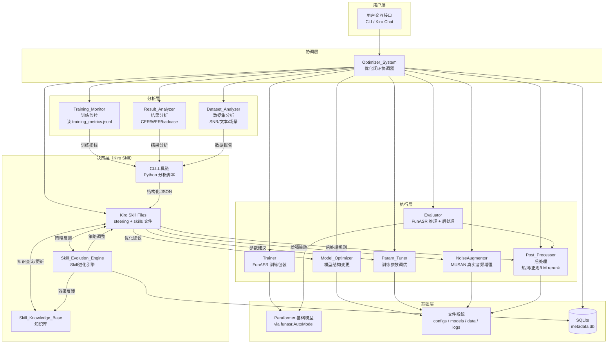
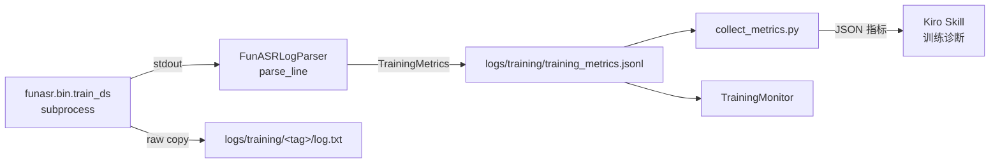
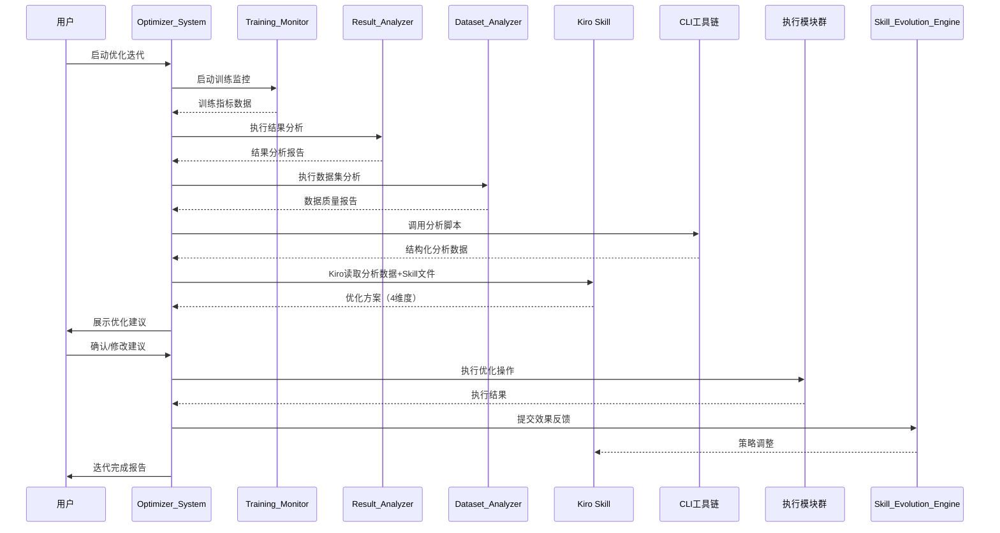
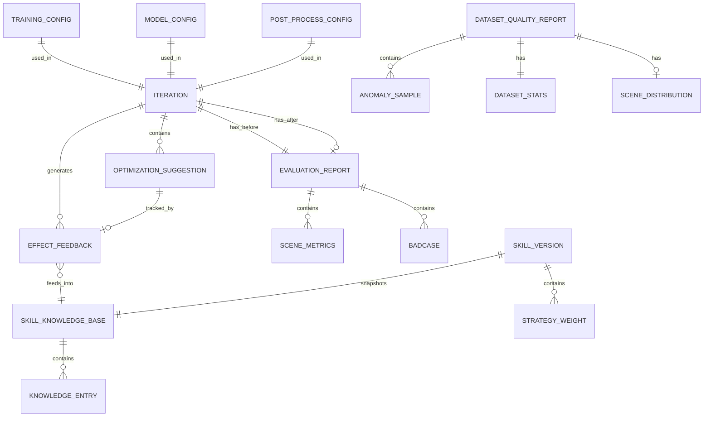

# 技术设计文档：ASR训练优化系统

## 概览（Overview）

本系统是一个基于 Kiro Skill 驱动的 ASR 模型训练优化闭环系统，目标是提升FunASR框架下 `speech_seaco_paraformer_large_asr_nat-zh-cn-16k-common-vocab8404-pytorch` 模型在背景人声场景下的语音识别率。

系统采用"Python 脚本 + Kiro Skill"双层架构：Python 脚本负责数据采集、指标计算、统计分析等确定性操作，Kiro 大模型通过 Skill 文件（steering + skills）中编码的 ASR 领域知识进行智能决策，形成"监控→分析→决策→执行→反馈"的智能优化闭环。Skill Evolution Engine 通过更新 Skill 文件内容来实现策略进化，使优化策略随使用持续改进。

### 关键设计决策

1. **非自回归架构适配**：Paraformer采用非自回归（NAR）端到端架构，支持并行推理。系统设计需充分利用其SeACo（Semantic-Aware Co-decoder）模块的热词定制能力。
2. **Kiro Skill作为决策中枢**：通过 Kiro 的 Skill 能力（steering 文件 + skills 文件）将 ASR 领域知识编码为结构化的分析规则和 prompt 模板，Kiro 大模型本身作为推理引擎，读取分析脚本的输出并生成优化建议。无需外部 LLM API 调用。
3. **双层架构：Python 脚本 + Kiro Skill**：Python 脚本负责数据采集、指标计算、统计分析等确定性操作；Kiro Skill 负责模式识别、原因诊断、策略推荐等智能决策。Kiro 通过 shell 命令调用 Python 脚本获取结构化数据，再基于 Skill 文件中的领域知识进行推理。
4. **配置驱动的优化执行**：所有优化操作通过配置变更实现，确保可追溯、可回滚。
5. **Skill自我进化**：通过更新 Skill 文件中的 prompt 模板、分析规则和知识库内容来实现策略进化，版本化管理 Skill 文件变更。

### 技术栈

- **语言**：Python 3.10+
- **ASR框架**：FunASR 1.3+（基于 PyTorch 2.11+cu130）
- **基础模型**：speech_seaco_paraformer_large_asr_nat-zh-cn-16k-common-vocab8404-pytorch
- **AI集成**：Kiro Skill（`.kiro/steering/*.md` steering 文件 + `.kiro/skills/*.md` skills 文件）
- **CLI工具链**：Python 脚本（数据预处理、指标采集、训练、推理、增强、配置变更）
- **音频处理**：soundfile、scipy.signal（真实音频数据增强，非模拟）、librosa（可选的重采样）
- **数据处理**：NumPy、SciPy
- **可视化**：Matplotlib、Plotly
- **持久化**：SQLite（元数据）+ 文件系统（模型/音频/配置）
- **统一配置**：`workspace/configs/funasr_config.yaml` 为唯一主配置，包含 6 个顶级段落（model / data / augmentation / training / evaluation / post_process）
- **测试**：pytest + Hypothesis（属性测试）
- **虚拟环境**：`workspace/.venv`（所有 Python 脚本和测试均在此环境下执行）

## 架构（Architecture）

### 系统架构图



### 训练日志流（实时解析）



关键变化：训练日志不再依赖独立的转换步骤。`Trainer` 在 `subprocess.Popen` 读取 FunASR 的 stdout 时，每行同时写入原始 log.txt 并经 `FunASRLogParser.parse_line()` 解析为 `TrainingMetrics`，直接追加到统一的 `training_metrics.jsonl`。下游 `TrainingMonitor` / `collect_metrics.py` 不再需要读取 FunASR 原生日志。

### 优化闭环流程



### 分层架构说明

| 层级 | 职责 | 模块 |
|------|------|------|
| 用户层 | 提供 CLI 和 Kiro Chat 交互 | UI |
| 协调层 | 管理优化迭代生命周期、协调各模块 | Optimizer_System |
| 分析层 | 采集和分析训练过程、结果、数据 | Training_Monitor / Result_Analyzer / Dataset_Analyzer |
| 决策层 | 基于 Kiro Skill 智能分析和生成建议，CLI 工具链提供结构化数据 | Kiro Skill Files / CLI 工具链 / Skill_Evolution_Engine / Skill_Knowledge_Base |
| 执行层 | 执行具体的优化操作与训练/推理 | Model_Optimizer / Param_Tuner / NoiseAugmentor / Post_Processor / Trainer / Evaluator |
| 基础层 | 提供模型、数据和元数据存储 | Paraformer（via AutoModel）/ 文件系统 / SQLite |


## 组件与接口（Components and Interfaces）

### 1. Training_Monitor（训练监控模块）

**职责**：实时采集训练过程指标，检测异常，生成告警。

```python
from dataclasses import dataclass, field
from typing import Optional
from enum import Enum

class AlertType(Enum):
    STAGNATION = "stagnation"       # 训练停滞
    NAN_INF = "nan_inf"             # 数值异常
    GRADIENT_EXPLOSION = "gradient_explosion"  # 梯度爆炸

@dataclass
class TrainingMetrics:
    step: int
    epoch: int
    train_loss: float
    val_loss: Optional[float]
    learning_rate: float
    gradient_norm: float
    cer: Optional[float] = None
    wer: Optional[float] = None
    timestamp: str = ""

@dataclass
class TrainingAlert:
    alert_type: AlertType
    message: str
    context: dict  # 异常上下文信息
    epoch: int
    step: int

class TrainingMonitor:
    """训练监控模块接口"""

    def collect_metrics(self, step: int, epoch: int, raw_metrics: dict) -> TrainingMetrics:
        """每隔指定步数采集训练指标"""
        ...

    def compute_epoch_metrics(self, epoch: int) -> dict:
        """计算epoch级别的平均CER和WER"""
        ...

    def check_stagnation(self, threshold: float, window: int = 5) -> Optional[TrainingAlert]:
        """检测训练停滞：连续N个epoch loss未下降超过阈值"""
        ...

    def check_numerical_anomaly(self, loss: float) -> Optional[TrainingAlert]:
        """检测NaN/Inf异常"""
        ...

    def get_training_curves(self) -> dict:
        """获取训练曲线数据用于可视化"""
        ...
```

### 2. Result_Analyzer（训练结果分析模块）

**职责**：对训练完成的模型进行全面评估，生成badcase分析。

```python
@dataclass
class SceneMetrics:
    scene_type: str          # "clean" | "background_voice" | "background_noise"
    cer: float
    wer: float
    sample_count: int

class ErrorType(Enum):
    SUBSTITUTION = "substitution"  # 替换错误
    INSERTION = "insertion"        # 插入错误
    DELETION = "deletion"          # 删除错误

@dataclass
class BadCase:
    audio_path: str
    reference_text: str
    hypothesis_text: str
    cer: float
    wer: float
    error_details: list[dict]  # 每个错误的类型和位置
    scene_type: str

@dataclass
class EvaluationReport:
    overall_cer: float
    overall_wer: float
    scene_metrics: list[SceneMetrics]
    badcases: list[BadCase]
    error_type_distribution: dict[str, int]  # ErrorType -> count

class ResultAnalyzer:
    """训练结果分析模块接口"""

    def evaluate_model(self, model_path: str, test_set_path: str) -> EvaluationReport:
        """在测试集上评估模型"""
        ...

    def generate_badcases(self, threshold: float) -> list[BadCase]:
        """生成badcase列表"""
        ...

    def classify_errors(self, badcases: list[BadCase]) -> dict[str, int]:
        """对badcase进行错误类型分类"""
        ...

    def compare_with_baseline(self, baseline_report: EvaluationReport,
                               current_report: EvaluationReport) -> dict:
        """对比当前模型与基线模型"""
        ...
```

### 3. Dataset_Analyzer（数据集分析模块）

**职责**：分析数据集质量、分布和异常样本。

```python
@dataclass
class DatasetStats:
    total_samples: int
    total_duration_hours: float
    avg_duration_seconds: float
    duration_distribution: dict    # 时长分布直方图数据
    snr_distribution: dict         # SNR分布
    low_quality_samples: list[str] # SNR低于阈值的样本路径

@dataclass
class TextStats:
    char_distribution: dict[str, int]
    word_frequency: dict[str, int]
    sentence_length_distribution: dict

@dataclass
class AnomalySample:
    audio_path: str
    anomaly_type: str  # "empty_label" | "duration_mismatch" | "corrupted_audio"
    details: str

@dataclass
class SceneDistribution:
    scene_counts: dict[str, int]
    scene_ratios: dict[str, float]
    underrepresented_scenes: list[str]

class DatasetQualityReport:
    stats: DatasetStats
    text_stats: TextStats
    anomalies: list[AnomalySample]
    scene_distribution: Optional[SceneDistribution]
    issues_by_severity: list[dict]  # 按严重程度排序的问题列表

class DatasetAnalyzer:
    """数据集分析模块接口"""

    def analyze_basic_stats(self, dataset_path: str) -> DatasetStats:
        """统计数据集基本信息"""
        ...

    def analyze_snr(self, dataset_path: str, threshold: float) -> list[str]:
        """分析SNR分布，标记低质量样本"""
        ...

    def analyze_text(self, dataset_path: str) -> TextStats:
        """统计文本标注分布"""
        ...

    def detect_anomalies(self, dataset_path: str) -> list[AnomalySample]:
        """检测异常样本"""
        ...

    def analyze_scene_distribution(self, dataset_path: str) -> SceneDistribution:
        """统计场景分布"""
        ...

    def generate_quality_report(self, dataset_path: str) -> DatasetQualityReport:
        """生成完整数据质量报告"""
        ...
```

### 4. LLM_Skill_Engine（Kiro Skill 智能决策引擎）

**职责**：通过 Kiro Skill 文件和配套 Python 分析脚本实现智能分析与优化建议生成。

#### 4.1 Kiro Skill 文件设计

系统通过 Kiro 的 steering 文件和 skills 文件将 ASR 领域知识编码为结构化的分析规则和 prompt 模板。Kiro 大模型本身作为推理引擎，读取 Python 脚本的输出并基于 Skill 文件中的领域知识进行推理。

**Steering 文件结构**（`.kiro/steering/`）：

```
.kiro/steering/
├── asr-optimization-workflow.md      # 优化闭环工作流引导
├── training-analysis-guide.md        # 训练过程分析指南
├── badcase-analysis-guide.md         # Badcase 分析指南
└── data-quality-guide.md             # 数据质量分析指南
```

**Steering 文件示例**（`asr-optimization-workflow.md`）：

```markdown
---
inclusion: manual
---

# ASR 训练优化工作流

## 触发条件
当用户请求进行 ASR 模型优化分析时，按以下流程执行。

## 工作流步骤

### 1. 采集训练指标
训练指标在训练过程中由 Trainer 实时写入 `logs/training/training_metrics.jsonl`。
运行 `python scripts/collect_metrics.py --log-dir logs/training/` 汇总指标。

### 2. 分析训练结果
运行 `python scripts/run_inference.py --model-dir <model> --evaluate` 产出
CER/WER 报告（推理时自动应用后处理）。
再运行 `python scripts/analyze_results.py --test-set <test_set.jsonl>` 获取
badcase 和场景分析。

### 3. 分析数据集质量
运行 `python scripts/analyze_dataset.py --dataset-path <dataset>` 获取数据质量报告。

### 4. 综合分析与建议生成
基于上述三份报告，结合 SQLite 知识库中的历史经验，从模型结构、训练参数、
数据增强、后处理四个维度生成优化建议。

### 5. 执行优化
用户确认建议后，调用对应的配置变更脚本执行优化操作，变更同时保存版本快照并
同步回 funasr_config.yaml（详见“配置架构”）。

### 6. 重新训练与评估
- `python scripts/run_augmentation.py --strategy <type>` 生成新一轮增强数据
- `python scripts/run_training.py --tag iter_N` 启动训练
- `python scripts/run_inference.py --model-dir <iter_dir> --evaluate` 评估新模型
```

**Skills 文件结构**（`.kiro/skills/`）：

```
.kiro/skills/
├── asr-training-diagnostics.md       # 训练诊断能力（读取 training_metrics.jsonl）
├── asr-training-execution.md         # 训练执行能力（调用 run_training.py）
├── asr-badcase-analysis.md           # Badcase 模式识别能力
├── asr-data-optimization.md          # 数据优化策略能力
├── asr-inference-evaluation.md       # 推理与评估能力（调用 run_inference.py）
├── asr-model-tuning.md               # 模型调优建议能力
└── asr-postprocess-rules.md          # 后处理规则生成能力
```

**Skill 文件示例**（`asr-training-diagnostics.md`）：

```markdown
# ASR 训练诊断

## 能力描述
分析 ASR 模型训练过程中的异常和瓶颈，生成诊断报告和优化建议。

## 分析规则

### 训练停滞诊断
当训练 loss 连续 5 个 epoch 未下降超过阈值时：
1. 检查学习率是否过小（< 1e-6）→ 建议提高学习率或切换调度策略
2. 检查梯度范数是否过小（< 1e-4）→ 可能陷入局部最优，建议增加学习率 warmup
3. 检查验证 loss 是否同步停滞 → 如果验证 loss 仍在下降，可能是过拟合
4. 检查 batch size 是否过大 → 建议减小 batch size 增加梯度噪声

### 背景人声场景专项诊断
当背景人声场景 CER 显著高于纯净语音场景时：
1. 检查训练数据中背景人声样本占比 → 如果 < 20%，建议增加数据增强
2. 检查 SeACo 模块参数 → 建议调整 co-decoder 的注意力权重
3. 检查是否启用语音增强前端 → 建议添加 speech enhancement 模块

## 知识库引用
分析时参考 knowledge/knowledge_base.json 中的历史诊断经验。
```

#### 4.2 CLI 工具链设计

Python 脚本分为"CLI 脚本（直接被用户或 Kiro Skill 调用）"、"库模块（被其他脚本 import）"两类，输出结构化 JSON 数据供 Kiro 读取和推理。

**CLI 入口脚本**（带 `__main__`，可直接运行）：

```
scripts/
├── run_training.py             # 启动 FunASR 训练（强制使用增强数据）
├── run_inference.py            # 推理+评估（自动应用后处理）
├── run_augmentation.py         # 真实音频增强（MUSAN babble/music/noise/reverb/speed/volume）
├── collect_metrics.py          # 采集训练指标（从 training_metrics.jsonl）
├── analyze_results.py          # 模型评估与 badcase 分析
├── analyze_dataset.py          # 数据集质量分析
├── preprocess_metadata.py      # 为增强后 jsonl 追加 duration/snr/energy/zcr
├── extract_hotwords.py         # 从 badcase 挖掘热词候选
├── apply_model_config.py       # 应用模型配置变更 + 写回主配置 + 版本快照
├── apply_training_config.py    # 应用训练参数变更 + 写回主配置 + 版本快照
├── apply_postprocess.py        # 应用后处理规则 + 写回主配置 + 版本快照
├── record_feedback.py          # 记录优化效果反馈
├── manage_iterations.py        # 管理优化迭代
├── manage_knowledge.py         # 管理知识库
└── seed_strategies.py          # 将 DATA_STRATEGIES 注入知识库作为 seed
```

**库模块**（按架构层级组织为子目录，被 CLI 脚本 import）：

```
scripts/
├── core/                       # 基础设施层
│   ├── models.py               # 全部数据类定义
│   ├── database.py             # SQLite 访问封装
│   ├── config_utils.py         # YAML/JSON/JSONL 读写 + 版本快照
│   └── error_handlers.py       # 训练/配置/Skill 异常处理器
├── analysis/                   # 分析层
│   ├── training_monitor.py     # TrainingMonitor：指标采集、停滞/异常检测
│   ├── result_analyzer.py      # ResultAnalyzer：CER/WER/badcase/场景分析
│   ├── dataset_analyzer.py     # DatasetAnalyzer：数据质量/SNR/文本/场景
│   └── funasr_log_analyzer.py  # FunASRLogParser：日志行 → TrainingMetrics
├── execution/                  # 执行层
│   ├── funasr_trainer.py       # Trainer：subprocess 启动 FunASR 训练
│   ├── funasr_evaluator.py     # Evaluator：推理 + 后处理 + 委托 ResultAnalyzer
│   ├── funasr_noise_augment.py # NoiseAugmentor：MUSAN 真实音频增强
│   ├── model_optimizer.py      # ModelOptimizer：模型结构配置变更
│   ├── param_tuner.py          # ParamTuner：训练超参管理
│   └── post_processor.py       # PostProcessor：热词/正则/LM rerank
└── decision/                   # 决策层
    ├── optimizer_system.py     # OptimizerSystem：优化闭环协调器
    ├── llm_skill_engine.py     # LLMSkillEngine：数据准备 + 方案解析
    ├── skill_evolution.py      # SkillEvolutionEngine：Skill 进化引擎
    ├── skill_knowledge_base.py # SkillKnowledgeBase：知识库管理
    └── badcase_strategy_map.py # DATA_STRATEGIES 映射表 + match_strategies
```

import 路径示例：`from scripts.core.models import TrainingMetrics`、`from scripts.execution.funasr_trainer import Trainer`。

#### 4.4 Badcase → 数据手段映射（badcase_strategy_map.py）

`badcase_strategy_map.py` 是"闭环优化"的核心关联表：将 evaluation 阶段发现的 badcase 错误模式，映射到 data / post_process / train_config 阶段的具体优化手段。

**设计特点**：

- 每条策略为一个 `Strategy` 字典，包含 `name / dimension / category / trigger / commands / config_changes / priority / confidence / rationale`
- `trigger` 是以 `rep`（EvaluationReport）和 `badcases` 为上下文的 Python 表达式字符串
- `commands` 是推荐执行的 CLI 命令列表（可含占位符如 `{eval_report}`）
- 新增/修改映射无需改动 Kiro 代码或 Skill 文件，只需在列表中追加新 Strategy 字典

**当前已注册策略**（随项目演进而扩充）：

| 策略名 | 维度 | 触发 | 推荐命令 |
|-------|------|------|---------|
| `babble_augment_for_insertion` | data | 插入错误 > 替换错误 | `run_augmentation.py --all --strategy babble/noise` |
| `hotwords_from_substitution` | post_process | 替换错误为主 | `extract_hotwords.py --eval-report ... --merge` |
| `specaug_for_substitution` | train_config | CER>0.10 且有替换错误 | 启用 `training.spec_aug.enabled` |
| `reverb_speed_for_deletion` | data | 删除错误为主 | `run_augmentation.py --all --strategy reverb/speed` |
| `full_augment_for_high_cer` | data | CER > 0.20 | `run_augmentation.py --all` |
| `balance_scene_augment` | data | 某场景样本数 < 20 | `preprocess_metadata.py` → `run_augmentation.py` |
| `volume_augment_for_sensitivity` | data | 人工判断 | `run_augmentation.py --all --strategy volume` |

**对外 API**：

```python
def match_strategies(evaluation_report, badcases=None) -> list[dict]:
    """给定 EvaluationReport，返回所有触发的策略（按 priority 降序）。"""

def seed_knowledge_base(kb: SkillKnowledgeBase) -> int:
    """首次初始化时将 DATA_STRATEGIES 批量写入知识库，随反馈积累自动调整置信度。"""
```

该映射同时被 `LLMSkillEngine.prepare_badcase_analysis_data()` 引用，作为 Kiro 推理时的结构化 seed。

#### 4.3 数据模型（保持不变）

```python
@dataclass
class OptimizationSuggestion:
    dimension: str           # "model" | "param" | "data" | "post_process"
    title: str
    description: str
    priority: int            # 1-5, 5为最高
    confidence: float        # 0.0-1.0
    config_changes: dict     # 可执行的配置变更
    rationale: str           # 建议理由

@dataclass
class OptimizationPlan:
    iteration_id: str
    suggestions: list[OptimizationSuggestion]
    diagnosis_summary: str
    created_at: str

@dataclass
class OptimizationLog:
    iteration_id: str
    suggestion: OptimizationSuggestion
    executed: bool
    result_cer_before: float
    result_cer_after: Optional[float]
    result_wer_before: float
    result_wer_after: Optional[float]

class LLMSkillEngine:
    """
    LLM Skill 引擎接口
    
    注意：此类封装了 Kiro Skill 的调用逻辑。实际运行时，Kiro 通过读取
    Skill 文件中的分析规则和 prompt 模板，结合 Python 脚本输出的结构化数据
    进行推理。此接口主要用于 Python 脚本侧的数据准备和结果解析。
    """

    def prepare_training_analysis_data(self, metrics_history: list[TrainingMetrics],
                                        alert: TrainingAlert) -> dict:
        """准备训练停滞分析所需的结构化数据，输出JSON供Kiro读取"""
        ...

    def prepare_badcase_analysis_data(self, badcases: list[BadCase],
                                       error_distribution: dict) -> dict:
        """准备badcase分析所需的结构化数据，输出JSON供Kiro读取"""
        ...

    def prepare_data_quality_analysis(self, report: DatasetQualityReport) -> dict:
        """准备数据质量分析所需的结构化数据，输出JSON供Kiro读取"""
        ...

    def prepare_comprehensive_analysis(self,
                                        training_data: dict,
                                        result_data: EvaluationReport,
                                        dataset_data: DatasetQualityReport) -> dict:
        """准备综合分析所需的结构化数据，输出JSON供Kiro读取"""
        ...

    def parse_optimization_plan(self, kiro_output: str) -> OptimizationPlan:
        """解析Kiro生成的优化方案文本为结构化OptimizationPlan"""
        ...

    def generate_executable_config(self, suggestion: OptimizationSuggestion) -> dict:
        """将建议转化为可执行配置"""
        ...
```

### 5. Model_Optimizer（模型结构优化模块）

**职责**：根据Kiro Skill建议调整模型结构参数。

```python
@dataclass
class ModelConfig:
    attention_heads: int
    hidden_dim: int
    seaco_params: dict          # SeACo模块参数
    speech_enhance_config: Optional[dict]  # 语音增强前端配置
    extra_params: dict

class ModelOptimizer:
    """模型结构优化模块接口"""

    def apply_attention_config(self, config: dict) -> ModelConfig:
        """调整注意力机制参数"""
        ...

    def add_speech_enhance_module(self, module_config: dict) -> ModelConfig:
        """添加语音增强前端模块"""
        ...

    def adjust_seaco_params(self, seaco_config: dict) -> ModelConfig:
        """调整SeACo模块参数"""
        ...

    def validate_config(self, config: ModelConfig) -> tuple[bool, str]:
        """验证配置合法性"""
        ...

    def rollback(self) -> ModelConfig:
        """回滚到上一个有效配置"""
        ...
```

### 6. Param_Tuner（训练参数调优模块）

**职责**：管理训练超参数配置和调优。

```python
class LRScheduleType(Enum):
    WARMUP_DECAY = "warmup_decay"
    COSINE_ANNEALING = "cosine_annealing"
    STEP_DECAY = "step_decay"

@dataclass
class TrainingConfig:
    learning_rate: float
    batch_size: int
    warmup_steps: int
    weight_decay: float
    lr_schedule: LRScheduleType
    max_epochs: int
    gradient_clip: float
    extra_params: dict

@dataclass
class ParamHistory:
    config: TrainingConfig
    evaluation_result: Optional[EvaluationReport]
    timestamp: str
    iteration_id: str

class ParamTuner:
    """训练参数调优模块接口"""

    def generate_config(self, suggestions: list[OptimizationSuggestion]) -> TrainingConfig:
        """根据优化建议生成新配置"""
        ...

    def apply_config(self, config: TrainingConfig) -> bool:
        """应用配置到训练流程"""
        ...

    def check_early_anomaly(self, metrics: list[TrainingMetrics],
                             step_threshold: int = 100) -> bool:
        """检测前N步是否出现loss异常"""
        ...

    def rollback(self) -> TrainingConfig:
        """回滚到上一组有效参数"""
        ...

    def get_param_history(self) -> list[ParamHistory]:
        """获取参数历史"""
        ...
```

### 7. NoiseAugmentor（真实音频增强模块）

**职责**：基于 MUSAN 噪声数据集对训练/验证/测试音频进行真实音频增强（非 numpy 模拟），生成新的 wav 文件和对应的 jsonl。所有训练和推理必须使用增强后的数据（`augmentation.require_augmentation: true` 业务规则强制）。

**实现位置**：`scripts/funasr_noise_augment.py`（类 `NoiseAugmentor`）+ `scripts/run_augmentation.py`（CLI 入口）。

**支持的增强策略**：

| 策略名 | 方法 | 依赖 | 说明 |
|-------|------|------|------|
| `babble` | `_add_babble` | MUSAN `speech/` | 混入 1-3 个背景人声（本项目核心场景）|
| `music` | `_add_background` (category=music) | MUSAN `music/` | 混入背景音乐 |
| `noise` | `_add_background` (category=noise) | MUSAN `noise/` | 混入环境噪声 |
| `reverb` | `_add_reverb` | scipy.signal.fftconvolve | RT60 参数化混响 |
| `speed` | `_apply_speed` | scipy.signal.resample_poly | 语速扰动 0.9×~1.1× |
| `volume` | `_apply_volume` | 幅度缩放 | dB 增益扰动 |

SNR 混合统一由 `_mix_at_snr` 完成，保证可复现的信噪比控制。

```python
@dataclass
class AugmentationStrategy:
    type: str                 # babble | music | noise | reverb | speed | volume
    probability: float        # 应用概率
    snr_range: Optional[tuple[float, float]]   # babble/music/noise 使用
    num_speakers: Optional[tuple[int, int]]    # babble 使用
    rt60_range: Optional[tuple[float, float]]  # reverb 使用
    speed_range: Optional[tuple[float, float]] # speed 使用
    volume_range_db: Optional[tuple[float, float]]  # volume 使用

class NoiseAugmentor:
    """真实音频增强器（非模拟）。"""

    def __init__(self, config: dict, base_dir: str = ".") -> None:
        """从 config['augmentation'] 读取 noise_dir / augmented_dir / strategies。"""
        ...

    def prepare_noise_data(self) -> None:
        """必要时下载 MUSAN，加载 speech/music/noise 文件索引。"""
        ...

    def augment_dataset(
        self,
        jsonl_path: str,
        output_jsonl: str,
        strategies: Optional[list[dict]] = None,
    ) -> dict:
        """批量增强整个 jsonl 数据集。
        
        对每条样本按 strategies 列表中的 probability 抽样应用，生成
        新 wav 文件到 augmented_dir/，并在 output_jsonl 中写入
        原条目 + 增强条目（文件名带 `_aug_<type>` 后缀）。
        返回 {original_count, augmented_count, output_path}。
        """
        ...

    # 私有增强方法
    def _add_babble(self, speech, sr, strategy) -> np.ndarray: ...
    def _add_background(self, speech, sr, category, strategy) -> np.ndarray: ...
    def _add_reverb(self, speech, sr, strategy) -> np.ndarray: ...
    def _apply_speed(self, speech, sr, strategy) -> np.ndarray: ...
    def _apply_volume(self, speech, sr, strategy) -> np.ndarray: ...
    @staticmethod
    def _mix_at_snr(speech, noise, snr_db) -> np.ndarray: ...
```

**CLI 接口**（`run_augmentation.py`）：

```
# 只处理训练集的 babble 策略
python scripts/run_augmentation.py --strategy babble

# 应用配置中所有策略到 train/val/test 三套
python scripts/run_augmentation.py --all
```

产物目录：

```
data/augmented/
├── train_aug.jsonl           # 原 train.jsonl + 增强条目
├── val_aug.jsonl
├── test_aug.jsonl
└── <utt_id>_aug_<type>.wav   # 增强后的音频文件
```

**与闭环的连接**：当 `Result_Analyzer` 输出的 badcase 模式触发 `badcase_strategy_map.DATA_STRATEGIES` 中 `dimension == "data"` 的策略时，Kiro 会推荐执行 `run_augmentation.py --strategy <type>` 重新生成增强数据，随后 `run_training.py` 使用新数据重训。

> 备注：`data_pipeline.py`（旧版模拟增强 + 采样策略）已废弃，不再作为 CLI 入口；相关采样权重 / SNR 过滤的数据结构（`SamplingStrategy`、`AugmentationReport`）仍保留在 `models.py` 中，供历史测试与 `DatasetAnalyzer` 引用。

### 11. Trainer（FunASR 训练包装模块）

**职责**：用 `subprocess` 启动 `funasr.bin.train_ds`，实时解析 FunASR stdout 并写入统一日志。

**实现位置**：`scripts/funasr_trainer.py`（类 `Trainer`）+ `scripts/run_training.py`（CLI 入口）。

```python
class Trainer:
    """FunASR Paraformer 训练包装。

    关键行为：subprocess.Popen 逐行读取 funasr.bin.train_ds 的 stdout，
    每一行同时：
    1. 写入 logs/training/<tag>/log.txt（保留 FunASR 原始日志供参考）
    2. 经 FunASRLogParser.parse_line() 解析为 TrainingMetrics
    3. 追加到 logs/training/training_metrics.jsonl（下游工具唯一数据源）
    """

    def __init__(self, config: dict, base_dir: str = ".") -> None: ...

    def train(
        self,
        train_jsonl: str,
        val_jsonl: str,
        override_params: Optional[dict] = None,
        tag: str = "",
    ) -> dict:
        """启动训练，返回 {tag, model_dir, log_file, exit_code}。"""
        ...
```

**CLI 路径校验**（需求 7.7-7.9）：`run_training.py` 在启动前必须验证 `train_jsonl` 与 `val_jsonl` 位于 `data.augmented_dir` 下、且文件名带 `_aug` 后缀；否则直接拒绝。

### 12. Evaluator（FunASR 推理 + 后处理模块）

**职责**：基于 `funasr.AutoModel` 对测试集做推理，推理结果先经过 `PostProcessor` 再进行评估；CER/WER/场景指标全部委托 `ResultAnalyzer`，不在此重复实现。

**实现位置**：`scripts/funasr_evaluator.py`（类 `Evaluator`）+ `scripts/run_inference.py`（CLI 入口）。

```python
class Evaluator:
    """FunASR 模型评估器。

    - _build_post_processor(config) 在构造时从 config['post_process'] 构造
      PostProcessor（包含热词、正则、LM rerank）。
    - _run_inference() 对每条样本：raw = model.generate(...), hyp = post.process(raw).
      最终 jsonl 同时保留 hypothesis_raw 和 hypothesis 便于对比。
    - 全部 CER/WER 统计调用 ResultAnalyzer 的 compute_metrics / by_scene 实现。
    """

    def __init__(self, config: dict, base_dir: str = ".") -> None: ...

    def _build_post_processor(self, config: dict) -> Optional[PostProcessor]: ...

    def evaluate(
        self,
        model_dir: str,
        test_jsonl: str,
        tag: str = "",
    ) -> dict:
        """返回 {overall_cer, overall_wer, scene_metrics, badcases, report_path}。"""
        ...
```

**CLI 路径校验**：`run_inference.py` 同样强制要求 `test_jsonl` 是增强后数据（`data.augmented_test_jsonl`）。

### 8. Post_Processor（后处理模块）

**职责**：对ASR识别结果进行后处理纠错。

```python
@dataclass
class HotwordEntry:
    wrong_text: str
    correct_text: str
    priority: int = 0

@dataclass
class RegexRule:
    pattern: str
    replacement: str
    description: str
    priority: int = 0

@dataclass
class PostProcessConfig:
    hotword_entries: list[HotwordEntry]
    regex_rules: list[RegexRule]
    enable_lm_rerank: bool
    lm_model_path: Optional[str]
    pipeline_order: list[str]  # 默认: ["hotword", "regex", "lm_rerank"]

@dataclass
class PostProcessResult:
    original_text: str
    processed_text: str
    applied_rules: list[str]
    cer_before: float
    cer_after: float

class PostProcessor:
    """后处理模块接口"""

    def load_hotwords(self, hotword_path: str) -> list[HotwordEntry]:
        """加载热词表"""
        ...

    def apply_hotword_correction(self, text: str) -> str:
        """应用热词纠正"""
        ...

    def apply_regex_rules(self, text: str) -> str:
        """应用正则替换规则"""
        ...

    def apply_lm_rerank(self, nbest: list[tuple[str, float]]) -> str:
        """语言模型N-best重排序"""
        ...

    def process(self, text: str, nbest: Optional[list] = None) -> PostProcessResult:
        """执行完整后处理流水线"""
        ...

    def evaluate_effect(self, results: list[PostProcessResult]) -> dict:
        """计算后处理前后CER/WER变化"""
        ...
```

### 9. Optimizer_System（优化闭环协调器）

**职责**：管理优化迭代生命周期，协调各模块。

```python
@dataclass
class IterationRecord:
    iteration_id: str
    optimization_content: str
    param_changes: dict
    data_changes: dict
    model_changes: dict
    evaluation_before: EvaluationReport
    evaluation_after: Optional[EvaluationReport]
    cer_delta: Optional[float]
    wer_delta: Optional[float]
    timestamp: str
    status: str  # "pending" | "running" | "completed" | "failed"

class OptimizerSystem:
    """优化闭环协调器接口"""

    def start_iteration(self, description: str) -> str:
        """启动新的优化迭代，返回iteration_id"""
        ...

    def run_analysis_phase(self, iteration_id: str) -> dict:
        """执行分析阶段：训练监控 + 结果分析 + 数据集分析"""
        ...

    def run_optimization_phase(self, iteration_id: str,
                                plan: OptimizationPlan) -> dict:
        """执行优化阶段"""
        ...

    def compare_iterations(self, iter_id_a: str, iter_id_b: str) -> dict:
        """对比两次迭代"""
        ...

    def rollback_to_iteration(self, iteration_id: str) -> bool:
        """回滚到指定迭代"""
        ...

    def get_iteration_history(self) -> list[IterationRecord]:
        """获取迭代历史"""
        ...

    def check_optimization_plateau(self, window: int = 3) -> bool:
        """检测连续N次迭代无改善"""
        ...

    # ── 自动Skill审查（需求11新增） ──

    def _auto_review_skills(self, iteration_id: str) -> dict:
        """迭代完成时自动触发轻量级Skill审查：
        1. 更新本次建议的反馈标记
        2. 检查是否有规则需要更新阈值/置信度
        3. 执行知识条目生命周期转换
        4. 更新Skill文件速查表"""
        ...

    def _deep_review_skills(self) -> dict:
        """每5次迭代触发深度审查：
        1. 合并相似知识条目
        2. 淘汰长期无效规则
        3. 重新计算所有策略权重
        4. 更新所有Skill文件的速查表和规则参数"""
        ...
```

### 10. Skill_Evolution_Engine（Skill自我进化引擎）

**职责**：管理Skill的自我学习和持续改进。通过更新 `.kiro/skills/` 目录下的 Skill 文件内容（分析规则、prompt 模板、知识库引用）来实现策略进化。

```python
@dataclass
class EffectFeedback:
    iteration_id: str
    suggestion_id: str
    suggestion_content: str
    input_analysis: dict
    param_changes: dict
    cer_before: float
    cer_after: float
    wer_before: float
    wer_after: float
    is_positive: bool          # CER/WER是否改善
    timestamp: str

@dataclass
class KnowledgeEntry:
    knowledge_type: str        # "scene_solution" | "param_effect" | "data_strategy"
    content: dict
    confidence: float          # 0.0-1.0
    source_iteration_id: str
    created_at: str
    updated_at: str

@dataclass
class StrategyWeight:
    strategy_name: str
    weight: float              # 推荐权重
    success_rate: float
    sample_count: int

@dataclass
class SkillVersion:
    version_id: str
    strategy_rules: dict
    knowledge_base_snapshot: dict
    change_description: str
    positive_feedback_rate: float
    avg_cer_improvement: float
    created_at: str

class SkillEvolutionEngine:
    """
    Skill自我进化引擎接口
    
    进化机制：通过分析历史效果反馈，自动更新 .kiro/skills/ 目录下的
    Skill 文件内容，包括调整分析规则的权重、更新 prompt 模板中的
    策略推荐优先级、以及丰富知识库中的经验条目。
    """

    def record_feedback(self, feedback: EffectFeedback) -> None:
        """记录优化效果反馈"""
        ...

    def label_feedback(self, iteration_id: str,
                        cer_before: float, cer_after: float) -> EffectFeedback:
        """标记反馈为正面/负面"""
        ...

    def analyze_patterns(self, min_feedback_count: int) -> dict:
        """分析历史反馈模式"""
        ...

    def update_strategy_weights(self, pattern_analysis: dict) -> list[StrategyWeight]:
        """更新策略推荐权重"""
        ...

    def update_skill_files(self, strategy_weights: list[StrategyWeight]) -> dict:
        """
        根据策略权重更新 Skill 文件内容：
        1. 更新 .kiro/skills/ 下各 Skill 文件中的分析规则优先级
        2. 更新 prompt 模板中的策略推荐顺序
        3. 将新发现的知识条目写入知识库
        返回变更摘要
        """
        ...

    def create_version_snapshot(self, change_description: str) -> SkillVersion:
        """创建Skill版本快照（包含当前所有 Skill 文件内容的副本）"""
        ...

    def compare_versions(self, version_a: str, version_b: str) -> dict:
        """对比Skill版本"""
        ...

    def rollback_version(self, version_id: str) -> bool:
        """回滚到指定版本（恢复对应版本的 Skill 文件内容）"""
        ...

    def trigger_learning(self, time_range: tuple[str, str]) -> dict:
        """手动触发Skill学习"""
        ...

    # ── Skill内容自动进化（需求11新增） ──

    def update_skill_rules_from_patterns(self, patterns: dict, weights: list[StrategyWeight]) -> dict:
        """基于模式分析结果自动更新Skill文件中的规则参数（阈值、置信度）。
        对验证次数>=3且成功率与标注偏差>0.1的规则执行更新。
        返回变更摘要。"""
        ...

    def generate_skill_summary_table(self, skill_name: str) -> str:
        """为指定Skill生成经验速查表（markdown表格），包含该领域内
        验证次数最多、成功率最高的策略摘要（不超过10条）。"""
        ...

    def update_skill_quick_reference(self, skill_name: str) -> dict:
        """将速查表写入对应Skill文件顶部。返回操作结果。"""
        ...

    def deprecate_failed_rules(self, min_failures: int = 3) -> list[str]:
        """标记连续验证失败的规则为deprecated。返回被标记的规则列表。"""
        ...

    def append_discovered_rules(self, min_confidence: float = 0.8, min_verified: int = 3) -> list[str]:
        """将高置信度新模式追加到对应Skill文件。返回追加的规则列表。"""
        ...

class SkillKnowledgeBase:
    """Skill知识库接口"""

    def add_knowledge(self, entry: KnowledgeEntry) -> str:
        """添加知识条目（宽松模式，允许手动写入）"""
        ...

    def add_knowledge_verified(self, entry: KnowledgeEntry) -> str:
        """添加知识条目（严格模式，需满足行动验证原则）：
        - 必须来源于完整迭代闭环（iteration_id非空）
        - 关联的effect_feedback中is_positive=True
        - 同类知识在至少2次不同迭代中验证过"""
        ...

    def query_knowledge(self, knowledge_type: str,
                         filters: dict = None,
                         include_stale: bool = False,
                         include_archived: bool = False) -> list[KnowledgeEntry]:
        """查询知识条目。默认只返回active状态条目。"""
        ...

    def compute_confidence(self, entry_id: str) -> float:
        """基于实际反馈数据自动计算知识条目置信度。
        公式：confidence = (success_count / total_count) * 0.95^(days/30)"""
        ...

    def apply_lifecycle_transitions(self) -> dict:
        """执行知识条目生命周期状态转换。返回转换计数。"""
        ...

    def get_structured_view(self) -> dict:
        """获取结构化知识视图"""
        ...

    def update_confidence(self, entry_id: str, new_confidence: float) -> None:
        """更新知识条目置信度"""
        ...
```

## 数据模型（Data Models）

### 核心数据实体关系



### 持久化策略

| 数据类型 | 存储方式 | 说明 |
|---------|---------|------|
| 迭代记录（IterationRecord） | SQLite | 结构化元数据，支持查询和对比 |
| 评估报告（EvaluationReport） | SQLite + JSON文件 | 摘要存SQLite，详细badcase存JSON |
| 训练指标（TrainingMetrics） | JSON Lines文件 | 按epoch组织，支持流式写入 |
| 模型配置（ModelConfig） | YAML文件 | 版本化存储，每次变更创建新文件 |
| 训练配置（TrainingConfig） | YAML文件 | 版本化存储 |
| 后处理配置（PostProcessConfig） | YAML + 热词表文件 | 配置和热词分离存储 |
| 数据增强报告（AugmentationReport） | JSON文件 | 每次增强操作生成独立报告 |
| 效果反馈（EffectFeedback） | SQLite | 支持模式分析查询 |
| 知识条目（KnowledgeEntry） | SQLite + JSON | 结构化索引 + 详细内容 |
| Skill版本（SkillVersion） | SQLite + JSON快照 + Skill文件副本 | 版本元数据 + 完整策略快照 + Skill文件内容 |

### 目录结构

```
workspace/
├── .kiro/
│   ├── steering/                     # Kiro Steering 文件
│   │   ├── asr-optimization-workflow.md
│   │   ├── training-analysis-guide.md
│   │   ├── badcase-analysis-guide.md
│   │   └── data-quality-guide.md
│   └── skills/                       # Kiro Skill 文件
│       ├── asr-training-diagnostics.md
│       ├── asr-training-execution.md     # 训练执行
│       ├── asr-badcase-analysis.md
│       ├── asr-data-optimization.md
│       ├── asr-inference-evaluation.md   # 推理与评估
│       ├── asr-model-tuning.md
│       └── asr-postprocess-rules.md
├── scripts/                          # CLI 工具链（详见 4.2）
│   ├── run_training.py / run_inference.py / run_augmentation.py
│   ├── collect_metrics.py / analyze_results.py / analyze_dataset.py
│   ├── preprocess_metadata.py / extract_hotwords.py
│   ├── apply_model_config.py / apply_training_config.py / apply_postprocess.py
│   ├── manage_iterations.py / manage_knowledge.py / record_feedback.py
│   ├── seed_strategies.py
│   ├── core/                     # 基础设施（models / database / config_utils / error_handlers）
│   ├── analysis/                 # 分析层（training_monitor / result_analyzer / dataset_analyzer / funasr_log_analyzer）
│   ├── execution/                # 执行层（funasr_trainer / funasr_evaluator / funasr_noise_augment / model_optimizer / param_tuner / post_processor）
│   └── decision/                 # 决策层（optimizer_system / llm_skill_engine / skill_evolution / skill_knowledge_base / badcase_strategy_map）
├── configs/
│   ├── funasr_config.yaml            # ★唯一主配置（model/data/augmentation/training/evaluation/post_process）
│   ├── model/                        # 模型配置版本快照
│   │   └── v00N_model.yaml
│   ├── training/                     # 训练配置版本快照
│   │   └── v00N_train.yaml
│   ├── augmentation/                 # 数据增强配置版本快照
│   │   └── v00N_augment.yaml
│   └── post_process/                 # 后处理配置版本快照 + 热词表
│       ├── v00N_postprocess.yaml
│       └── hotwords.txt
├── data/
│   ├── train.jsonl / val.jsonl / test.jsonl    # 原始 jsonl 索引
│   ├── original/                     # 原始 wav（只读）
│   ├── musan/                        # MUSAN 噪声数据（只读）
│   ├── augmented/                    # 增强产物（训练/推理实际使用）
│   │   ├── train_aug.jsonl
│   │   ├── val_aug.jsonl
│   │   ├── test_aug.jsonl
│   │   └── <utt_id>_aug_<type>.wav          # 增强后的音频文件（自带 scene_type）
├── models/
│   ├── baseline/                     # 基线模型
│   └── iterations/                   # 各迭代模型
│       └── iter_00N/
├── logs/
│   ├── training/                     # 训练日志
│   │   ├── training_metrics.jsonl    # ★统一训练指标（实时写入）
│   │   └── <tag>/log.txt             # FunASR 原始日志
│   └── optimization/                 # 优化日志
├── reports/
│   ├── evaluation/                   # 评估报告（含 badcases.json）
│   └── dataset/                      # 数据集分析报告
├── knowledge/
│   ├── skill_versions/               # Skill 版本快照（含 Skill 文件副本）
│   └── knowledge_base.json           # 知识库（导出镜像，SQLite 为主存储）
└── metadata.db                       # SQLite 元数据库
```

**配置来源原则**：`configs/funasr_config.yaml` 是唯一可修改源。`apply_*.py` 脚本在执行配置变更时：(1) 更新主配置对应段落；(2) 将变更后的段落单独保存为带自增版号的 yaml 到 `configs/{model|training|augmentation|post_process}/`。版本快照只读，仅用于审计和回滚。

### SQLite Schema

```sql
-- 迭代记录表
CREATE TABLE iterations (
    iteration_id TEXT PRIMARY KEY,
    description TEXT,
    status TEXT CHECK(status IN ('pending', 'running', 'completed', 'failed')),
    cer_before REAL,
    cer_after REAL,
    wer_before REAL,
    wer_after REAL,
    param_changes_json TEXT,
    model_changes_json TEXT,
    data_changes_json TEXT,
    created_at TEXT,
    completed_at TEXT
);

-- 效果反馈表
CREATE TABLE effect_feedbacks (
    feedback_id TEXT PRIMARY KEY,
    iteration_id TEXT REFERENCES iterations(iteration_id),
    suggestion_id TEXT,
    suggestion_content TEXT,
    input_analysis_json TEXT,
    param_changes_json TEXT,
    cer_before REAL,
    cer_after REAL,
    wer_before REAL,
    wer_after REAL,
    is_positive INTEGER,
    created_at TEXT
);

-- 知识条目表
CREATE TABLE knowledge_entries (
    entry_id TEXT PRIMARY KEY,
    knowledge_type TEXT CHECK(knowledge_type IN ('scene_solution', 'param_effect', 'data_strategy')),
    content_json TEXT,
    confidence REAL,
    source_iteration_id TEXT,
    created_at TEXT,
    updated_at TEXT,
    state TEXT DEFAULT 'active' CHECK(state IN ('active', 'stale', 'archived')),
    verified_count INTEGER DEFAULT 0,
    last_verified_at TEXT,
    auto_confidence REAL
);

-- Skill版本表
CREATE TABLE skill_versions (
    version_id TEXT PRIMARY KEY,
    strategy_rules_json TEXT,
    knowledge_snapshot_path TEXT,
    change_description TEXT,
    positive_feedback_rate REAL,
    avg_cer_improvement REAL,
    created_at TEXT
);

-- 策略权重表
CREATE TABLE strategy_weights (
    strategy_name TEXT PRIMARY KEY,
    weight REAL,
    success_rate REAL,
    sample_count INTEGER,
    version_id TEXT REFERENCES skill_versions(version_id),
    updated_at TEXT
);

-- 训练参数历史表
CREATE TABLE param_history (
    history_id TEXT PRIMARY KEY,
    iteration_id TEXT REFERENCES iterations(iteration_id),
    config_json TEXT,
    cer_result REAL,
    wer_result REAL,
    created_at TEXT
);
```

## 正确性属性（Correctness Properties）

*正确性属性是一种在系统所有有效执行中都应成立的特征或行为——本质上是对系统应做什么的形式化陈述。属性是人类可读规范与机器可验证正确性保证之间的桥梁。*

### Property 1: Epoch平均指标计算正确性

*For any* 非空的 TrainingMetrics 列表（每个元素包含有效的 CER 和 WER 值），compute_epoch_metrics 返回的平均 CER 应等于列表中所有 CER 值的算术平均值，平均 WER 同理。

**Validates: Requirements 1.2**

### Property 2: 训练停滞检测正确性

*For any* loss 序列和阈值，当且仅当连续 5 个 epoch 的 loss 下降量均小于阈值时，check_stagnation 应返回告警；否则不应返回告警。

**Validates: Requirements 1.4**

### Property 3: 数值异常与早期loss异常检测

*For any* float 值，check_numerical_anomaly 对 NaN 或 Inf 值应返回告警，对有限正常值不应返回告警。对于前 100 步的 loss 序列，check_early_anomaly 应在序列包含 NaN/Inf 或 loss 异常增长时返回 True。

**Validates: Requirements 1.5, 6.5**

### Property 4: 按场景分组CER/WER计算正确性

*For any* 带场景标签的评估结果列表，按场景分组后计算的 CER/WER 应等于该场景下所有样本 CER/WER 的加权平均值（按样本时长或数量加权）。

**Validates: Requirements 2.2**

### Property 5: Badcase过滤完备性

*For any* 评估结果列表和 CER 阈值，generate_badcases 返回的列表应满足：(1) 列表中每个样本的 CER 都大于阈值；(2) 原始列表中所有 CER 大于阈值的样本都出现在返回列表中。

**Validates: Requirements 2.3**

### Property 6: 错误类型分类一致性

*For any* 参考文本和识别文本对，classify_errors 返回的替换错误数 + 插入错误数 + 删除错误数应等于该文本对的编辑距离，且每个错误都被唯一分类为替换、插入或删除之一。

**Validates: Requirements 2.5**

### Property 7: 评估报告对比正确性

*For any* 两个 EvaluationReport（包含相同场景类型），compare_with_baseline 返回的各场景 CER 差值应等于当前报告的场景 CER 减去基线报告的场景 CER，WER 差值同理。

**Validates: Requirements 2.4, 9.2**

### Property 8: SNR阈值过滤双向完备性

*For any* 样本 SNR 值列表和阈值，SNR 过滤操作应满足：(1) 所有被标记为低质量的样本 SNR 确实低于阈值；(2) 所有 SNR 低于阈值的样本都被标记；(3) 过滤后保留的样本 SNR 均不低于阈值。

**Validates: Requirements 3.2, 7.2**

### Property 9: 文本统计守恒性

*For any* 非空文本列表，analyze_text 返回的字符分布中所有字符计数之和应等于所有文本的总字符数，词频分布中所有词频之和应等于所有文本的总词数。

**Validates: Requirements 3.3**

### Property 10: 异常样本检测正确性

*For any* 样本元数据集合（包含标注文本和音频时长），detect_anomalies 应将空标注（空字符串或纯空白）标记为 "empty_label" 异常，将标注字符数与音频时长比值超出合理范围的标记为 "duration_mismatch" 异常。

**Validates: Requirements 3.4**

### Property 11: 场景分布统计与不足识别

*For any* 带场景标签的样本列表和最小样本数阈值，analyze_scene_distribution 返回的各场景样本数之和应等于总样本数，各场景占比之和应等于 1.0（允许浮点误差），且 underrepresented_scenes 中的每个场景的样本数都小于阈值。

**Validates: Requirements 3.5**

### Property 12: 问题严重程度排序

*For any* 数据质量报告中的问题列表，issues_by_severity 应按严重程度降序排列，即对于列表中任意相邻的两个问题，前者的严重程度不低于后者。

**Validates: Requirements 3.6**

### Property 13: 优化方案四维度覆盖

*For any* 由 generate_optimization_plan 生成的 OptimizationPlan，其 suggestions 列表中应至少包含 "model"、"param"、"data"、"post_process" 四个 dimension 中的每一个（当对应维度存在可优化空间时）。

**Validates: Requirements 4.4**

### Property 14: 模型配置合法性验证

*For any* ModelConfig，validate_config 应对注意力头数能整除隐藏层维度、隐藏层维度为正整数、SeACo 参数在有效范围内的配置返回 True，对不满足这些条件的配置返回 False。

**Validates: Requirements 5.4**

### Property 15: 模型配置回滚恢复

*For any* 合法的 ModelConfig 初始状态和一个导致验证失败的变更，执行变更后调用 rollback 应返回与初始状态完全相同的 ModelConfig。

**Validates: Requirements 5.5**

### Property 16: 训练参数配置持久化round-trip

*For any* 有效的 TrainingConfig，将其保存到文件后再读取，得到的 TrainingConfig 应与原始配置在所有字段上完全相等。

**Validates: Requirements 6.4**

### Property 17: 动态采样权重与场景表现反相关

*For any* 包含至少两个场景的 SceneMetrics 列表，update_sampling_strategy 返回的 SamplingStrategy 中，CER 更高的场景应获得不低于 CER 更低场景的采样权重。

**Validates: Requirements 7.4**

### Property 18: 数据增强不修改原始数据

*For any* 数据增强操作，增强前后原始数据目录中所有文件的内容应保持不变（文件数量不变、每个文件的哈希值不变）。

**Validates: Requirements 7.6**

### Property 19: 热词替换正确性

*For any* 热词表和包含热词表中错误词的文本，apply_hotword_correction 应将所有匹配的错误词替换为对应的正确词汇，且不修改文本中不在热词表中的部分。

**Validates: Requirements 8.1**

### Property 20: N-best重排序选择最优

*For any* 非空的 N-best 候选列表（每个候选包含文本和语言模型得分），apply_lm_rerank 应返回得分最高的候选文本。

**Validates: Requirements 8.3**

### Property 21: 后处理流水线执行顺序

*For any* 启用了多个后处理步骤的 PostProcessConfig，process 方法返回的 applied_rules 列表中，热词纠正（如果启用）应出现在正则替换之前，正则替换应出现在语言模型重排序之前。

**Validates: Requirements 8.5**

### Property 22: 后处理CER/WER变化量化

*For any* 参考文本、原始识别文本和后处理文本，evaluate_effect 返回的 CER 变化值应等于后处理后 CER 减去后处理前 CER（负值表示改善）。

**Validates: Requirements 8.6**

### Property 23: 迭代回滚状态恢复

*For any* 迭代历史中的某个迭代 ID，rollback_to_iteration 执行后，当前系统的模型配置、训练配置和后处理配置应与该迭代记录中保存的配置完全一致。

**Validates: Requirements 9.4**

### Property 24: 优化停滞检测

*For any* 迭代历史序列，当且仅当最近 3 次迭代的 CER 均未改善（cer_after >= cer_before）时，check_optimization_plateau 应返回 True。

**Validates: Requirements 9.5**

### Property 25: 效果反馈正负标记正确性

*For any* CER before 和 CER after 值对，label_feedback 应在 cer_after < cer_before 时标记 is_positive 为 True，在 cer_after >= cer_before 时标记为 False。

**Validates: Requirements 10.2**

### Property 26: 反馈驱动的策略权重调整

*For any* 包含足够数量 EffectFeedback 的知识库，analyze_patterns 后调用 update_strategy_weights，成功率高于平均水平的策略应获得不低于成功率低于平均水平的策略的推荐权重。

**Validates: Requirements 10.3, 10.4**

### Property 27: Skill版本快照完整性

*For any* 策略变更操作，create_version_snapshot 创建的 SkillVersion 应包含当前的完整策略规则和知识库状态，且与变更后的实际状态一致。

**Validates: Requirements 10.7**

### Property 28: Skill版本自动回滚

*For any* 连续的 Skill 版本序列，如果新版本的正面反馈率连续低于上一版本，系统应自动回滚到上一版本的策略配置。

**Validates: Requirements 10.9**

## 错误处理（Error Handling）

### 错误分类与处理策略

| 错误类别 | 示例 | 处理策略 | 恢复方式 |
|---------|------|---------|---------|
| 训练异常 | loss出现NaN/Inf、梯度爆炸 | 立即暂停训练，记录上下文 | 回滚到上一有效checkpoint |
| 配置错误 | 模型配置不合法、参数超出范围 | 验证失败时拒绝应用 | 保持当前配置不变 |
| 数据错误 | 音频文件损坏、标注为空 | 标记异常样本，从训练集排除 | 跳过异常样本继续处理 |
| 增强路径缺失 | `run_training.py` / `run_inference.py` 被指向非增强路径 | 直接拒绝启动并提示用户先运行 `run_augmentation.py` | 用户执行增强后重试 |
| Skill解析错误 | Kiro输出格式异常、Skill文件语法错误 | 使用默认模板重试，记录异常 | 回退到上一有效Skill版本 |
| 存储错误 | 磁盘空间不足、文件写入失败 | 记录错误，通知用户 | 清理临时文件，提示扩容 |
| 回滚失败 | 目标版本文件缺失 | 记录错误，列出可用版本 | 提示用户选择其他版本 |

### 关键错误处理流程

#### 训练过程异常处理

```python
class TrainingErrorHandler:
    """训练异常处理器"""

    def handle_nan_inf(self, step: int, epoch: int, context: dict) -> None:
        """
        处理NaN/Inf异常：
        1. 立即暂停训练
        2. 保存当前模型状态（如果可能）
        3. 记录异常上下文（step、epoch、最近N步的loss、学习率、梯度范数）
        4. 生成TrainingAlert通知LLM_Skill_Engine
        """
        ...

    def handle_gradient_explosion(self, gradient_norm: float, threshold: float) -> None:
        """
        处理梯度爆炸：
        1. 应用梯度裁剪
        2. 如果裁剪后仍异常，降低学习率
        3. 记录事件
        """
        ...
```

#### 模型配置变更异常处理

```python
class ConfigErrorHandler:
    """配置变更异常处理器"""

    def handle_invalid_config(self, config: ModelConfig, errors: list[str]) -> ModelConfig:
        """
        处理无效配置：
        1. 记录验证错误详情
        2. 回滚到上一有效配置
        3. 返回回滚后的配置
        """
        ...

    def handle_init_failure(self, config: ModelConfig, error: Exception) -> ModelConfig:
        """
        处理模型初始化失败：
        1. 捕获初始化异常
        2. 记录失败原因（内存不足、参数不兼容等）
        3. 回滚配置
        4. 通知用户
        """
        ...
```

#### Kiro Skill 输出解析异常处理

```python
class SkillOutputHandler:
    """Kiro Skill 输出解析处理器"""

    def parse_optimization_output(self, kiro_output: str) -> dict:
        """
        解析Kiro基于Skill文件生成的优化建议文本：
        1. 尝试从输出中提取结构化JSON块
        2. 如果无法提取JSON，尝试基于关键词和模板匹配解析
        3. 解析失败时，记录原始输出并提示用户手动确认
        """
        ...

    def validate_skill_file(self, skill_path: str) -> tuple[bool, list[str]]:
        """
        验证Skill文件格式和内容：
        1. 检查Markdown格式是否正确
        2. 检查必要的章节是否存在（能力描述、分析规则等）
        3. 检查知识库引用路径是否有效
        返回(是否有效, 错误列表)
        """
        ...

    def handle_skill_evolution_failure(self, version_id: str) -> bool:
        """
        处理Skill进化失败：
        1. 记录失败的变更内容
        2. 回滚到上一版本的Skill文件
        3. 通知用户进化失败原因
        """
        ...
```

### 全局错误处理原则

1. **不丢失数据**：任何错误发生时，已采集的训练指标、已完成的分析结果不应丢失
2. **可恢复性**：所有配置变更操作支持回滚，确保系统可恢复到已知良好状态
3. **透明性**：所有错误和异常处理操作记录到日志，用户可查看完整的错误历史
4. **优雅降级**：Skill文件损坏或解析失败时，系统仍可执行基本的监控和分析功能（Python脚本独立运行），仅智能建议功能受限

## 测试策略（Testing Strategy）

### 测试框架

- **单元测试**：pytest
- **属性测试**：Hypothesis（Python属性测试库）
- **集成测试**：pytest + mock（模拟FunASR模型推理和Kiro Skill输出解析）

### 双重测试方法

本系统采用单元测试与属性测试相结合的策略：

- **单元测试**：验证具体示例、边界条件和错误处理
- **属性测试**：验证跨所有输入的通用属性（基于上述28个正确性属性）

### 属性测试配置

- **测试库**：Hypothesis
- **最小迭代次数**：每个属性测试至少运行 100 次
- **标签格式**：`Feature: asr-training-optimizer, Property {number}: {property_text}`

### 属性测试示例

```python
from hypothesis import given, settings, strategies as st
import hypothesis

@settings(max_examples=100)
@given(
    cer_values=st.lists(st.floats(min_value=0.0, max_value=1.0), min_size=1, max_size=100),
    wer_values=st.lists(st.floats(min_value=0.0, max_value=1.0), min_size=1, max_size=100),
)
def test_epoch_average_metrics(cer_values, wer_values):
    """
    Feature: asr-training-optimizer, Property 1: Epoch平均指标计算正确性
    For any 非空的 TrainingMetrics 列表，compute_epoch_metrics 返回的平均 CER
    应等于列表中所有 CER 值的算术平均值。
    """
    metrics = [TrainingMetrics(step=i, epoch=0, train_loss=0.0, val_loss=None,
                                learning_rate=0.001, gradient_norm=1.0,
                                cer=cer, wer=wer)
               for i, (cer, wer) in enumerate(zip(cer_values, wer_values))]
    monitor = TrainingMonitor()
    result = monitor.compute_epoch_metrics(0)
    expected_cer = sum(cer_values) / len(cer_values)
    expected_wer = sum(wer_values) / len(wer_values)
    assert abs(result['avg_cer'] - expected_cer) < 1e-6
    assert abs(result['avg_wer'] - expected_wer) < 1e-6


@settings(max_examples=100)
@given(
    loss_sequence=st.lists(st.floats(min_value=0.01, max_value=10.0), min_size=6, max_size=20),
    threshold=st.floats(min_value=0.001, max_value=0.5),
)
def test_stagnation_detection(loss_sequence, threshold):
    """
    Feature: asr-training-optimizer, Property 2: 训练停滞检测正确性
    For any loss 序列和阈值，当且仅当连续5个epoch的loss下降量均小于阈值时，
    应返回告警。
    """
    monitor = TrainingMonitor()
    # 填充指标数据
    for i, loss in enumerate(loss_sequence):
        monitor.collect_metrics(step=i, epoch=i, raw_metrics={'train_loss': loss})
    alert = monitor.check_stagnation(threshold=threshold, window=5)
    # 验证：检查最后5个epoch的loss变化
    last_5_deltas = [loss_sequence[i] - loss_sequence[i+1]
                     for i in range(len(loss_sequence)-5, len(loss_sequence)-1)]
    should_alert = all(delta < threshold for delta in last_5_deltas)
    assert (alert is not None) == should_alert


@settings(max_examples=100)
@given(
    snr_values=st.lists(st.floats(min_value=-10.0, max_value=60.0), min_size=1, max_size=50),
    threshold=st.floats(min_value=0.0, max_value=30.0),
)
def test_snr_filter_completeness(snr_values, threshold):
    """
    Feature: asr-training-optimizer, Property 8: SNR阈值过滤双向完备性
    For any 样本SNR值列表和阈值，过滤操作应满足双向完备性。
    """
    # 所有被标记为低质量的样本SNR确实低于阈值
    low_quality = [snr for snr in snr_values if snr < threshold]
    filtered = [snr for snr in snr_values if snr >= threshold]
    assert all(snr < threshold for snr in low_quality)
    assert all(snr >= threshold for snr in filtered)
    assert len(low_quality) + len(filtered) == len(snr_values)
```

### 单元测试覆盖范围

| 模块 | 单元测试重点 | 属性测试重点 |
|------|------------|------------|
| Training_Monitor | 可视化数据格式、告警消息内容 | 指标计算、停滞检测、异常检测 |
| Result_Analyzer | 模型评估流程、报告格式 | 分组计算、badcase过滤、错误分类、对比计算 |
| Dataset_Analyzer | 文件I/O、报告生成 | SNR过滤、文本统计、异常检测、场景分布、排序 |
| LLM_Skill_Engine | 数据准备脚本、Skill输出解析 | 优化方案维度覆盖 |
| Model_Optimizer | 具体配置变更、SeACo参数 | 配置验证、回滚恢复 |
| Param_Tuner | 调度策略切换、配置文件格式 | 配置round-trip、早期异常检测 |
| Data_Pipeline / NoiseAugmentor | 增强操作（babble/music/noise/reverb/speed/volume）、报告生成 | 采样权重、原始数据不变量、SNR mix 守恒 |
| Trainer / Evaluator | subprocess 调起、路径校验、log 解析路由、后处理集成 | 训练日志实时解析完备性、Evaluator 输出 hypothesis_raw + hypothesis 一致性 |
| Post_Processor | 具体热词替换、正则规则 | 热词替换、N-best重排序、流水线顺序、CER变化 |
| Optimizer_System | 迭代生命周期、历史展示 | 迭代对比、回滚恢复、停滞检测 |
| Skill_Evolution_Engine | 版本对比、知识库展示 | 反馈标记、策略权重、版本快照、版本回滚 |

### 集成测试

集成测试使用 mock 替代外部依赖（FunASR模型推理、Kiro Skill 输出），重点验证：

1. **端到端优化闭环**：从分析到建议到执行的完整流程
2. **模块间数据传递**：验证各模块接口的数据格式兼容性
3. **回滚机制**：验证各层级回滚操作的正确性
4. **Skill进化流程**：验证反馈记录→模式分析→Skill文件更新→版本管理的完整链路
5. **CLI工具链**：验证各Python脚本的输入输出格式正确性
