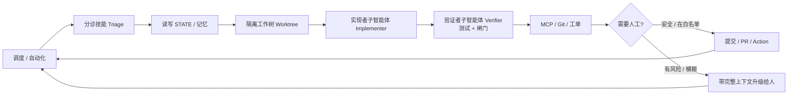
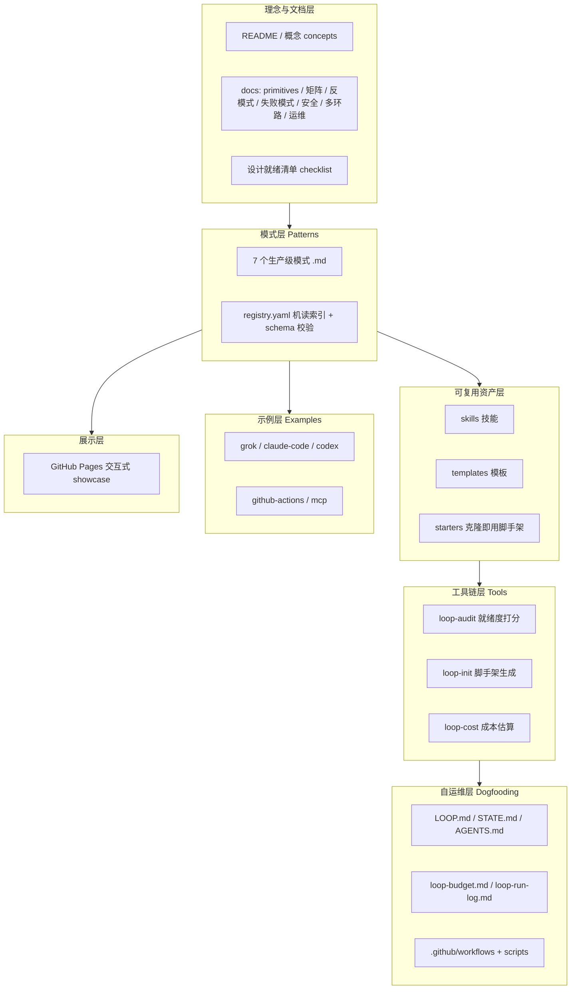

# Loop Engineering 项目分析：设计思路、架构与模块

> 仓库：`loop-engineering`（作者 Cobus Greyling）。本文基于对仓库 README、LOOP.md、AGENTS.md、docs/、patterns/、skills/、tools/、starters/、templates/ 等内容的通读整理而成。

## 一、项目概述

Loop Engineering（环路工程）面向 Grok、Claude Code、Codex、Cursor 等 AI 编码智能体，是一个**“参考知识库 + 可克隆脚手架 + 工具链”**三位一体的开源项目。它的一句话主张是：

> **不要再亲自给智能体写提示词（prompting），而是去设计那套“替你给智能体写提示词”的系统。**

一个**环路（Loop）**被定义为一个**递归目标（recursive goal）**：你定义目的，AI 借助子智能体、验证机制与外部状态持续迭代，直到目标达成、或环路主动把控制权交还给人。

它的定位不是一个可运行的业务应用，而是一套“高信噪比、可直接抄用”的**模式（patterns）+ 技能（skills）+ 脚手架（starters）+ 工具（tools）**集合，并且坚持 **dogfooding（自产自销）**——用环路工程自己的方法来维护这个仓库本身。

核心立意（引用项目中的两段话）：

- Peter Steinberger：“你不该再给编码智能体写提示了，你该设计‘给智能体写提示’的环路。”
- Boris Cherny（Anthropic，Claude Code 负责人）：“我已经不直接提示 Claude 了，我让环路去提示它、去决定做什么；我的工作是写环路。”

即：**杠杆点已经从“打磨单条提示词”转移到“设计随时间编排智能体的控制系统”。**

## 二、设计思路（设计哲学）

### 2.1 六大基础原语（5 Building Blocks + Memory）

项目把“可靠环路”拆解为六个可组合的基础能力，这是整个方法论的地基：

| 原语 | 在环路中的职责 | 常见实现 |
|------|----------------|----------|
| 自动化 / 调度（Scheduling） | 环路的“心跳”，按节奏触发发现与分诊 | Grok `/loop`、Claude Code 定时任务、GitHub Actions cron、`/goal` |
| 工作树（Worktrees） | 隔离的并行执行，避免多智能体改同一文件造成合并地狱 | git worktree、隔离 checkout、`isolation: "worktree"` |
| 技能（Skills） | 持久化的**意图记忆**：项目规约、构建/测试命令、评审标准、历史教训 | `SKILL.md` + 可选脚本/引用 |
| 插件与连接器（Plugins & Connectors / MCP） | 让环路能触达真实工具：改 Jira/Linear、发 Slack、开 PR、查库 | MCP（Model Context Protocol）已成通用底座 |
| 子智能体（Sub-agents） | **maker/checker 分离**：写代码的智能体不能给自己判分 | Explorer→Implementer→Verifier 等角色拆分 |
| + 记忆 / 状态（Memory / State） | 会话之外的**持久脊柱**：在做什么、上次试过什么、在等谁 | `STATE.md`、`LOOP-STATE.json`、Linear 看板、数据库行 |

> 关键判断：**状态文件往往是环路产出的最重要工件**。模型在跨会话时没有长期记忆，环路必须把“当前进展 / 上次结果 / 待人工事项”读写到持久介质中。

### 2.2 渐进式叠加原则（最小可用环路 → 逐步增强）

- 最小可用环路 = **调度 + 一个分诊技能（triage）+ 状态文件**；
- 开始改代码时，再加 **工作树隔离**；
- 进入自主行动时，再加 **子智能体验证（verifier）**；
- 需要驱动工单/PR 时，再加 **连接器（MCP）**。
- 原则：**只有当上一版本证明了价值（与其失败模式）后，才叠加下一个原语。**

### 2.3 maker/checker 分离（对抗式评审）

项目反复强调的最重要结构模式：**实现者永远不能给自己的工作判“完成”**。由另一个子智能体（可用更强模型、且一定用不同指令）做验证——验证器在隔离工作树中跑测试通过后才放行。无人值守环路的“可放心走开”正是来自这个验证环节；`/goal` 用“全新模型”判断停止条件，是同一思想的延伸。

### 2.4 分阶段上线（L1 → L2 → L3）

环路不是一上来就无人值守，而是分级灰度：

| 级别 | 含义 | 典型形态 |
|------|------|----------|
| L0 | 草稿：只写清意图 | 仅有目标文档 |
| L1 | 仅报告：分诊→写状态，不自动动手 | 每日晨检报告 |
| L2 | 辅助：带验证器的小修复 | 补丁级自动修复 + verifier |
| L3 | 无人值守（仍带人工闸门） | 自动跑、自动开 PR，关键处升级给人 |

### 2.5 安全优先与人工闸门（Human Gates）

- **默认不自动合并**，除非有明确 allowlist + 验证器（如仅 trivial 依赖补丁）；
- **denylist**：认证、支付、密钥、基础设施、核心文档等路径禁止自动改；
- **连接器最小权限**：在环路被信任前只给“读 + 评论”；
- **预算与急停**：`loop-budget.md` 设每日 token 上限，`STATE.md`/标签可作 kill switch；
- **只在需要人工时才通知**，避免每次运行都打扰。

### 2.6 核心概念词汇（设计时的心智模型）

- **意图债（Intent Debt）**：智能体每次冷启动会用“自信的猜测”填补缺失意图；用 **技能** 一次写清、每次读取来偿还。
- **理解债（Comprehension Debt）**：环路产出你没写过的代码，越快越多；唯有**去读环路写了什么**来偿还。
- **认知投降（Cognitive Surrender）**：放任环路运行而自己停止思考——同样的动作，用来“免于思考”就是加速器，用来“放大判断”才是解药。
- **编排税（Orchestration Tax）**：并行智能体带来的评审带宽、合并冲突、上下文切换成本；工作树消除机械冲突，但人始终是并行度的天花板。
- **Harness vs Loop**：Harness 是“单个智能体的运行环境”（工具/上下文/权限/规则）；Loop 是“Harness + 调度 + 状态 + 验证链”，即随时间编排多次 Harness 运行。

## 三、项目架构

### 3.1 一个环路的解剖（运行时数据流）



要点：调度触发 → 分诊产出信号并落到状态 → 在隔离工作树里由实现者改动 → 验证者跑测试与闸门 → 通过连接器驱动 Git/工单 → 经人工闸门决定“自动提交”或“升级给人” → 回到调度，形成闭环。

### 3.2 分层架构（仓库即“方法论的可执行载体”）

该仓库本身不是单体应用，而是按“理念 → 模式 → 资产 → 工具 → 示例 → 自运维 → 展示”分层组织：



### 3.3 目录结构总览

```text
loop-engineering/
├── README.md / LOOP.md / AGENTS.md / STATE.md   # 总览、自运维环路说明、规约、实时状态
├── loop-budget.md / loop-run-log.md             # token 预算上限 / 追加式运行日志
├── docs/                  # 方法论文档（原语、概念、矩阵、清单、安全、失败模式…）
│   └── index.html + _config.yml                 # GitHub Pages 交互式展示站（Jekyll）
├── patterns/              # 7 个模式 + registry.yaml(机读索引) + registry.schema.json
├── skills/                # loop-triage / loop-verifier / minimal-fix / loop-budget
├── templates/             # SKILL.md.* / STATE.md.template / budget|run-log 模板 / 模式模板
├── starters/              # 按模式 & 按工具(grok/claude/codex)的克隆即用脚手架
├── tools/                 # loop-audit / loop-init / loop-cost / goal-audit（TS 编写的 npm CLI）
├── examples/              # grok / claude-code / codex / github-actions / mcp 用例
├── scripts/               # validate-registry / check-loop-init-sync / before-after-demo
├── stories/               # 真实成功与“诚实的失败”复盘
├── resources/             # 出处与延伸阅读
└── .github/workflows/     # daily-triage / validate-patterns / audit（自运维 CI）
```

## 四、核心模块详解

### 4.1 模式模块（patterns/）

7 个“生产级模式”，每个模式是一份 `.md`（含调度节奏、所需技能、状态设计、运行周期、验证策略、人工交接点、各工具用法、失败模式与缓解、成本画像、成功指标），并由 `registry.yaml` 提供**机读索引**（被 loop-audit / loop-cost / 文档站共用），用 `registry.schema.json` 做结构校验。

| 模式 | 目标 | 节奏 | 风险 | 首周模式 | token 成本 |
|------|------|------|------|----------|-----------|
| Daily Triage 每日分诊 | 对 CI/issue/提交/聊天做优先级晨检 | 1d–2h | 低 | L1 | 低 |
| PR Babysitter PR 保姆 | 护送 PR 过评审/CI/rebase/合并 | 5–15m | 中 | L1 | 高 |
| CI Sweeper CI 清扫 | 对失败 CI 做最小修复并升级 | 5–15m | 中 | L2 | 极高 |
| Dependency Sweeper 依赖清扫 | 安全地发现/应用/验证依赖与 CVE 更新 | 6h–1d | 中 | L2 | 中 |
| Changelog Drafter 变更日志起草 | 扫合并 PR，起草分类发布说明 | 1d/打 tag | 低 | L1 | 低 |
| Post-Merge Cleanup 合并后清理 | 合并到主干后跟进技术债清理 | 1d–6h | 低 | L1 | 低 |
| Issue Triage 议题分诊 | 发现/去重/打分/打标签，保持队列干净 | 2h–1d | 低 | L1 | 低 |

`registry.yaml` 中每个模式的关键字段：`id / name / goal / cadence / risk / tools / skills / state / phases / human_gates / starter / week_one_mode / token_cost / cost`（其中 `cost` 含 noop/report/action 三档 token 估算、建议每日上限、是否要求提前退出）。

### 4.2 技能模块（skills/）

技能是“意图记忆”的载体，采用带 frontmatter 的 `SKILL.md`（字段如 `name / description / user_invocable`），描述刻意写得“无聊而具体”以利于自动触发。共 4 个：

- **loop-triage**：分诊技能。输入 CI 失败、open issues、近期提交、聊天、当前状态文件；输出固定四段式报告——高优先级（要动手）/ 观察项 / 噪声忽略 / 状态更新。规则强调“极度精简、存疑则降级、绝不在分诊阶段提架构级改造”。
- **loop-verifier**：验证者（checker）技能，承担 maker/checker 中的“判分”角色。
- **minimal-fix**：对显而易见的失败起草**最小**修复。
- **loop-budget**：运行时预算守卫，在每轮开始/结束检查 token 花费。

### 4.3 工具链模块（tools/）—— 用 TypeScript 编写、发布到 npm 的三件套

| 工具 | 作用 | 关键源码 | 命令示例 |
|------|------|----------|----------|
| **loop-audit** | 给项目的“环路就绪度”打分（0–100）并定级 L0–L3，给出补齐建议 | `auditor.ts`(打分引擎) / `reporter.ts`(human/json/md 输出) / `cli.ts` | `npx @cobusgreyling/loop-audit . --suggest` |
| **loop-init** | 脚手架生成：把 starter + 预算/运行日志写入目标项目 | `cli.ts`（含 registry.yaml、scripts 同步校验） | `npx @cobusgreyling/loop-init . --pattern daily-triage --tool grok` |
| **loop-cost** | token 花费估算：按模式/节奏/级别估算每日成本 | `estimator.ts` / `cli.ts`（读 `registry.json` 成本元数据） | `npx @cobusgreyling/loop-cost --pattern ci-sweeper --cadence 15m --level L2` |

补充：`tools/goal-audit` 是配套项目 **Goal Engineering**（`/goal` 跑到达成可验证条件为止）的审计工具。

**loop-audit 的检查信号（v1.4+）**：状态文件、分诊技能、验证者技能、LOOP.md/配置、AGENTS.md/CLAUDE.md、安全文档、`.github` 工作流、MCP/连接器、工作树证据、`patterns/registry.yaml`、`loop-budget.md`、`loop-run-log.md`、LOOP.md 预算段、loop-budget 技能，以及 **loopActivity 动态证据**（状态里的“Last run”时间戳、与环路相关的 git 提交、定时工作流、运行日志）。

- 评分 < 40 时退出码为 `2`，可用作 CI 门禁；
- **L3 不仅要求“文件齐全”，还要求“有真实运行证据”**（不是把文件摆上磁盘就算数）。

### 4.4 脚手架与模板模块（starters/、templates/）

- **starters/**：克隆即用套件。既有“按模式”的（minimal-loop、pr-babysitter、ci-sweeper、dependency-sweeper、changelog-drafter、post-merge-cleanup、issue-triage），也有“按工具”的 minimal-loop 变体（grok / claude / codex）。
- **templates/**：各类种子模板——`SKILL.md.*`（loop-triage / minimal-fix / verifier / loop-budget / issue-triage）、`STATE.md.template`、`loop-budget.md.template`、`loop-run-log.md.template`、`pattern-template.md`（新增模式的模板）。

### 4.5 自运维 / dogfooding 模块（根级工件 + .github/workflows）

仓库用环路工程自己维护自己，关键工件：

- **STATE.md**：仓库根的“实时环路状态”脊柱；
- **LOOP.md**：声明该仓库正在运行哪些环路（每日分诊 L1、PR 保姆 L2、依赖清扫 L2、变更日志起草 L1 等）及其节奏、技能、状态、交接点；
- **AGENTS.md**：给“人与环路”的协作规约（构建/验证命令、评审规范、禁止自动改的路径）；
- **loop-budget.md / loop-run-log.md**：token 上限与急停 / 追加式运行历史；
- **.github/workflows/**：`daily-triage.yml`（每工作日跑分诊并追加运行日志）、`validate-patterns.yml`（校验模式与 registry）、`audit.yml`（在 PR 上贴“环路就绪度分数”）；
- **scripts/**：`validate-registry.mjs`、`check-loop-init-sync.mjs`、`before-after-demo.sh`（演示“空目录 → L1 → L2”分数攀升）。

### 4.6 示例与展示模块（examples/、docs 展示站）

- **examples/**：按工具（grok、claude-code、codex、github-actions）与 **MCP** 连接器给出可对照的用法示例；
- **GitHub Pages 展示站**：`docs/index.html` + `_config.yml`（Jekyll），提供**交互式“模式选择器（pattern picker）”**，把上述模式/原语做成可浏览的 showcase。

## 五、就绪度分级模型（贯穿全项目的主线）

`L0 草稿 → L1 仅报告 → L2 带验证器的辅助修复 → L3 无人值守（带人工闸门）`。

它既是**设计清单**（`docs/loop-design-checklist.md` 用 10 个维度逐项打勾：目的与范围 / 调度 / 技能 / maker-checker / 状态 / 人工交接 / 连接器 / 成本与限额 / 可观测性 / 安全），也是 **loop-audit 的评分目标**，还是 **patterns/registry.yaml 里每个模式的 `week_one_mode`**。三者用同一把尺子串起来，构成项目的一致性主线。

## 六、设计亮点总结

1. **方法论与工具一体化**：不只讲“怎么想”，还把就绪度做成可执行的 `loop-audit` 评分、把成本做成 `loop-cost` 估算、把落地做成 `loop-init` 脚手架——理念可被量化、可被门禁。
2. **机读单一事实源**：`patterns/registry.yaml` 同时驱动文档、审计、成本与展示站，避免多处描述漂移（并有 schema 与 sync 校验）。
3. **安全与渐进内建于流程**：默认报告优先、默认不自动合并、denylist/allowlist、最小权限连接器、预算与急停——“放大判断而非替代判断”。
4. **maker/checker 作为可靠性基石**：实现者不可自评，验证者在隔离工作树跑测试后放行。
5. **状态/记忆是一等公民**：环路的“记忆脊柱”外置且持久，是产出的最重要工件。
6. **自产自销**：用自己的环路（CI 工作流 + STATE/LOOP/budget/run-log）维护自己，是方法论可信度的最好证明。

## 七、对本课题（asr-evolve / 开题报告）的启示

本仓库与你的 **asr-evolve（Agent 驱动的 ASR 优化）** 高度同构，可直接借鉴其概念框架：

- **六原语映射**：调度↔优化循环触发；工作树↔实验隔离；技能↔10 个 ASR 领域技能（Skill）；连接器↔远程训练/数据库接口；子智能体↔决策 vs 评测分离；记忆/状态↔实验树 + journal + 紧凑记忆 + 死胡同 + 洞察。
- **maker/checker**：对应“规则型评估器 + LLM 型归因评估器”双轨，以及“Agent 决策 / 评测产出独立可审计”。
- **L1→L3 渐进 + 人工闸门**：与“GPU 密集任务需用户确认、关键决策升级给人”一致；可把“就绪度分级”引入论文，作为系统成熟度的量化表述。
- **状态即脊柱**：与 `MEMORY_LOG.md / DEAD_ENDS.md / INSIGHTS.md / experiment_tree.json` 的分层记忆设计完全呼应。
- **理解债/意图债**：可用于论证“为何要把资深工程师经验结构化沉淀到技能与记忆系统”。

---

*文档生成：基于对 loop-engineering 仓库的通读整理；如需我把某个模块（例如 loop-audit 评分算法、某个 starter 的具体文件）展开为更细的子文档，或补充英文版，告诉我即可。*
