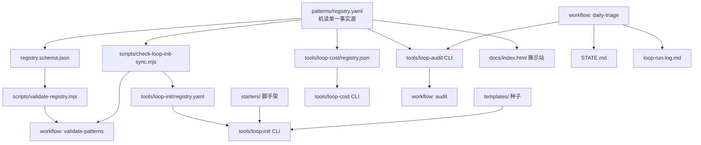

# Loop Engineering 项目实现细节

> 本文档基于对仓库所有目录与文件的实际阅读，分两部分阐述项目的具体实现。

---

## 第一部分：目录结构与文件功能

### 顶层文件

| 文件 | 功能 |
|------|------|
| `README.md` | 项目总入口文档：概念、原语、模式一览表、快速上手命令、工具链用法、安全注意事项、贡献指南。 |
| `LOOP.md` | **自运维声明**：描述该仓库自身正在跑哪些环路（Daily Triage L1、PR Babysitter L2、Dependency Sweeper L2、Changelog Drafter L1）、节奏、状态文件、工作树策略、预算、安全闸门。 |
| `AGENTS.md` | **人/环路协作规约**：构建/验证命令（`npm ci && npm run build && node dist/cli.js`）、评审规范（永不自动合并核心文档或审计逻辑）、环路操作方式。 |
| `STATE.md` | **实时环路状态脊柱**：`Last run` 时间戳 + 高优先级 / 观察 / 噪声三段。由 CI workflow `daily-triage.yml` 自动更新。 |
| `loop-budget.md` | **token 预算**：各环路每日上限（runs/day、tokens/day、sub-agent spawns）、超限处理、急停 kill switch（label `loop-pause-all`）。 |
| `loop-run-log.md` | **追加式运行日志**：每次运行追加一行 JSON（`run_id / pattern / duration_s / items_found / actions_taken / escalations / tokens_estimate / readiness_score / outcome / workflow_run`）。 |
| `package.json` | monorepo 根：`scripts` 统一入口——`validate:registry`、`check:loop-init`、`test:tools`、`build:tools`。依赖 ajv + yaml（校验 registry）。 |
| `_config.yml` | GitHub Pages Jekyll 配置：主题 `jekyll-theme-minimal`、baseurl、relative-links 插件。 |
| `CONTRIBUTING.md` | 贡献指南：模式提交规范、工具测试要求、故事格式。 |
| `SECURITY.md` | 安全政策：报告漏洞渠道、无人值守自动化的风险声明。 |
| `CODEOWNERS` | 代码所有权：指定核心路径（docs/primitives*、tools/loop-audit/src/、showcase）的审查人。 |
| `LICENSE` | MIT |
| `.gitignore` | 忽略 node_modules、dist、*.tgz 等。 |

---

### `docs/` — 方法论文档

| 文件 | 功能 |
|------|------|
| `primitives.md` | **六大原语详解**（调度/工作树/技能/连接器/子智能体/记忆）：每个原语的职责、常见实现方式、何时叠加。 |
| `primitives-matrix.md` | **跨工具矩阵**：同一原语在 Grok/Claude Code/Codex/Cursor/Windsurf 五个工具中如何落地，含调度快速参考、技能分发、子 agent 拆分表、状态约定。 |
| `concepts.md` | **概念词汇表**：Loop Engineering / Agent Harness / Factory Model / Intent Debt / Comprehension Debt / Cognitive Surrender / Orchestration Tax / Code Agent Orchestra，含 Mermaid 概念图。 |
| `loop-design-checklist.md` | **设计清单（10 维度）**：目的与范围/调度/技能/maker-checker/状态/人工交接/连接器/成本/可观测性/安全。含 L0–L3 定义与"红旗"快速排查。 |
| `pattern-picker.md` | **模式选择器**：决策流程图（"你想达成什么"→推荐哪个 pattern）。 |
| `safety.md` | **安全约束**：denylist 路径、auto-merge 规则、MCP scope 限制、密钥处理。 |
| `operating-loops.md` | **运维**：token 成本监控、`loop-budget.md`/`loop-run-log.md` 使用、何时暂停/终止环路。 |
| `failure-modes.md` | **失败模式清单**（事故级格式）：每种失败的触发条件、影响、缓解措施。 |
| `anti-patterns.md` | **反模式**：部署前应避免的设计错误。 |
| `multi-loop.md` | **多环路协调**：优先级排序、冲突避免策略（worktree vs branch）、调度错开。 |
| `adopters.md` | 使用者列表/案例。 |
| `RELEASE.md` | 发布流程：git tag → CI 自动 build+publish 到 npm。 |
| `GITHUB_PAGES.md` | Pages 部署说明。 |
| `index.html` | Pages 交互式展示站的 HTML 入口（JS 实现模式选择器）。 |
| `_config.yml` | Pages 本地 Jekyll 配置。 |
| `assets/` | 文档用图片。 |

---

### `patterns/` — 7 个生产模式

| 文件 | 功能 |
|------|------|
| `daily-triage.md` | 每日分诊模式：调度/技能/状态/运行周期/验证/交接/成本/指标，含各工具命令示例。 |
| `pr-babysitter.md` | PR 保姆模式：同结构。 |
| `ci-sweeper.md` | CI 清扫模式。 |
| `dependency-sweeper.md` | 依赖清扫模式。 |
| `changelog-drafter.md` | 变更日志起草模式。 |
| `post-merge-cleanup.md` | 合并后清理模式。 |
| `issue-triage.md` | 议题分诊模式。 |
| `README.md` | 模式目录总览。 |
| `registry.yaml` | **机读索引**：7 条记录，每条含 id/name/goal/cadence/risk/tools/skills/state/phases/human_gates/starter/week_one_mode/token_cost/cost（三档 token 估算+daily cap）。被 loop-audit/loop-cost/文档站/CI 共同消费。 |
| `registry.schema.json` | registry.yaml 的 JSON Schema，供 `validate-registry.mjs` 校验。 |

---

### `skills/` — 4 个核心技能

每个技能是一个目录，内含 `SKILL.md`（带 YAML frontmatter：`name / description / user_invocable`）+ 可选脚本。

| 技能目录 | SKILL.md 功能 |
|----------|--------------|
| `loop-triage/` | 分诊代理：输入 CI 失败+issues+commits+state；输出四段式报告（高优/观察/噪声/状态更新）。规则：极度精简、不提架构改造。 |
| `loop-verifier/` | 验证者代理（checker）：默认 REJECT；清单：范围/意图/测试(亲自跑)/无作弊/风险；输出三态裁决 APPROVE\|REJECT\|ESCALATE_HUMAN。 |
| `minimal-fix/` | 最小修复代理（maker）：一次只修一个问题、最小 diff、不碰 denylist、不自评完成。 |
| `loop-budget/` | 预算守卫代理：在每轮开始/结束检查 token 花费是否超限。 |

---

### `templates/` — 种子模板

| 文件 | 功能 |
|------|------|
| `STATE.md.template` | 状态文件种子：`Last run` + 高优/观察/噪声三段占位。 |
| `loop-budget.md.template` | 预算文件种子：表格（loop/max runs/max tokens/max spawns）+ 超限/急停。 |
| `loop-run-log.md.template` | 运行日志种子：JSON 格式说明 + "Recent Runs"追加区。 |
| `pattern-template.md` | **新增模式的模板**：标准结构（Goal/Scheduling/Skills/State/Cycle/Verification/Handoff/Tool-specific/Failure modes/Cost/Metrics）。 |
| `SKILL.md.loop-triage` | loop-triage 技能种子（与 skills/ 内容一致，供 loop-init 拷贝）。 |
| `SKILL.md.minimal-fix` | minimal-fix 技能种子。 |
| `SKILL.md.verifier` | loop-verifier 技能种子。 |
| `SKILL.md.loop-budget` | loop-budget 技能种子。 |
| `SKILL.md.issue-triage` | issue-triage 技能种子。 |

---

### `starters/` — 克隆即用脚手架（9 套）

每个 starter 是一个完整的"最小可跑环路"文件包。以 `minimal-loop`（Grok 版）和 `pr-babysitter`（多工具版）为例：

#### `starters/minimal-loop/`（Grok 每日分诊 L1）

| 路径 | 功能 |
|------|------|
| `README.md` | 使用说明：复制到项目、设好 Grok `/loop` 命令、期望输出。 |
| `LOOP.md` | 该 starter 的环路声明（节奏、技能、状态、交接）。 |
| `STATE.md.example` | 初始状态文件示例。 |
| `.grok/skills/` | 内置 loop-triage 技能 SKILL.md，供 Grok 自动发现与加载。 |

#### `starters/pr-babysitter/`（多工具 PR 保姆 L2）

| 路径 | 功能 |
|------|------|
| `README.md` | 使用说明。 |
| `LOOP.md` | PR-babysitter 环路声明。 |
| `pr-babysitter-state.md.example` | 初始状态文件。 |
| `.grok/skills/` | Grok 版分诊技能。 |
| `.claude/skills/pr-review-triage/` | Claude Code 版分诊技能。 |
| `.claude/agents/loop-verifier.md` | **Claude Code 子 agent 定义文件**：frontmatter（name/description/model:inherit）+ 验证者系统提示词。 |
| `.codex/skills/` | Codex 版技能。 |
| `.codex/agents/verifier.toml` | **Codex 子 agent 定义文件**：TOML 格式（name/description/instructions/reasoning_effort=high）。 |

其他 starters（`ci-sweeper`、`dependency-sweeper`、`changelog-drafter`、`post-merge-cleanup`、`issue-triage`、`minimal-loop-claude`、`minimal-loop-codex`）结构类似，区别在于：所含技能对应各自模式、是否含 verifier agent、状态文件名不同。

---

### `tools/` — 4 个 CLI 工具（TypeScript，发布到 npm）

#### `tools/loop-audit/`

| 文件 | 功能 |
|------|------|
| `src/cli.ts` | CLI 入口：解析参数（`--json`/`--md`/`--suggest`）、调 auditor、格式化输出、退出码（<40 → exit 2）。 |
| `src/auditor.ts` | **打分引擎**：扫描目标目录，检查 15+ 项信号（STATE.md/技能文件/verifier/LOOP.md/AGENTS.md/安全文档/workflows/MCP证据/worktree证据/registry.yaml/loop-budget/loop-run-log/活跃度证据），每项给分权重，汇总 0–100 并映射 L0–L3。 |
| `src/reporter.ts` | 输出格式化：human-readable（彩色终端）/ JSON / Markdown 三种；`--suggest` 模式额外输出"缺失项的修复命令"。 |
| `test/` | 单元测试。 |
| `package.json` | npm 元数据 `@cobusgreyling/loop-audit`，scripts: build/test/prepublishOnly。 |
| `tsconfig.json` | TypeScript 编译配置。 |
| `CHANGELOG.md` | 版本历史。 |

#### `tools/loop-init/`

| 文件 | 功能 |
|------|------|
| `src/cli.ts` | **脚手架生成器**：根据 `--pattern` 和 `--tool` 从内嵌 registry 查找 starter，把对应的 SKILL.md/STATE.md/LOOP.md/loop-budget/loop-run-log 拷贝到目标目录。 |
| `registry.yaml` | loop-init 自己内嵌的模式→starter 映射（与 patterns/registry.yaml 同步，由 `check-loop-init-sync.mjs` 校验）。 |
| `scripts/` | 辅助脚本。 |
| `test/` | 单元测试。 |
| `package.json` | npm 元数据 `@cobusgreyling/loop-init`。 |

#### `tools/loop-cost/`

| 文件 | 功能 |
|------|------|
| `src/cli.ts` | CLI 入口：解析 `--pattern/--cadence/--level/--conservative/--json/--list`。 |
| `src/estimator.ts` | **成本估算引擎**：读 `registry.json` 中每个模式的 `cost` 字段（tokens_noop/tokens_report/tokens_action/early_exit_required），结合 cadence 和 level 计算每日 token 花费的四种场景（noop/full-triage/action-every-run/realistic-blend）。 |
| `registry.json` | 从 patterns/registry.yaml 的 cost 数据提取的 JSON 快照（CI build 时同步）。 |
| `test/` | 单元测试。 |
| `package.json` | npm 元数据 `@cobusgreyling/loop-cost`。 |

#### `tools/goal-audit/`

| 文件 | 功能 |
|------|------|
| `src/` | 类似 loop-audit 的打分引擎，但针对 **Goal Engineering**（`/goal` 跑到验证条件达成）的就绪度。 |
| `README.md` | `npx @cobusgreyling/goal-audit . --suggest`。 |
| `package.json` | npm 元数据 `@cobusgreyling/goal-audit`。 |

---

### `scripts/` — 辅助脚本

| 文件 | 功能 |
|------|------|
| `validate-registry.mjs` | 用 ajv 校验 `patterns/registry.yaml` 是否符合 `registry.schema.json`。被 CI `validate-patterns.yml` 调用。 |
| `check-loop-init-sync.mjs` | 检查 `tools/loop-init/registry.yaml` 与 `patterns/registry.yaml` 是否同步（id/名称/starter 对应）。 |
| `append-run-log.mjs` | 供 `daily-triage.yml` 调用：把当次运行数据追加到 `loop-run-log.md`。 |
| `before-after-demo.sh` | 演示脚本：创建空目录→装入 starter→运行 loop-audit，展示分数从 0 → L1 → L2 的攀升过程。 |
| `ci-audit-gates.sh` | CI 用：跑 loop-audit，分数<阈值则失败。 |
| `ci-validate-gates.sh` | CI 用：跑 validate-registry + check-loop-init-sync。 |
| `upload-social-preview.sh` | 上传社交预览图到 GitHub。 |

---

### `.github/workflows/` — CI/CD 工作流

| 文件 | 功能 |
|------|------|
| `daily-triage.yml` | cron 每工作日跑一次：`loop-audit` 打分 → 更新 STATE.md → `append-run-log.mjs` 追加日志 → commit & push。**真正的 dogfooding 心跳。** |
| `validate-patterns.yml` | push/PR 触发：`validate-registry.mjs` + `check-loop-init-sync.mjs`（模式/schema/init 同步校验）。 |
| `audit.yml` | PR 触发：在 PR comment 里贴"当前 Loop Readiness Score"。 |
| `changelog-drafter.yml` | tag 触发：起草 release notes。 |
| `release-loop-audit.yml` | tag `loop-audit-v*` 触发：build + `npm publish`。 |
| `release-loop-init.yml` | tag `loop-init-v*` 触发：同上。 |
| `release-loop-cost.yml` | tag `loop-cost-v*` 触发：同上。 |
| `release-goal-audit.yml` | tag `goal-audit-v*` 触发：同上。 |
| `publish-goal-audit-bootstrap.yml` | goal-audit 首次发布引导。 |

---

### `examples/` — 各工具用法示例

| 子目录/文件 | 功能 |
|-------------|------|
| `grok/daily-triage.md` | Grok `/loop` 命令示例、STATE.md 形态、Tips、演进路径。 |
| `claude-code/*.md` | 7 个模式在 Claude Code 里的调用命令 + 状态 + 注意事项。 |
| `codex/*.md` | Codex Automations tab 用法。 |
| `github-actions/*.yml` | 纯 GitHub Actions 实现（无 TUI），适合团队。 |
| `mcp/*.md` | MCP 连接器配置示例。 |

---

### `stories/` — 真实案例与失败复盘

| 文件 | 内容 |
|------|------|
| `daily-triage-report-only.md` | 第一周仅报告的经验。 |
| `pr-babysitter-week-one.md` | PR 保姆首周实战。 |
| `why-we-killed-ci-sweeper.md` | **诚实的失败**：CI Sweeper 被关停的原因（token 爆炸 + 误修）。 |
| `dependency-sweeper-week-one.md` | 依赖清扫首周。 |
| `changelog-drafter-week-one.md` | 变更日志起草首周。 |
| `post-merge-cleanup-honest-win.md` | 合并后清理的真实收益。 |
| `l1-to-l2-graduation.md` | 从报告级升至辅助级的过程。 |
| `multi-loop-collision.md` | 多环路冲突实例。 |
| `loop-budget-example.md` | 预算文件如何发挥作用。 |
| `loop-run-log-example.md` | 运行日志如何发挥作用。 |
| `README.md` | 故事目录总览。 |

---

### `resources/`

| 文件 | 功能 |
|------|------|
| `sources.md` | 所有引用/灵感来源的链接列表。 |

### `assets/visuals/`

| 文件 | 功能 |
|------|------|
| `loop-engineering-logo.jpg` | 项目 logo。 |
| `loop-engineering-social-banner.jpg` | 社交分享横幅。 |
| `primitives-infographic.jpg` | 六原语信息图。 |

---

## 第二部分：系统模块视角——每个模块怎么实现

从"系统做了什么事"出发，把文件组织成功能模块。

---

### 模块 A：方法论知识库（静态内容，人读为主）

**职责**：定义环路工程的完整理论框架，让任何人 5 分钟内理解"怎么想、怎么做"。

| 实现文件 | 在模块中的角色 |
|----------|---------------|
| `README.md` | 总入口（索引+快速上手） |
| `docs/primitives.md` | 六原语展开 |
| `docs/primitives-matrix.md` | 跨工具映射表 |
| `docs/concepts.md` | 词汇表 + 心智模型 |
| `docs/loop-design-checklist.md` | 设计交付准则（10 维度打勾） |
| `docs/pattern-picker.md` | 决策树：选哪个模式 |
| `docs/safety.md` / `docs/failure-modes.md` / `docs/anti-patterns.md` / `docs/multi-loop.md` / `docs/operating-loops.md` | 运维与安全子知识 |
| `resources/sources.md` | 出处链接 |

**实现方式**：纯 Markdown + Mermaid，无代码依赖。Jekyll 构建成 GitHub Pages 展示站（`docs/index.html` + `_config.yml`）。

---

### 模块 B：模式注册表（机读单一事实源）

**职责**：为工具链、文档站、CI 提供统一的"哪些模式存在、各项参数是什么"结构化元数据。

| 实现文件 | 在模块中的角色 |
|----------|---------------|
| `patterns/registry.yaml` | 单一事实源：7 条模式记录 |
| `patterns/registry.schema.json` | YAML 的 JSON Schema 约束 |
| `scripts/validate-registry.mjs` | CI 校验脚本（ajv 验证 yaml 符合 schema） |
| `scripts/check-loop-init-sync.mjs` | 确保 `tools/loop-init/registry.yaml` 与此同步 |
| `.github/workflows/validate-patterns.yml` | CI 触发上述两个校验 |

**数据消费者**：
- `loop-audit`（读 registry 判断"patterns/ 存在"）；
- `loop-cost`（读 cost 字段做估算）；
- `loop-init`（读 id/starter 字段决定拷哪套文件）；
- `docs/index.html`（展示站渲染模式选择器）。

---

### 模块 C：模式文档集（可执行的最佳实践）

**职责**：每个模式是一份"可照做"的操作手册。

| 实现文件 | 角色 |
|----------|------|
| `patterns/daily-triage.md` | 手册（调度/技能/状态/周期/验证/交接/各工具命令/失败模式/成本/指标） |
| `patterns/pr-babysitter.md` | 同结构 |
| `patterns/ci-sweeper.md` | 同 |
| `patterns/dependency-sweeper.md` | 同 |
| `patterns/changelog-drafter.md` | 同 |
| `patterns/post-merge-cleanup.md` | 同 |
| `patterns/issue-triage.md` | 同 |
| `templates/pattern-template.md` | **新建模式的标准模板**（贡献者用） |

---

### 模块 D：技能系统（意图记忆单元）

**职责**：把"环路每次运行需要的指令"封装为可复用、可分发的 SKILL.md 文件。

| 实现文件 | 角色 |
|----------|------|
| `skills/loop-triage/SKILL.md` | 分诊技能（正式版） |
| `skills/loop-verifier/SKILL.md` | 验证者技能 |
| `skills/minimal-fix/SKILL.md` | 最小修复技能 |
| `skills/loop-budget/SKILL.md` | 预算守卫技能 |
| `templates/SKILL.md.*` | 5 个技能种子（供 loop-init 拷贝到用户项目） |

**安装路径**（由宿主工具约定）：
- Grok → `.grok/skills/<name>/SKILL.md`
- Claude Code → `.claude/skills/<name>/SKILL.md`
- Codex → `.codex/skills/<name>/SKILL.md`

**starters 里预装了对应工具路径的 SKILL.md，用户直接用。**

---

### 模块 E：子 agent 定义（maker/checker 结构落地）

**职责**：以宿主工具约定的格式，把"验证者 agent"声明出来，让主 agent 在运行时能委派验证任务。

| 实现文件 | 宿主工具 | 格式 |
|----------|----------|------|
| `starters/pr-babysitter/.claude/agents/loop-verifier.md` | Claude Code | Markdown（frontmatter: name/description/model + 正文=系统提示词） |
| `starters/pr-babysitter/.codex/agents/verifier.toml` | Codex | TOML（name/description/instructions/reasoning_effort） |
| `starters/minimal-loop-claude/.claude/agents/` | Claude Code | 同上（分诊场景的 verifier） |
| `starters/minimal-loop-codex/.codex/agents/` | Codex | 同上 |

**运行时机制（概括）**：
- Claude Code：主 agent 跑到"需要验证"时，通过 Task/委派把任务分配给 `.claude/agents/loop-verifier.md` 定义的子 agent，后者在独立上下文中运行、结果回传给主 agent。
- Codex：`.codex/agents/verifier.toml` 作为 subagent 定义，`reasoning_effort=high` 让验证者用更强推理。
- Grok：无独立 agent 文件，通过 `Task` 工具 + 不同指令 + `isolation:"worktree"` 实现。

**这个仓库本身不运行 agent**——它只提供声明文件，实际"跑起来"是宿主工具的引擎。

---

### 模块 F：脚手架与初始化工具

**职责**：让用户"零配置上手"——一条命令把一套完整的环路骨架装入自己的项目。

| 实现文件 | 角色 |
|----------|------|
| `starters/minimal-loop/` | Grok L1 脚手架（STATE.md.example + .grok/skills/ + LOOP.md） |
| `starters/minimal-loop-claude/` | Claude Code L1 脚手架 |
| `starters/minimal-loop-codex/` | Codex L1 脚手架 |
| `starters/pr-babysitter/` | 多工具 L2 脚手架（含 verifier agent） |
| `starters/ci-sweeper/` | CI 清扫 L2 脚手架 |
| `starters/dependency-sweeper/` | 依赖清扫 L2 脚手架 |
| `starters/changelog-drafter/` | 变更日志 L1 脚手架 |
| `starters/post-merge-cleanup/` | 合并后清理 L1 脚手架 |
| `starters/issue-triage/` | 议题分诊 L1 脚手架 |
| `templates/STATE.md.template` | 通用状态文件种子 |
| `templates/loop-budget.md.template` | 预算文件种子 |
| `templates/loop-run-log.md.template` | 运行日志种子 |
| **`tools/loop-init/src/cli.ts`** | **自动化拷贝器**：解析 `--pattern`/`--tool` → 查内嵌 registry → 把对应 starter + budget + run-log 模板写入目标目录。 |
| `tools/loop-init/registry.yaml` | loop-init 内嵌的模式→starter 映射 |

---

### 模块 G：就绪度审计工具

**职责**：量化一个项目"离可靠环路还差多远"。

| 实现文件 | 角色 |
|----------|------|
| **`tools/loop-audit/src/auditor.ts`** | 核心引擎：逐项检查 15+ 信号，每项加权打分（状态文件 10分/技能 10分/verifier 15分/LOOP.md 10分/AGENTS.md 5分/安全 5分/workflows 5分/MCP 5分/worktree 5分/registry 5分/budget 5分/run-log 5分/活跃度 15分），汇总 0-100 → L0/L1/L2/L3。 |
| `tools/loop-audit/src/reporter.ts` | 输出层：human(彩色)、JSON、Markdown 三种格式；`--suggest` 额外生成"缺什么→跑什么命令补"。 |
| `tools/loop-audit/src/cli.ts` | CLI 入口：argparse、调 auditor→reporter、exit code。 |
| `tools/loop-audit/test/` | 单元测试（mock 目录结构，验证评分逻辑）。 |
| `.github/workflows/audit.yml` | PR 门禁：跑 audit → comment 分数。 |

**关键设计**：L3 不仅要求"文件齐全"，还要求 **loopActivity**（STATE.md 里的 "Last run" 时间戳近期、loop-run-log 有条目、workflows 被触发过）——防止"摆文件但不真跑"的假 L3。

---

### 模块 H：成本估算工具

**职责**：在环路上线前，让用户知道"每天/每月大概花多少 token"。

| 实现文件 | 角色 |
|----------|------|
| **`tools/loop-cost/src/estimator.ts`** | 估算逻辑：从 registry.json 读 `cost` 字段（tokens_noop/tokens_report/tokens_action/early_exit_required），结合用户指定的 cadence 和 level，计算 4 种场景的每日 token 总量。 |
| `tools/loop-cost/src/cli.ts` | CLI 入口。 |
| `tools/loop-cost/registry.json` | 从 patterns/registry.yaml cost 数据静态提取的 JSON 快照。 |
| `tools/loop-cost/test/` | 单元测试。 |

---

### 模块 I：自运维/Dogfooding 系统

**职责**：该仓库用自己的方法论维护自己——证明方法论可行、同时持续产出活跃度证据。

| 实现文件 | 角色 |
|----------|------|
| `LOOP.md` | 声明：跑了哪些环路、各自节奏/技能/状态/交接。 |
| `STATE.md` | 实时脊柱（由 CI 自动更新 Last run + 高优/观察/噪声）。 |
| `loop-budget.md` | 预算约束。 |
| `loop-run-log.md` | 追加式日志（真实每日运行数据，含 workflow_run ID 可追溯）。 |
| `AGENTS.md` | 人/环路协作规约。 |
| `.github/workflows/daily-triage.yml` | **心跳**：cron 每工作日 → loop-audit 打分 → 更新 STATE.md → append-run-log → commit+push。 |
| `.github/workflows/validate-patterns.yml` | 每次 push/PR 校验 registry schema 与 init 同步。 |
| `.github/workflows/audit.yml` | PR 门禁：贴就绪度分数。 |
| `scripts/append-run-log.mjs` | 辅助：daily-triage.yml 调用，把运行数据追加到 loop-run-log.md。 |
| `scripts/ci-audit-gates.sh` / `ci-validate-gates.sh` | CI gate 脚本。 |

---

### 模块 J：展示站与交互式 UI

**职责**：让用户在浏览器里浏览模式、选择适合自己的环路。

| 实现文件 | 角色 |
|----------|------|
| `docs/index.html` | 单页应用（纯 JS）：模式选择器（根据用户回答推荐 pattern）、原语浏览、示例链接。 |
| `docs/_config.yml` | Jekyll 本地站点配置。 |
| `_config.yml`（根） | GitHub Pages 全局配置（theme、baseurl、include/exclude）。 |
| `assets/visuals/*.jpg` | logo、社交横幅、信息图。 |

---

### 模块 K：故事与案例集

**职责**：用真实经历（含成功与失败）证明模式有效性、提供经验教训。

| 实现文件 | 内容类型 |
|----------|----------|
| `stories/daily-triage-report-only.md` | 成功：第一周仅报告 |
| `stories/pr-babysitter-week-one.md` | 成功：PR 保姆首周 |
| `stories/why-we-killed-ci-sweeper.md` | **失败**：为什么关停 CI 清扫 |
| `stories/dependency-sweeper-week-one.md` | 实战 |
| `stories/changelog-drafter-week-one.md` | 实战 |
| `stories/post-merge-cleanup-honest-win.md` | 成功 |
| `stories/l1-to-l2-graduation.md` | 升级过程 |
| `stories/multi-loop-collision.md` | 多环路冲突 |
| `stories/loop-budget-example.md` | 预算生效实例 |
| `stories/loop-run-log-example.md` | 日志生效实例 |

---

### 模块间关系图（数据流）

---

## 总结

loop-engineering 不是一个可运行的 agent 应用，而是一个**"方法论的可执行载体"**：

1. **知识库**（docs/ + README）告诉你怎么想；
2. **模式注册表**（patterns/registry.yaml + schema）是机读的单一事实源；
3. **模式文档**（patterns/*.md）告诉你怎么做；
4. **技能**（skills/）是可直接安装到工具里的"意图记忆"；
5. **子 agent 定义**（starters/.claude/agents/*.md, .codex/agents/*.toml）让 maker/checker 结构直接落地到宿主工具；
6. **脚手架 + loop-init**把上述资产一键装入用户项目；
7. **loop-audit / loop-cost**把就绪度和成本量化为可门禁的数值；
8. **CI workflows + STATE + run-log**让仓库自己吃自己的狗粮，产生持续的活跃度证据；
9. **stories** 用真实案例（含失败）建立可信度。

所有模块通过 `patterns/registry.yaml` 这个单一事实源串联——audit 读它打分、cost 读它估算、init 读它决定拷什么、CI 读它校验一致性、展示站读它渲染 UI——任何新增模式只需往 registry.yaml 加一条记录 + 写对应 .md + 建 starter 目录，整条工具链自动跟上。
