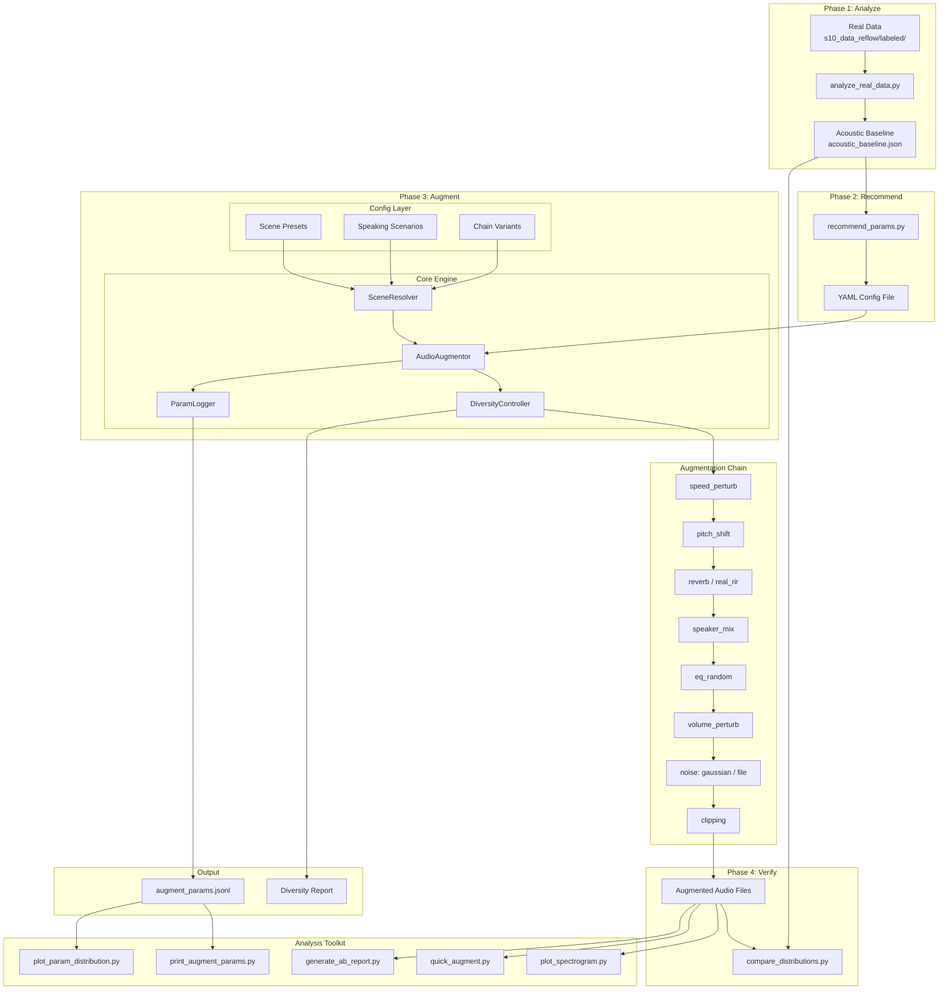

# Design Document: Audio Augmentation Scene Diversity

## Overview

This design extends the existing `07_augment/` audio augmentation system to provide systematic scene diversity for smart speaker training data. The current system (`AudioAugmentor` in `augment_engine.py`) supports a rich set of augmentation strategies (reverb, speaker mixing, noise, EQ, etc.) with a single configurable chain. However, it lacks structured scene composition — there's no way to systematically cover different room types, speaking scenarios, or ensure balanced diversity across augmentation outputs.

The core design principle is **"analyze first, then augment"**: augmentation parameters should be grounded in the acoustic characteristics of real business data, not set by guesswork. The workflow follows a four-phase cycle:

1. **Analyze** — Extract acoustic features from real data (`s10_data_reflow/labeled/`) to establish a baseline
2. **Recommend** — Auto-generate augmentation parameter suggestions based on the baseline
3. **Augment** — Execute augmentation with scene diversity (room presets, speaking scenarios, distance control)
4. **Verify** — Compare augmented data distributions against the real data baseline

The enhancement introduces three layers of scene diversity:

1. **Room-level diversity**: Scene presets (living_room, bedroom, study) that bundle room acoustics parameters
2. **Scenario-level diversity**: Speaking scenario types (single_clean, single_noisy, multi_speaker) that control which augmentation strategies are active
3. **Parameter-level diversity**: Distance-correlated parameter sampling for both main and background speakers, with continuous clarity control

Additionally, the system gains an analysis toolkit for baseline extraction, parameter recommendation, spectrogram visualization, parameter auditing, distribution comparison, and A/B listening — all essential for the iterative "analyze → recommend → augment → verify" cycle. The entire development process is managed through Git with a structured dev log.

All new features are opt-in via configuration, preserving full backward compatibility with existing YAML configs.

## Architecture

### High-Level Architecture



### Design Decisions

1. **SceneResolver as a separate component**: Rather than embedding scene/scenario logic directly into `augment_single()`, we introduce a `SceneResolver` class that resolves a complete set of augmentation parameters for each sample. This keeps the core augmentation methods pure and testable.

2. **DiversityController for balanced allocation**: A `DiversityController` manages counters for balanced/weighted distribution of scenes, scenarios, and chain variants. It's initialized once per augmentation batch and queried per sample.

3. **ParamLogger for audit trail**: A lightweight `ParamLogger` records actual sampled parameters per augmentation to a JSONL file, enabling post-hoc analysis without modifying the augmentation logic.

4. **Backward compatibility by default**: All new config fields default to `None` or `False`, causing the engine to fall through to existing behavior. The `SceneResolver` returns passthrough values when no scene/scenario config is present.

5. **Analysis toolkit as standalone scripts**: Each analysis tool is an independent Python script in `07_augment/tools/`, using shared utilities but no dependency on the augmentation engine's runtime state.

6. **Background speaker source at caller level**: The `bg_speaker_dir` separation is handled by the caller scripts (`augment_dir.py` / `augment_manifest.py`), not inside `AudioAugmentor`. The engine's `augment_single()` already accepts `audio_cache` and `candidate_paths` as parameters — the caller simply passes a different pool when `bg_speaker_dir` is configured. This avoids modifying the engine's core interface while cleanly supporting both self-mix and separate-source modes.

## Components and Interfaces

### 1. SceneResolver

**File**: `07_augment/scene_resolver.py`

Responsible for resolving per-sample augmentation parameters based on scene presets, speaking scenarios, and chain variants.

```python
class SceneResolver:
    """Resolves scene-aware augmentation parameters for each sample."""

    # Built-in scene presets
    BUILTIN_PRESETS = {
        "living_room": {
            "rt60_range": [0.4, 0.7],
            "noise_snr_range": [15, 25],
            "eq_profile": "warm",       # slight low-freq boost
        },
        "bedroom": {
            "rt60_range": [0.2, 0.4],
            "noise_snr_range": [25, 35],
            "eq_profile": "neutral",
        },
        "study": {
            "rt60_range": [0.3, 0.5],
            "noise_snr_range": [20, 30],
            "eq_profile": "bright",     # slight high-freq presence
        },
    }

    def __init__(self, config: dict):
        """Initialize from parsed YAML config."""
        ...

    def validate_config(self) -> None:
        """Validate scene/scenario config at startup. Raises ValueError for invalid preset names."""
        ...

    def resolve(self, sample_idx: int, aug_idx: int, total_augments: int,
                rng: np.random.Generator) -> ResolvedScene:
        """Resolve complete scene parameters for one augmentation sample.

        Returns:
            ResolvedScene with: preset_name, scenario_type, chain,
            main_distance_factor, bg_clarity_factor, effective_strategies_config
        """
        ...
```

**ResolvedScene dataclass**:
```python
@dataclasses.dataclass
class ResolvedScene:
    preset_name: str | None          # e.g. "living_room", None if no presets
    scenario_type: str | None        # e.g. "single_clean", None if no scenarios
    chain: list[str]                 # effective augmentation chain
    main_distance_factor: float | None  # d ∈ [0,1], None if not enabled
    bg_clarity_factor: float | None  # t ∈ [bg_clarity_range], None if not applicable
    strategy_overrides: dict         # parameter overrides from scene/scenario
    overlap_mode: str | None         # resolved overlap mode
```

### 2. DiversityController

**File**: `07_augment/diversity_controller.py`

Manages balanced/weighted allocation and background speaker diversity tracking.

```python
class DiversityController:
    """Controls diversity allocation across augmentation batches."""

    def __init__(self, config: dict, total_samples: int):
        ...

    def next_preset(self, rng: np.random.Generator) -> str:
        """Get next scene preset based on mode (random/balanced)."""
        ...

    def next_scenario(self, rng: np.random.Generator) -> str:
        """Get next speaking scenario based on mode (balanced/weighted)."""
        ...

    def next_chain_variant(self, variant_idx: int, rng: np.random.Generator) -> list[str]:
        """Get next chain variant based on mode (round_robin/random)."""
        ...

    def select_bg_speaker(self, candidates: list[str], exclude: str,
                          rng: np.random.Generator) -> str | None:
        """Select background speaker with diversity tracking."""
        ...

    def get_statistics(self) -> dict:
        """Return diversity statistics for reporting."""
        ...
```

### 3. ParamLogger

**File**: `07_augment/param_logger.py`

Records actual augmentation parameters per sample.

```python
class ParamLogger:
    """Logs actual augmentation parameters to JSONL."""

    def __init__(self, output_path: str, enabled: bool = False):
        ...

    def log(self, key: str, params: dict) -> None:
        """Log parameters for one augmented sample."""
        ...

    def close(self) -> None:
        """Flush and close the log file."""
        ...
```

### 4. DiversityReporter

**File**: `07_augment/diversity_reporter.py`

Generates diversity statistics reports after augmentation.

```python
class DiversityReporter:
    """Generates scene diversity statistics reports."""

    IMBALANCE_THRESHOLD = 0.6  # warn if any category > 60%

    def __init__(self, statistics: dict):
        ...

    def write_text_report(self, output_path: str) -> None:
        """Write human-readable diversity_report.txt."""
        ...

    def write_json_report(self, output_path: str) -> None:
        """Write machine-readable diversity_summary.json."""
        ...

    def check_imbalance(self) -> list[str]:
        """Return list of warning messages for imbalanced dimensions."""
        ...
```

### 5. Extended AudioAugmentor

**File**: `07_augment/augment_engine.py` (modified)

The existing `AudioAugmentor` class is extended with:

```python
class AudioAugmentor:
    def __init__(self, config_path: str):
        # ... existing init ...
        self.scene_resolver = SceneResolver(self.config)
        self.scene_resolver.validate_config()  # fail-fast on invalid presets
        self.param_logger = None  # initialized in batch processing
        self.diversity_controller = None  # initialized per batch

    def init_batch(self, total_samples: int, output_dir: str) -> None:
        """Initialize batch-level state (diversity controller, param logger)."""
        self.diversity_controller = DiversityController(self.config, total_samples)
        if self.config.get("log_augment_params", False):
            log_path = os.path.join(output_dir, "augment_params.jsonl")
            self.param_logger = ParamLogger(log_path, enabled=True)

    def finalize_batch(self, output_dir: str) -> None:
        """Finalize batch: write diversity report, close logger."""
        if self.param_logger:
            self.param_logger.close()
        if self.diversity_controller:
            stats = self.diversity_controller.get_statistics()
            reporter = DiversityReporter(stats)
            reporter.write_text_report(os.path.join(output_dir, "diversity_report.txt"))
            reporter.write_json_report(os.path.join(output_dir, "diversity_summary.json"))

    def augment_single(self, audio, sr, wav_path, aug_idx, file_idx,
                       audio_cache=None, candidate_paths=None):
        # Resolve scene parameters
        resolved = self.scene_resolver.resolve(
            file_idx, aug_idx, self.augment_factor, aug_rng)

        # Use resolved chain instead of default
        active_chain = resolved.chain or self._resolve_chain(wav_path)

        # Apply strategy overrides from scene/scenario
        effective_strategies = self._merge_strategies(
            self.strategies, resolved.strategy_overrides)

        # ... execute chain with effective_strategies ...
        # ... log params if logger enabled ...
```

### 6. Main Speaker Distance Module

Integrated into `SceneResolver.resolve()`:

```python
def _resolve_main_distance(self, d: float, config: dict) -> dict:
    """Convert distance factor d ∈ [0,1] to acoustic parameters.

    d=0 (closest): low RT60, 0dB volume, high-freq preserved
    d=1 (farthest): high RT60, negative volume, high-freq attenuated

    Returns dict with rt60, volume_gain_db, highfreq_cutoff.
    """
    rt60_range = config.get("main_distance_rt60_range", [0.08, 0.7])
    volume_range = config.get("main_distance_volume_range", [0, -14])
    highfreq_range = config.get("main_distance_highfreq_range", [8000, 4000])

    return {
        "rt60": rt60_range[0] + d * (rt60_range[1] - rt60_range[0]),
        "volume_gain_db": volume_range[0] + d * (volume_range[1] - volume_range[0]),
        "highfreq_cutoff": highfreq_range[0] + d * (highfreq_range[1] - highfreq_range[0]),
    }
```

### 7. Background Speaker Source Separation

**Integrated into**: `07_augment/augment_dir.py`, `07_augment/augment_manifest.py`, `07_augment/augment_engine.py`

Supports two modes for background speaker audio sourcing:

1. **Self-mix mode** (default, current behavior): When only `--input_dir` is specified, background speakers are selected from the same candidate pool as the main speakers.
2. **Separate source mode**: When `--bg_speaker_dir` is specified, background speakers are loaded from a dedicated directory, completely independent from the main speaker pool.

```python
# In augment_dir.py / augment_manifest.py:

def process_directory(augmentor, input_dir, output_dir, factor=None, bg_speaker_dir=None):
    # ... existing wav scanning and audio_cache loading for main speakers ...

    # Load background speaker pool
    if bg_speaker_dir:
        bg_wav_files = scan_wav_files(bg_speaker_dir)
        if not bg_wav_files:
            logger.error("bg_speaker_dir 中未找到 wav 文件: %s", bg_speaker_dir)
            return
        logger.info("加载背景说话人目录: %d 个文件", len(bg_wav_files))
        bg_audio_cache = {}
        for wp in bg_wav_files:
            try:
                bg_audio_cache[wp] = sf.read(wp, dtype="float64")
            except Exception as ex:
                logger.warning("背景音频读取失败，跳过: %s (%s)", wp, ex)
        bg_candidate_paths = list(bg_audio_cache.keys())
    else:
        # Self-mix mode: use main speaker pool as background candidates
        bg_audio_cache = audio_cache
        bg_candidate_paths = candidate_paths

    # Pass both caches to augment_single
    for idx, wav_path in enumerate(candidate_paths):
        audio, sr = audio_cache[wav_path]
        for aug_idx in range(augmentor.augment_factor):
            aug_audio = augmentor.augment_single(
                audio, sr, wav_path, aug_idx, idx,
                audio_cache=bg_audio_cache,        # background speaker cache
                candidate_paths=bg_candidate_paths, # background candidates
            )
```

**Key design points**:
- `augment_single()` signature remains unchanged — `audio_cache` and `candidate_paths` already represent the background speaker pool
- The caller (`augment_dir.py` / `augment_manifest.py`) decides which pool to pass based on whether `bg_speaker_dir` is configured
- In separate source mode, the main speaker's own path is still excluded from background selection (existing `candidates = [p for p in candidate_paths if p != wav_path]` logic handles this, though in practice the pools won't overlap)
- Background audio cache is independent from main audio cache to avoid memory confusion
- CLI argument `--bg_speaker_dir` is added to both `augment_dir.py` and `augment_manifest.py`

### 8. Mutual Exclusion Logic for real_rir / reverb

In `augment_single()`, track which reverb-type strategy has been applied:

```python
reverb_applied = False
for strategy_name in active_chain:
    if strategy_name in ("reverb", "real_rir"):
        if reverb_applied:
            logger.info("Skipping %s: reverb already applied", strategy_name)
            continue
        # ... apply the strategy ...
        reverb_applied = True
```

### 9. Analysis Toolkit Scripts

All scripts live in `07_augment/tools/`:

**Phase 1: Analyze (prerequisite before augmentation)**

| Script | Purpose | Key Dependencies |
|--------|---------|-----------------|
| `analyze_real_data.py` | Real data acoustic feature extraction → `acoustic_baseline.json` | librosa, soundfile |

**Phase 2: Recommend (parameter calibration)**

| Script | Purpose | Key Dependencies |
|--------|---------|-----------------|
| `recommend_params.py` | Read baseline, output recommended YAML params | pyyaml |

**Phase 4: Verify (post-augmentation)**

| Script | Purpose | Key Dependencies |
|--------|---------|-----------------|
| `compare_distributions.py` | Real vs augmented distribution comparison | scipy, matplotlib |

**General analysis tools (usable at any phase)**

| Script | Purpose | Key Dependencies |
|--------|---------|-----------------|
| `plot_spectrogram.py` | Mel/linear spectrogram visualization | matplotlib, librosa |
| `print_augment_params.py` | Query/filter augment_params.jsonl | pandas |
| `plot_param_distribution.py` | Parameter distribution histograms | matplotlib, pandas |
| `quick_augment.py` | Single-file quick augmentation | augment_engine |
| `generate_ab_report.py` | HTML A/B comparison page | jinja2 (or string templates) |

### 10. Config Schema Extension

New top-level config fields (all optional, defaults to feature-off):

```yaml
# Scene presets (Req 1)
scene_presets:                    # optional, default: null (disabled)
  living_room: { ... }           # override or extend built-in
  bedroom: { ... }
  study: { ... }
scene_mode: "balanced"            # "random" | "balanced", default: null

# Speaking scenarios (Req 2)
speaking_scenarios:               # optional, default: null (disabled)
  - single_clean
  - single_noisy
  - multi_speaker
scenario_mode: "balanced"         # "balanced" | "weighted", default: null
scenario_weights:                 # optional, used with "weighted" mode
  single_clean: 0.3
  single_noisy: 0.3
  multi_speaker: 0.4

# Main speaker distance (Req 3)
main_speaker_distance: false      # default: false

# Background clarity (Req 4)
bg_clarity_range: [0.0, 1.0]     # default: [0.0, 1.0]

# Background speaker diversity (Req 7)
bg_speaker_diversity: false       # default: false
bg_max_reuse: null                # default: null (unlimited)

# Background speaker source (Req 8)
bg_speaker_dir: null              # default: null (self-mix from input_dir)

# Chain variants (Req 9)
chain_variants: null              # default: null (use single chain)
chain_variant_mode: "round_robin" # "round_robin" | "random"

# Parameter logging (Req 12)
log_augment_params: false         # default: false

# Noise category weights (Req 5)
noise_category_weights: null      # default: null (uniform)
```

## Data Models

### ResolvedScene

```python
@dataclasses.dataclass
class ResolvedScene:
    preset_name: str | None
    scenario_type: str | None
    chain: list[str]
    main_distance_factor: float | None
    bg_clarity_factor: float | None
    strategy_overrides: dict
    overlap_mode: str | None
```

### DiversityStatistics

```python
@dataclasses.dataclass
class DiversityStatistics:
    preset_distribution: dict[str, int]      # {"living_room": 150, ...}
    scenario_distribution: dict[str, int]    # {"single_clean": 100, ...}
    overlap_mode_distribution: dict[str, int]
    bg_clarity_histogram: list[int]          # 10-bin histogram of distance factors
    main_distance_histogram: list[int]       # 10-bin histogram
    chain_variant_distribution: dict[str, int]
    total_samples: int
```

### AugmentParamRecord

```python
@dataclasses.dataclass
class AugmentParamRecord:
    key: str                        # augmented audio key
    source_wav: str                 # original wav path
    aug_idx: int                    # augmentation index
    preset_name: str | None
    scenario_type: str | None
    chain_variant: str | None
    main_distance_factor: float | None
    bg_clarity_factor: float | None
    snr_db: float | None
    rt60: float | None
    volume_gain_db: float | None
    speed_factor: float | None
    pitch_semitones: float | None
    overlap_mode: str | None
    bg_speaker_paths: list[str]
    noise_file: str | None
    rir_file: str | None
```

### AcousticFeatures (for analyze_real_data.py)

```python
@dataclasses.dataclass
class AcousticFeatures:
    file_path: str
    sample_rate: int
    duration_sec: float
    rms_energy: float
    peak_level: float
    spectral_centroid_mean: float
    estimated_snr: float
    spectral_envelope: list[float]  # per-band energy
```

### AcousticBaseline (output of analyze_real_data.py, input to recommend_params.py)

```python
@dataclasses.dataclass
class AcousticBaseline:
    """Aggregate statistics from real data analysis — the ground truth for parameter calibration."""
    sample_count: int
    sample_rate_mode: int           # most common sample rate
    duration_stats: DistStats       # mean, std, p5, p25, p50, p75, p95
    rms_energy_stats: DistStats
    peak_level_stats: DistStats
    spectral_centroid_stats: DistStats
    snr_stats: DistStats
    spectral_envelope_mean: list[float]  # per-band average energy

@dataclasses.dataclass
class DistStats:
    mean: float
    std: float
    p5: float
    p25: float
    p50: float
    p75: float
    p95: float
```

### ParamRecommendation (output of recommend_params.py)

```python
@dataclasses.dataclass
class ParamRecommendation:
    """Recommended augmentation parameters derived from acoustic baseline."""
    snr_range: list[float]          # from baseline snr_stats [p25, p75]
    volume_gain_range: list[float]  # from baseline rms_energy distribution
    eq_gain_range: list[float]      # from baseline spectral_envelope variance
    rt60_range: list[float] | None  # estimated from spectral decay if possible
    reasoning: dict[str, str]       # {param_name: "derived from baseline X because Y"}
```

### DiversityReport JSON Schema

```json
{
    "total_samples": 1000,
    "preset_distribution": {"living_room": 334, "bedroom": 333, "study": 333},
    "scenario_distribution": {"single_clean": 300, "single_noisy": 300, "multi_speaker": 400},
    "overlap_mode_distribution": {"full": 50, "random": 60, "mid_insert": 55, ...},
    "bg_clarity_histogram": {"bins": [0.0, 0.1, ...], "counts": [12, 15, ...]},
    "main_distance_histogram": {"bins": [0.0, 0.1, ...], "counts": [10, 11, ...]},
    "chain_variant_distribution": {"variant_0": 500, "variant_1": 500},
    "warnings": ["preset_distribution: living_room占比62.5%，超过60%阈值"]
}
```

## Correctness Properties

*A property is a characteristic or behavior that should hold true across all valid executions of a system — essentially, a formal statement about what the system should do. Properties serve as the bridge between human-readable specifications and machine-verifiable correctness guarantees.*

### Property 1: Scene preset parameter resolution

*For any* valid scene preset configuration mapping preset names to parameter sets, loading the config and resolving a preset by name SHALL return exactly the parameters defined for that preset.

**Validates: Requirements 1.1**

### Property 2: Random mode produces valid selections

*For any* set of K defined scene presets and any augmentation index, random scene mode SHALL select a preset name that exists in the defined set.

**Validates: Requirements 1.3**

### Property 3: Balanced mode distributes evenly

*For any* positive integer N (total augmentations) and any set of K categories (scene presets or speaking scenarios), balanced mode SHALL produce category counts where `max_count - min_count <= 1`.

**Validates: Requirements 1.4, 2.5**

### Property 4: Invalid preset name causes error

*For any* preset name string that is not present in the defined scene presets (including built-in defaults), the engine SHALL raise a validation error during config initialization.

**Validates: Requirements 1.5**

### Property 5: Speaking scenario determines effective chain composition

*For any* audio sample, when a speaking scenario is configured: `single_clean` SHALL produce a chain excluding `speaker_mix` and all noise strategies; `single_noisy` SHALL produce a chain including noise but excluding `speaker_mix`; `multi_speaker` SHALL produce a chain including `speaker_mix`.

**Validates: Requirements 2.2, 2.3, 2.4**

### Property 6: Weighted scenario mode approximates target weights

*For any* set of scenario weights summing to 1.0 and sufficiently large N (≥100), the proportion of each scenario type SHALL be within `±max(0.15, 2/√N)` of its target weight.

**Validates: Requirements 2.6**

### Property 7: Main speaker distance factor range invariant

*For any* augmentation with `main_speaker_distance: true`, the sampled distance factor `d` SHALL satisfy `0 ≤ d ≤ 1`.

**Validates: Requirements 3.1**

### Property 8: Distance factor monotonic parameter mapping

*For any* two main speaker distance factors `d1 < d2`, the resolved parameters SHALL satisfy: `RT60(d1) < RT60(d2)`, `volume(d1) > volume(d2)`, and `highfreq_cutoff(d1) > highfreq_cutoff(d2)`.

**Validates: Requirements 3.2**

### Property 9: Distance factor deterministic mapping

*For any* distance factor `d` and fixed config ranges, calling the distance-to-parameter mapping function twice with the same `d` SHALL produce identical RT60, volume, and high-frequency cutoff values.

**Validates: Requirements 3.3**

### Property 10: Background clarity range constraint

*For any* configured `bg_clarity_range: [min, max]` where `0 ≤ min ≤ max ≤ 1`, all sampled background speaker distance factors SHALL fall within `[min, max]`.

**Validates: Requirements 4.2**

### Property 11: Mutual exclusion of reverb strategies

*For any* augmentation chain containing both `real_rir` and `reverb`, only the first one encountered in chain order SHALL be applied; the second SHALL be skipped.

**Validates: Requirements 6.3**

### Property 12: Peak level preservation after RIR convolution

*For any* non-silent audio signal and any RIR, applying `apply_real_rir` SHALL produce output whose peak absolute value equals the input's peak absolute value (within floating-point tolerance of 1e-6).

**Validates: Requirements 6.4**

### Property 13: Background speaker diversity — unique before reuse

*For any* set of N candidate background speaker paths with `bg_speaker_diversity: true`, the first N selections (assuming N selections are made) SHALL all be distinct paths.

**Validates: Requirements 7.1, 7.2**

### Property 14: Background speaker diversity reset

*For any* set of N candidate paths and M > N total selections with `bg_speaker_diversity: true`, after the first N unique selections, the tracker SHALL reset, allowing all candidates to be selected again.

**Validates: Requirements 7.3**

### Property 15: Background speaker max reuse limit

*For any* positive integer K set as `bg_max_reuse` and any number of total selections, no single candidate path SHALL be selected more than K times across the entire batch.

**Validates: Requirements 7.4**

### Property 16: Background speaker source isolation

*For any* augmentation batch with `bg_speaker_dir` configured pointing to a valid directory, all background speaker audio paths used in `speaker_mix` SHALL be from the `bg_speaker_dir` directory, and no path from the main input directory SHALL appear as a background speaker.

**Validates: Requirements 8.2, 8.4**

### Property 17: Self-mix mode backward compatibility

*For any* augmentation batch without `bg_speaker_dir` configured, background speaker candidates SHALL be drawn from the same pool as the main speakers (excluding the current main speaker's own path), matching the current behavior.

**Validates: Requirements 8.1**

### Property 18: Diversity report contains all required dimensions

*For any* completed augmentation batch, the generated diversity report SHALL contain non-null entries for: preset distribution, scenario distribution, overlap mode distribution, background clarity histogram, and main distance histogram.

**Validates: Requirements 9.2**

### Property 19: JSON report validity and round-trip

*For any* diversity report, the JSON file (`diversity_summary.json`) SHALL be valid JSON, and parsing it SHALL produce a dictionary containing all dimension keys present in the text report.

**Validates: Requirements 9.4**

### Property 20: Imbalance warning threshold

*For any* distribution where the maximum category proportion exceeds 0.6 (60%), the diversity report SHALL contain a warning message referencing that dimension. *For any* distribution where no category exceeds 0.6, no imbalance warning SHALL be generated for that dimension.

**Validates: Requirements 8.5**

### Property 21: Chain variant selection validity

*For any* augmentation with `chain_variants` defined as a list of chains, the chain used for each augmentation SHALL be one of the chains in the `chain_variants` list.

**Validates: Requirements 9.1**

### Property 22: Round-robin chain variant ordering

*For any* list of K chain variants in `round_robin` mode, augmentation index `i` SHALL use chain variant `i % K`.

**Validates: Requirements 9.3**

### Property 23: Preset overrides strategy on conflict

*For any* config where both `scene_presets` defines an RT60 range for a preset and `reverb.rt60_range` is also set, the effective RT60 range used during augmentation SHALL equal the scene preset's value, not the strategy's value.

**Validates: Requirements 10.4**

### Property 24: Parameter logging accuracy

*For any* augmentation with `log_augment_params: true`, each line in `augment_params.jsonl` SHALL be valid JSON containing at minimum the fields: `key`, `rt60`, `snr_db`, `volume_gain_db`, and `overlap_mode` (when applicable).

**Validates: Requirements 12.1, 12.2**

### Property 25: CLI parameter override effectiveness

*For any* valid parameter override passed via `--override key=value` to `quick_augment.py`, the effective config used for augmentation SHALL reflect the overridden value for that key, not the original config file value.

**Validates: Requirements 17.3**

### Property 26: Acoustic baseline output completeness

*For any* non-empty directory of wav files, running `analyze_real_data.py` SHALL produce an `acoustic_baseline.json` containing all required feature statistics: duration, RMS energy, peak level, spectral centroid, SNR estimate, and spectral envelope.

**Validates: Requirements 14.2, 14.3**

### Property 27: Parameter recommendation derivation from baseline

*For any* valid `acoustic_baseline.json`, running `recommend_params.py` SHALL produce a YAML snippet where `snr_range` falls within the baseline's SNR distribution range (p5 to p95), and `gain_range` falls within the baseline's RMS energy distribution range.

**Validates: Requirements 15.1, 15.2**

### Property 28: Distribution comparison detects significant divergence

*For any* two feature distributions where the KL divergence exceeds the configured threshold, `compare_distributions.py` SHALL flag that feature in the output report with a warning and parameter adjustment suggestion.

**Validates: Requirements 16.2**

## Error Handling

### Configuration Errors (Fail-Fast)

| Error Condition | Behavior | Requirement |
|----------------|----------|-------------|
| Undefined scene preset name referenced | `ValueError` at startup with descriptive message | 1.5 |
| Invalid `scene_mode` value | `ValueError` at startup | 1.3 |
| Invalid `scenario_mode` value | `ValueError` at startup | 2.5 |
| `scenario_weights` don't sum to ~1.0 | `ValueError` at startup | 2.6 |
| `bg_clarity_range` min > max | `ValueError` at startup | 4.2 |
| `chain_variants` contains unknown strategy names | `ValueError` at startup | 9.1 |

### Runtime Errors (Graceful Degradation)

| Error Condition | Behavior | Requirement |
|----------------|----------|-------------|
| `noise_dir` doesn't exist or is empty | Log warning, skip `noise_from_file` strategy, continue chain | 5.4 |
| `rir_dir` doesn't exist or is empty | Log warning, skip `real_rir` strategy, continue chain | 6.1 |
| RIR file read failure | Log error, fall back to synthetic `reverb` with default RT60 | 6.5 |
| Noise file read failure | Log warning, skip this noise file, try next | 5.1 |
| `bg_speaker_dir` doesn't exist or has no wav files | Log error, terminate processing | 8.5 |
| Augmented audio contains NaN/Inf | Return `None`, caller skips this sample (existing behavior) | — |
| No candidate paths for speaker_mix | Skip speaker_mix strategy, continue chain (existing behavior) | — |
| All bg speakers exhausted and `bg_max_reuse` reached | Log warning, skip speaker_mix for this sample | 7.4 |
| `augment_params.jsonl` write failure | Log error, continue augmentation without logging | 12.1 |

### Analysis Toolkit Errors

| Error Condition | Behavior |
|----------------|----------|
| Input audio file not found | Print error message, exit with non-zero code |
| Output directory not writable | Print error message, exit with non-zero code |
| librosa/matplotlib not installed | Print helpful install instructions, exit |
| `--sample_n` exceeds available files | Process all available files, log info |

## Testing Strategy

### Property-Based Testing

This feature is well-suited for property-based testing because the core logic involves:
- Parameter resolution with configurable ranges (pure functions)
- Distribution balancing algorithms (mathematical invariants)
- Range constraint enforcement (boundary properties)
- Deterministic mappings (functional properties)

**Library**: [Hypothesis](https://hypothesis.readthedocs.io/) for Python property-based testing.

**Configuration**: Minimum 100 iterations per property test (`@settings(max_examples=100)`).

**Tag format**: Each test is tagged with a comment referencing its design property:
```python
# Feature: audio-augmentation-scene-diversity, Property 3: Balanced mode distributes evenly
```

**Property test targets** (from Correctness Properties above):
- Properties 1-4: SceneResolver config loading and preset validation
- Properties 5-6: Speaking scenario chain composition and weighted distribution
- Properties 7-9: Main speaker distance factor sampling and mapping
- Property 10: Background clarity range constraint
- Properties 11-12: Reverb mutual exclusion and peak preservation
- Properties 13-15: Background speaker diversity tracking
- Properties 16-18: Diversity report generation and validation
- Properties 19-20: Chain variant selection
- Properties 21-23: Config conflict resolution, param logging, CLI overrides

### Unit Tests (Example-Based)

Unit tests cover specific examples, edge cases, and integration points:

- **Built-in presets**: Verify living_room, bedroom, study have correct default values (Req 1.2)
- **Scenario type enumeration**: Verify single_clean, single_noisy, multi_speaker are accepted (Req 2.1)
- **Backward compatibility**: With existing configs + same seed, output matches current behavior (Req 10.1, 10.2, 10.3)
- **Noise subdirectory categorization**: Directory structure → category mapping (Req 5.2)
- **RIR subdirectory association**: Directory names → preset mapping (Req 6.2)
- **Report filenames**: diversity_report.txt and diversity_summary.json (Req 8.1, 8.3)
- **Chain variant backward compat**: Without chain_variants, default chain is used (Req 9.2)
- **Analysis tool CLI**: Verify argument parsing for all toolkit scripts (Req 11.5, 13.6)

### Integration Tests

- **End-to-end augmentation**: Run a small batch with scene presets + scenarios enabled, verify output files and report (Req 1-9)
- **Noise from file**: Create temp noise directory, run augmentation, verify noise is mixed (Req 5.1)
- **Real RIR**: Create temp RIR directory, run augmentation, verify convolution applied (Req 6.1)
- **Spectrogram generation**: Run plot_spectrogram.py on test audio, verify image output (Req 11.1-11.4)
- **Param logging**: Run augmentation with logging, verify JSONL output (Req 12.1-12.2)
- **Real data analysis**: Run analyze_real_data.py on small sample, verify feature output (Req 13.1-13.3)
- **Quick augment**: Run quick_augment.py with override, verify output (Req 14.1-14.3)
- **A/B report**: Run generate_ab_report.py, verify HTML output (Req 14.4-14.5)

### Edge Case Tests

- Empty audio input (0-length array)
- Single candidate path for speaker_mix (can't select different bg speaker)
- `augment_factor: 1` with balanced mode (each category gets exactly 0 or 1)
- `bg_clarity_range: [0.5, 0.5]` (degenerate range, single value)
- Missing `noise_dir` path (Req 5.4)
- Corrupt RIR file (Req 6.5)
- Config with no new fields at all (pure backward compat, Req 10.1)
